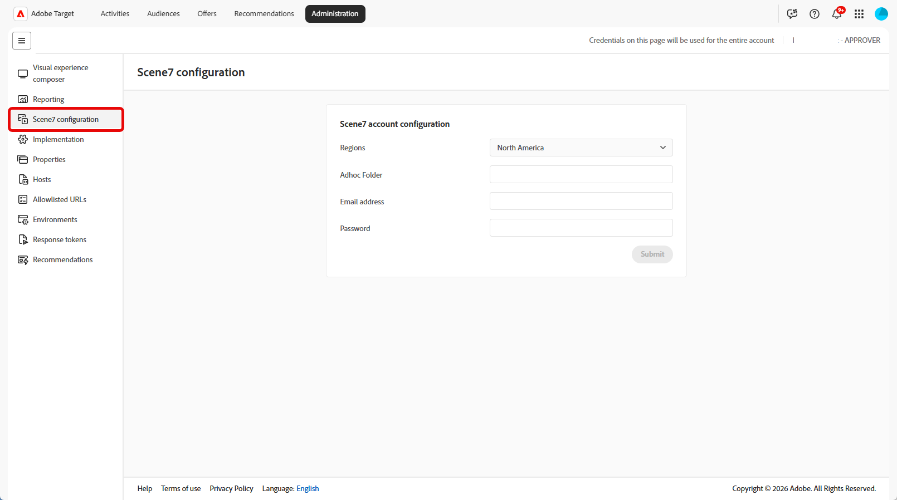

# Dynamic Media Classicの設定（Scene7）

**[!UICONTROL 管理]**&#x200B;の「**[!UICONTROL Scene7設定]**」タブを使用して、[!DNL Adobe Target]を[!DNL Adobe Dynamic Media Classic] （旧[!DNL Scene7]）に接続します。 この統合により、デジタルアセット管理（DAM）が[!UICONTROL &#x200B; コンテンツライブラリ &#x200B;]に取り込まれ、アクティビティで画像スワップのワークフローが有効になります。

このタブが他の管理タスクとどのように適合するかについては、[Targetの管理方法を参照してください。](/help/main/administrating-target/administrating-target.md) インターフェイスで&#x200B;**[!UICONTROL 管理]**&#x200B;を見つけるには、[UI](/help/main/c-intro/understand-the-target-ui.md)の理解を参照してください。 [!DNL Target] 

**概要**

1. [統合によって可能になること](#what-it-enables)：画像のオファー、スワップ画像、対象アセット。
1. [&#x200B; アカウントと資格情報](#account-and-credentials)：既存の[!DNL Dynamic Media] アカウントとサポートされているアカウントタイプ。
1. [使用ガイドライン &#x200B;](#usage-guidelines):URL、配信、およびサポートされていない機能。
1. [Target](#configure-scene7)でScene7を設定：ログインと地域の設定。

{{permissions-update}}

## 統合によって可能になること {#what-it-enables}

**[!UICONTROL Scene7設定]**&#x200B;を設定すると、作成者は[!DNL Target]のアクティビティで[!DNL Adobe Experience Cloud] アセットフォルダーにアップロードされた画像を使用できます。 **[!UICONTROL Swap Image offer]** オプションは、[Visual Experience Composerおよびフォームベース Experience Composer](/help/main/c-experiences/experiences.md#concept_A2E10F6AFB3D4AEAB6951EE14688848D)を含むアクティビティワークフローに表示されます。 VECでのスワップ動作については、[Visual Experience Composerのオプション &#x200B;](/help/main/c-experiences/c-visual-experience-composer/viztarget-options.md)を参照してください。

この設定が設定されていない場合、**[!UICONTROL スワップ画像オファー]**&#x200B;はアクティビティの作成中に使用できません。

統合は、Experience Cloud アセットフォルダーからアクティビティの一部であるアセットを配信します。 **not**&#x200B;は、[!DNL Dynamic Media Classic]のすべてのアセットを[!DNL Target]のアクティビティで使用するために公開します。

設定後、[!UICONTROL Offers] ライブラリで画像オファーを管理します。 [&#x200B; コンテンツの管理](/help/main/c-experiences/c-manage-content/manage-content.md)を参照してください。

## アカウントと認証情報 {#account-and-credentials}

既に[!DNL Dynamic Media] アカウントをお持ちの場合は、**[!UICONTROL Scene7設定]** ページに資格情報を入力してください。

Adobeは、新規[!DNL Target]のお客様または新規ユーザーに対して、使用制限または無償の[!DNL Dynamic Media Classic] アカウントをプロビジョニングしなくなりました。 組織がこの統合のログイン資格情報を既に持っている場合、それらは引き続き機能します。 アカウントに関するご質問は、[!DNL Adobe]担当者にお問い合わせください。

## 使用ガイドライン {#usage-guidelines}

この統合で画像を使用する場合は、次の制約を考慮してください。

* **画像オファー、ストレージ URLではありません。** [!DNL Dynamic Media]個のストレージ URLと公開された配信URLが異なります。 ストレージリンクからオファーを作成しないでください。配信が失敗します。 代わりに[画像オファー](/help/main/c-experiences/c-manage-content/manage-content.md)とスワップ画像ワークフローを使用してください。
* **カスタムコードのパブリック URL。** オファーまたはカスタムコードで公開画像URLを直接参照するには、独自のweb サーバーで画像をホストし、そのURLを使用します。 Experience Cloudでアップロードされた画像の公開URLを取得して、[!DNL Target] ターゲティングワークフロー以外で使用することはできません。この使用は、契約では許可されていません。
* **対象となるアセット。** Experience Cloud アセットフォルダー（およびこの統合でサポートされるワークフロー）にアップロードされたアセットのみがスコープ内に含まれ、完全な[!DNL Dynamic Media Classic] カタログは含まれません。

## TargetでのScene7の設定 {#configure-scene7}

次の手順を使用して、[!DNL Dynamic Media Classic] （[!DNL Scene7]）を接続します。

1. **[!UICONTROL 管理]** > **[!UICONTROL Scene7設定]**&#x200B;をクリックします。
1. [!DNL Dynamic Media Classic] アカウント情報を入力してください：

   | フィールド | 説明 |
   | --- | --- |
   | **地域** | [!DNL Dynamic Media] アカウントの地域：北米、ヨーロッパ、アジア。 |
   | **アドホックフォルダー** | 手動で[!DNL Dynamic Media]にアップロードするTarget フォルダー以外のコンテンツの場所。 |
   | **電子メールアドレス** | [!DNL Dynamic Media Classic] （[!DNL Scene7]）へのログインに使用された電子メールアドレス。 |
   | **パスワード** | [!DNL Dynamic Media Classic] （[!DNL Scene7]）へのログインに使用するパスワード。 |

   

1. [**[!UICONTROL 送信]**] をクリックします。
