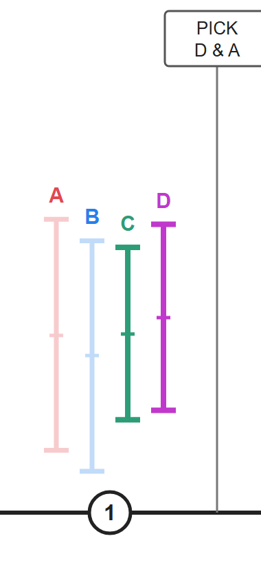

# [!UICONTROL 自動配分]の概要 {#auto-allocate-overview}

>[!BEGINSHADEBOX]

**このページ：**&#x200B;では、**[!UICONTROL 自動配分]** アクティビティが勝者エクスペリエンスを特定し、それにトラフィックを再割り当てする方法、使用するタイミング、アルゴリズムの仕組み、使用する前に考慮すべき事項について説明します。

>[!ENDSHADEBOX]

[!DNL Adobe Target] の&#x200B;**[!UICONTROL 自動配分]**&#x200B;アクティビティは、複数のエクスペリエンスの中から勝者を特定し、より多くのトラフィックをその勝者に自動的に再配分することでコンバージョンを促進します。その間もテストによる学習は続けられます。

A/B アクティビティの3段階のガイド付きワークフローを使用して、**[!UICONTROL 自動配分]** アクティビティを作成します。**[!UICONTROL ターゲティング]** ページで「**[!UICONTROL 最適なエクスペリエンスに自動配分]**」オプションを選択します（ステップ 2）。 手順については、[自動配分アクティビティの作成](/help/main/c-activities/automated-traffic-allocation/create-auto-allocate-activity.md)を参照してください。

## [!UICONTROL 自動割り当て]を使用する理由 {#why-auto-allocate}

標準的な A/B テストには、固有のコストがあります。 各エクスペリエンスのパフォーマンスを測定するにはトラフィックを費やす必要があり、トラフィックの配分は、あるエクスペリエンスが他のエクスペリエンスよりも優れたパフォーマンスを示した後でも固定されたままです。 サンプルサイズを決定するのは複雑です。アクティビティは、勝者に対してアクションを実行する前にコース全体を実行する必要があります。また、識別された勝者が真の勝者ではない可能性もあります。

**[!UICONTROL 自動割り当て]** アクティビティは、このコストとオーバーヘッドを削減します。

* すべてのエクスペリエンスの目標指標のパフォーマンスを監視し、パフォーマンスの高いエクスペリエンスに比例してより多くの新規参加者を割り当てます。 他のエクスペリエンスを調査するのに十分なトラフィックが確保されます。
* 最適化は学習と並行して行われるため、アクティビティの実行中に結果のメリットを確認できます。
* 訪問者は徐々に勝者エクスペリエンスに向かって移動するので、アクティビティが終了するまで待つ必要はありません。 成功していないエクスペリエンスに送られたアクティビティ参加者は勝者エクスペリエンスの可能性を示しているので、より迅速に上昇するメリットが得られます。

主な特長：

* A/B テストの厳格さを維持します。
* 手作業のA/B テストよりも統計的に有意な勝者を迅速に見つけ出します。
* 手動のA/B テストよりも平均リフトが高くなります。

### [!UICONTROL 自動割り当て]が勝者を特定する方法 {#true-winner}

[!DNL Target]の通常のA/B テストでは、各チャレンジャーをコントロールと比較します。 例えば、アクティビティにA、B、C、Dがあり、Aがコントロールである場合、テストはAとB、AとC、AとDを比較します。[!DNL Target]を含むほとんどの製品では、これらの比較に[Welchのt-test](https://en.wikipedia.org/wiki/Welch%27s_t-test){target=_blank}を使用して、p値に基づく信頼性を生成しています。 ただし、[!DNL Target]は、「最適な」エクスペリエンスを見つけるために必要な暗黙的な比較（B対C、B対D、C対D、C対D）を自動的に実行しないので、結果を手動で分析する必要があります。

**[!UICONTROL 自動割り当て]**&#x200B;は、この手動ステップを削除します：

* エクスペリエンス全体に対してすべての暗黙の比較を実行し、「真」の勝者を見つけます。 このテストには「コントロール」エクスペリエンスという概念がありません。
* 最適なエクスペリエンスの信頼区間が他のエクスペリエンスの信頼区間と重ならないまで、新しい訪問者をエクスペリエンスに割り当てます。
* [Bernstein Inequality](https://en.wikipedia.org/wiki/Bernstein_inequalities_%28probability_theory%29){target=_blank}に基づく信頼区間を使用します。これは、通常は偽陽性を生み出す繰り返し評価を補償します。
* ページにアクセスした訪問者に実質的な時間依存がなければ、勝者エクスペリエンスの真の応答よりも1% （相対）少なくとも低い真の応答を返す可能性が少なくとも95%あります。

## [!UICONTROL 自動割り当て]を使用するタイミング {#when-to-use}

目標に応じて、**[!UICONTROL 自動割り当て]**、**[!UICONTROL A/B テスト]**、**[!UICONTROL Automated Personalization]** アクティビティのいずれかを選択します。

| アクティビティ | 次の場合に使用 | 違いについて |
|---|---|---|
| **[!UICONTROL 自動配分]** | アクティビティを最初から最適化し、勝者エクスペリエンスをできるだけ早く特定する必要があります。 | パフォーマンスの高いエクスペリエンスをより頻繁に提供することで、アクティビティ全体のパフォーマンスを向上させます。 |
| [**[!UICONTROL A/B テスト]**](/help/main/c-activities/t-test-ab/test-ab.md#test-ab) | サイトを最適化する前に、あらゆるエクスペリエンスのパフォーマンスを評価する必要があります。 | **[!UICONTROL 自動配分]**&#x200B;が、パフォーマンスが最上位のエクスペリエンスを見つけてもパフォーマンスが低いエクスペリエンス間の差別化を保証しないのに対して、A/B テストは、すべてのエクスペリエンスをランク付けするのに役立ちます。 |
| [**[!UICONTROL Automated Personalization]**](/help/main/c-activities/t-automated-personalization/automated-personalization.md#automated-personalization-overview) | 最も複雑な最適化アルゴリズムである必要があります。たとえば、個々のプロファイル属性にもとづいて予測を構築するマシンラーニングモデルなどです。 | **[!UICONTROL 自動割り当て]**&#x200B;は、（標準のA/B テストと同様に）エクスペリエンスの集計動作を確認し、訪問者を区別しません。 |

## アルゴリズムの仕組み {#how-it-works}

**[!UICONTROL 自動割り当て]**&#x200B;のアルゴリズムは、[ マルチアームドバンディット ](https://en.wikipedia.org/wiki/Multi-armed_bandit){target=_blank}の最適化アプローチであり、探索的な学習とその学習の利用のバランスを取ります。 これには、測定されたパフォーマンス（コンバージョン率など）と累積データの信頼区間の両方が含まれます。 トラフィックがエクスペリエンス間で均等に分配される標準的なA/B テストとは異なり、**[!UICONTROL 自動配分]**&#x200B;は、エクスペリエンス間のトラフィック配分を変更します。

* 訪問者の80%は、このセクションで説明するロジックを使用して割り当てられます。
* 訪問者の 20％は、訪問者行動の変化に対応するように、すべてのエクスペリエンスにランダムに配分されます。

マルチアームドバンディットのアプローチにより、トラフィックを探求する余地を残しつつ、パフォーマンスが高いエクスペリエンスを活用できます。 より多くの新規訪問者を優れた体験に誘導する一方で、状況の変化に対応する能力を維持できます。 モデルは少なくとも1時間に1回更新し、最新のデータに確実に反応するようにします。

アクティビティに参加する訪問者が増えるにつれて、一部のエクスペリエンスは成功し、より多くのトラフィックを獲得します。 すべてのエクスペリエンスを調査するために、トラフィックの 20％が、引き続きランダムに配分されます。 パフォーマンスの低いエクスペリエンスの 1 つのパフォーマンスが向上し始めると、そのエクスペリエンスに配分されるトラフィックが増えます。 パフォーマンスの高いエクスペリエンスの成功率が低下すると、割り当てられるトラフィックが減少します。 これは、例えば、イベントによって訪問者がメディアサイト上のさまざまな情報を検索する場合や、小売サイトでの週末販売で異なる結果が得られる場合などに発生します。

次の図に、4 つのエクスペリエンスでのテスト中にアルゴリズムがどのように実行されるかを示します（クリックして図を展開します）。

{width="600" zoomable="yes"}

この図は、明確な勝者が決定されるまで、複数ラウンドのアクティビティの有効期間にわたって各エクスペリエンスに配分されるトラフィックがどのように変化するかを示しています。

| 四捨五入 | 説明 |
|--- |--- |
| {width="200" zoomable="yes"} | **ウォームアップラウンド （0）**: アクティビティ内の各エクスペリエンスの訪問者が1,000人で、コンバージョンが50人になるまで、各エクスペリエンスは同じトラフィックになります。<ul><li>エクスペリエンス A=25 ％</li><li>エクスペリエンス B=25 ％</li><li>エクスペリエンス C=25 ％</li><li>エクスペリエンス D=25 ％</li></ul>各エクスペリエンスが1,000人の訪問者と50人のコンバージョンに達すると、[!DNL Target]は自動トラフィック割り当てを開始します。 すべての割り当てはラウンドで行われ、各ラウンドに2つのエクスペリエンスが選択されます。 D と C の 2 つのエクスペリエンスだけが次のラウンドに進みます。<ul><li>前進するためには、ふたつのエクスペリエンスの80%が均等に割り当てられていることが必要です。</li><li>他の2つのエクスペリエンスは引き続き参加しますが、新規訪問者がアクティビティに入ると、20%のランダムトラフィック割り当ての一部としてのみ提供されます。</li><li>すべての割り当ては、1時間ごとに更新されます（上のx軸に沿った丸みで示されます）。 各ラウンドの後、累積データが比較されます。</li></ul> |
| {width="200" zoomable="yes"} | **ラウンド 1**: トラフィックの80%がエクスペリエンス CとDに割り当てられます（それぞれ40%）。 トラフィックの 20％がエクスペリエンス A、B、C および D にランダムに配分されます（5％ずつ）。 このラウンドでは、エクスペリエンス A のパフォーマンスが優れています。<ul><li>アルゴリズムにより、（各アクティビティの垂直スケールが示しているように）コンバージョン率が最も高いという理由で、エクスペリエンス D が選出され、次のラウンドに進みます。</li><li>アルゴリズムにより、残りのエクスペリエンスでベルンシュタインの 95％信頼区間の上限が最も高いという理由で、エクスペリエンス A も選出され、次に進みます。</li></ul>エクスペリエンス D と A が次に進みます。 |
| {width="200" zoomable="yes"} | **ラウンド 2**: トラフィックの80%がエクスペリエンス AとDに割り当てられます（それぞれ40%）。 トラフィックの20%はランダムに割り当てられるため、エクスペリエンス A、B、C、Dはそれぞれ5%のトラフィックを獲得します。 このラウンドでは、エクスペリエンス B のパフォーマンスが優れています。<ul><li>アルゴリズムにより、（各アクティビティの垂直スケールが示しているように）コンバージョン率が最も高いという理由で、エクスペリエンス D が選出され、次のラウンドに進みます。</li><li>アルゴリズムにより、残りのエクスペリエンスでベルンシュタインの 95％信頼区間の上限が最も高いという理由で、エクスペリエンス B も選出され、次に進みます。</li></ul>エクスペリエンス D と B が次に進みます。 |
| {width="200" zoomable="yes"} | **ラウンド 3**: トラフィックの80%がエクスペリエンス BとDに割り当てられます（それぞれ40%）。 トラフィックの20%はランダムに割り当てられるため、エクスペリエンス A、B、C、Dはそれぞれ5%のトラフィックを獲得します。 このラウンドでは、エクスペリエンス D が引き続きパフォーマンスが優れ、エクスペリエンス C もパフォーマンスが優れています。<ul><li>アルゴリズムにより、（各アクティビティの垂直スケールが示しているように）コンバージョン率が最も高いという理由で、エクスペリエンス D が選出され、次のラウンドに進みます。</li><li>アルゴリズムにより、残りのエクスペリエンスでベルンシュタインの 95％信頼区間の上限が最も高いという理由で、エクスペリエンス C も選出され、次に進みます。</li></ul>エクスペリエンス D と C が次に進みます。 |
| {width="200" zoomable="yes"} | **ラウンド 4**: トラフィックの80%がエクスペリエンス CとDに割り当てられます（それぞれ40%）。 トラフィックの20%はランダムに割り当てられるため、エクスペリエンス A、B、C、Dはそれぞれ5%のトラフィックを獲得します。 このラウンドでは、エクスペリエンス C のパフォーマンスが優れています。<ul><li>アルゴリズムにより、（各アクティビティの垂直スケールが示しているように）コンバージョン率が最も高いという理由で、エクスペリエンス C が選出され、次のラウンドに進みます。</li><li>アルゴリズムにより、残りのエクスペリエンスでベルンシュタインの 95％信頼区間の上限が最も高いという理由で、エクスペリエンス D も選出され、次に進みます。</li></ul>エクスペリエンス C と D が次に進みます。 |
| {width="200" zoomable="yes"} | **ラウンド *n***: アクティビティが進むにつれて、パフォーマンスの高いエクスペリエンスが現れ始め、勝者エクスペリエンスが得られるまでプロセスが続きます。 コンバージョン率が最も高いエクスペリエンスの信頼区間が、他のエクスペリエンスの信頼区間と重複しない場合、勝者としてラベル付けされます。 [バッジが、勝者となったアクティビティのページ](/help/main/c-activities/automated-traffic-allocation/determine-winner.md)と**[!UICONTROL &#x200B;アクティビティ&#x200B;]**リストに表示されます。<ul><li>アルゴリズムにより、エクスペリエンス C が明確な勝者として選定されます。</li></ul>現時点では、アルゴリズムはエクスペリエンス Cに対するトラフィックの80%を処理し、トラフィックの20%はすべてのエクスペリエンス（A、B、C、D）に対してランダムに処理され続けています。 後継で、C はトラフィックの 85％を獲得します。 勝者の信頼区間が再び重なり始めるというありそうもない場合、アルゴリズムはラウンド 4の動作に戻ります。 **重要**：プロセスの早い段階で勝者を手動で選択した場合、間違ったエクスペリエンスを選択するのは簡単です。 このため、アルゴリズムが勝者エクスペリエンスを決定するまで待つことをお勧めします。 |

>[!NOTE]
>
>アクティビティに 2 つのエクスペリエンスしかない場合は、[!DNL Target] が 75％の信頼性で勝者となるエクスペリエンスを特定するまでは、両方が均等のトラフィックを得ます。 その時点で、トラフィックの3分の2が勝者に、3分の1が敗者に割り当てられます。 その後、エクスペリエンスの信頼度が95%に達すると、トラフィックの90%が勝者に、10%が敗者に割り当てられます。 [!DNL Target]は、最終的に偽陽性を避けるために（つまり、一部の探索を維持するために）常に「失う」エクスペリエンスにトラフィックを送信します。

**[!UICONTROL 自動割り当て]** アクティビティがアクティブ化された後、[!DNL Target] UIでは次の操作は許可されません。

* **[!UICONTROL トラフィック配分]** モードを&#x200B;**[!UICONTROL 手動]**&#x200B;に切り替えています。
* 目標指標タイプの変更。
* **[!UICONTROL 詳細設定]** パネルのオプションを変更しています。

詳細については、[自動配分が手動テストよりも優れている方法](/help/main/c-activities/automated-traffic-allocation/faster-results-higher-revenue.md)を参照してください。

## 注意事項 {#caveats}

**[!UICONTROL 自動配分]**&#x200B;を使用する場合は、次の情報を考慮してください。

### 1つの詳細指標設定のみがサポートされています

**[!UICONTROL 自動割り当て]**&#x200B;機能は、次の1つの高度な指標設定でのみ機能します：**[!UICONTROL 増分数とユーザーをアクティビティに保持]**。 「**[!UICONTROL カウントを増分]**、**[!UICONTROL ユーザーをリリース]**、**[!UICONTROL 再入場を許可」および「カウントを増分]**、**[!UICONTROL ユーザーをリリース、再入場を許可しない]**」の詳細指標設定はサポートされていません。

### 頻繁に再訪問する訪問者は、コンバージョン率を高める可能性があります {#return-visitors}

エクスペリエンス Aを見た訪問者が頻繁に再訪問し、数回コンバージョンした場合、エクスペリエンス Aのコンバージョン率（CR）は人工的に増加します。 この結果を、訪問者はコンバージョンすることはできても、頻繁に戻ってこないエクスペリエンス Bと比較します。 その結果、エクスペリエンスのCRはエクスペリエンス BのCRよりも優れているため、新規訪問者はBよりもAに割り当てられる可能性が高くなります。参加者ごとに1回カウントすることを選択した場合、AのCRとBのCRは同じである可能性があります。

このロジックでは、訪問者が属するエクスペリエンスのコンバージョン率が一時的に高いため、迅速にコンバージョンする訪問者とより頻繁に訪問する訪問者が好まれます。 アルゴリズム自体は頻繁に調整されるので、コンバージョン率の増加は、各スナップショットで増幅されます。

再訪問者がランダムに配分されると、そのコンバージョン率への影響は、より安定する傾向があります。 この効果を軽減させるには、目標指標のカウント方法を参加者あたり 1 回のみに変更することを検討します。

### 差別化は高いパフォーマンスを示す人の間にあるのであり、低いパフォーマンスを示す人の間にあるのではありません

**[!UICONTROL 自動配分]**&#x200B;は、パフォーマンスの高いエクスペリエンスの間で区別する（そして勝者を見つける）のが得意です。 パフォーマンスの低いエクスペリエンス間で十分な差別化を図っていない場合があります。

あらゆるエクスペリエンスの間に統計的に有意な差異を生み出す場合は、トラフィック配分を手動で行うことを検討してください。

### 時間関連のコンバージョン率で割り当てが歪む

すべてのエクスペリエンスに同じように影響を与えるため、標準のA/B テスト中に無視できる要因の一部は、**[!UICONTROL 自動配分]** アクティビティでは無視できません。 そのアルゴリズムは、観測されたコンバージョン率に敏感です。 エクスペリエンスのパフォーマンスに影響を与える可能性のある要因は次のとおりです。

* 様々な状況（時間、場所、性別など）と関連性があるエクスペリエンス。

  次に例を示します。

  * &quot;Thank God it is Friday&quot;は、金曜日のコンバージョン率を高めます。
  * 「月曜日からジャンプスタート」は、月曜日に高いコンバージョンをもたらす。
  * 「東海岸の冬に備える」は、東海岸または冬が過酷な場所でコンバージョンが高くなる。

  コンテキストに関連する内容が異なるエクスペリエンスを使用すると、A/B テストでは結果が長い期間にわたって分析されるため、**[!UICONTROL 自動配分]** テストではA/B テストよりも結果が歪む可能性があります。

* おそらくメッセージの緊急性のために、コンバージョンの遅延が変化するエクスペリエンス。

  例えば、「今日30%のセールが終了」というメッセージは訪問者に今日コンバージョンを促していますが、「最初の購入が50% オフ」というメッセージは同じ切迫感を生み出すわけではありません。

## よくある質問 {#faq}

**[!UICONTROL 自動配分]** アクティビティを使用する場合は、次の質問と回答を参照してください。

+++ [!UICONTROL Analytics for Target]（A4T）は、[!UICONTROL 自動配分]アクティビティをサポートしていますか？

はい。 詳しくは、[A4T での自動割り当ておよび自動ターゲットアクティビティのサポート](/help/main/c-integrating-target-with-mac/a4t/a4t-at-aa.md)を参照してください。

+++

+++ 再訪問者は、自動的にパフォーマンスの高いエクスペリエンスに再配分されますか？

いいえ。 新規訪問者のみが自動的に配分されます。 再訪問者には引き続き元のエクスペリエンスが表示され、A/B テストの有効性を保護します。

+++

+++ アルゴリズムでは、偽陽性をどのように扱いますか？

このアルゴリズムでは、勝者バッジが表示されるまで待つと、95%の信頼性または5%の偽陽性率が保証されます。

+++

+++ [!UICONTROL 自動配分]でトラフィックの割り当てが開始されるのはいつですか？

アクティビティのすべてのエクスペリエンスに 1,000 人以上の訪問者と 50 回以上のコンバージョンがあれば、アルゴリズムが機能し始めます。

+++

+++ アルゴリズムは、どれくらい積極的に活用されますか？

トラフィックの 80％は&#x200B;**[!UICONTROL 自動配分]**&#x200B;を使用して配分され、トラフィックの 20％はランダムに配分されます。 勝者が特定されると、トラフィックの 80％が勝者に配分され、20％の一部が勝者エクスペリエンスを含むすべてのエクスペリエンスに引き続き配分されます。

+++

+++ 失敗エクスペリエンスは表示されますか？

はい。 マルチアームバンディットでは、すべてのエクスペリエンスにわたる変更のパターンまたはコンバージョン率を調査するために、トラフィックの少なくとも 20 ％が予約されます。

+++

+++ 長時間のコンバージョンの遅延があるアクティビティはどうなりますか？

最適化されたすべてのエクスペリエンスが同様の遅延に直面する限り、動作は、より速いコンバージョンサイクルを持つアクティビティと同じです。 ただし、トラフィック配分プロセスが開始されるまでに、50 コンバージョンのしきい値に達するまでに時間がかかります。

+++

+++ [!UICONTROL 自動配分]と [!UICONTROL Automated Personalization] の違いは何ですか？

**[!UICONTROL Automated Personalization]** は、各訪問者のプロファイル属性を使用して、最良のエクスペリエンスを判定します。 その際、訪問者のアクティビティを最適化するだけでなく、パーソナライズすることもできます。

一方、**[!UICONTROL 自動配分]**&#x200B;は、集計の勝者を提示する A/B テストです（最も一般的なエクスペリエンスですが、必ずしも各訪問者にとって最も効果的なエクスペリエンスとは限りません）。

+++

+++ 再訪問者は、成功指標のコンバージョン率を高めていますか？

はい、可能です。 説明と、この影響を軽減する方法については、[頻繁な再訪問者がコンバージョン率を高める可能性がある](#return-visitors)を参照してください。

+++

+++ [!UICONTROL 自動配分]でサンプルサイズ計算ツールを使用して、アクティビティが勝者を特定するのにかかる時間を見積もることはできますか？

既存の [!DNL Adobe Target] [サンプルサイズ計算ツール](/help/main/c-activities/t-test-ab/sample-size-determination.md#section_6B8725BD704C4AFE939EF2A6B6E834E6)を使用して、テストの実行時間を予測できます。 従来のA/B テストと同様に、2つ以上のオファーまたは1つ以上のコンバージョン指標または仮説をテストする場合は、Bonferroni補正を適用します。 この計算ツールは、従来の固定範囲 A/B テスト用に設計されており、算出結果はあくまで推定値です。 **[!UICONTROL 自動配分]**&#x200B;が勝者を宣言するため、**[!UICONTROL 自動配分]** アクティビティに計算機を使用することはオプションです。 テスト結果を確認するために特定の時点を選択する必要はありません。 提示された値は、統計的に常に有効です。

[!DNL Adobe] の社内実験では、次のことがわかりました。

* 2 つのエクスペリエンスをテストするとき、エクスペリエンス間のパフォーマンスの差が大きい場合、**[!UICONTROL 自動配分]**&#x200B;では、固定範囲のテスト（サンプルサイズ計算ツールで提案される時間枠）よりも速く勝者を見つけます。 しかし、**[!UICONTROL 自動配分]**&#x200B;は、エクスペリエンス間のパフォーマンスの差が小さい場合、勝者を特定するために余分な時間が必要になる場合があります。 この場合、通常、統計的に有意な結果が得られずに、固定範囲テストは終了していました。
* 2つ以上のエクスペリエンスをテストする場合、**[!UICONTROL 自動割り当て]**&#x200B;は、1つのエクスペリエンスが他のすべてのエクスペリエンスよりもパフォーマンスが高い場合に、固定地平線テスト（サンプルサイズ計算ツールによって提案された時間枠）よりも速く勝者を見つけます。 2つ以上のエクスペリエンスが他のエクスペリエンスに対して「勝つ」一方で、互いに密接に一致している場合、**[!UICONTROL 自動割り当て]**&#x200B;では、どちらが優れているかを判断するために余分な時間が必要になる場合があります。 これらのケースでは、通常、固定水平線テストは、「勝者」エクスペリエンスがパフォーマンスの低いエクスペリエンスよりも優れていると結論付けることで終了しますが、どのエクスペリエンスが優れているかは特定できません。

+++

+++ 勝者を決定するプロセスを高速化するために、[!UICONTROL 自動配分] アクティビティからパフォーマンスの低いエクスペリエンスを削除する必要がありますか？

パフォーマンスの低いエクスペリエンスを削除する本当の理由はありません。 **[!UICONTROL 自動割り当て]**&#x200B;は、パフォーマンスの高いエクスペリエンスをより頻繁に、パフォーマンスの低いエクスペリエンスを頻繁に提供しません。 アクティビティにパフォーマンスの低いエクスペリエンスを残しても、勝者を決定する速度には大きな影響を与えません。

訪問者の 20% は、すべてのエクスペリエンスにランダムに配分されます。 パフォーマンスの低いエクスペリエンスが提供するトラフィック量は最小限に抑えることができます（20%をエクスペリエンス数で割った値）。

+++

+++ [!UICONTROL 自動配分]アクティビティの途中で目標値を変更することは可能ですか？

[!DNL Adobe] では、アクティビティの途中で目標指標を変更することはお勧めしません。 [!DNL Target] UIのアクティビティ中に目標指標を変更することは可能ですが、常に新しいアクティビティを開始する必要があります。 [!DNL Adobe] は、実行後にアクティビティの目標指標を変更した場合の動作を保証しません。

このレコメンデーションは、**[!UICONTROL 自動配分]**、**[!UICONTROL 自動ターゲット]**、**[!UICONTROL Automated Personalization]** の各アクティビティで、レポートソースとして [!DNL Target] または [!DNL Analytics]（A4T）を使用します。

+++

+++ [!UICONTROL 自動配分]アクティビティの途中で、レポートソースを変更できますか？

[!DNL Adobe] では、アクティビティの途中でレポートソースを変更することはお勧めしません。 [!DNL Target] UIのアクティビティ中にレポートソース（[!DNL Target]からA4Tまたはその逆）を変更することは可能ですが、常に新しいアクティビティを開始する必要があります。 [!DNL Adobe] は、実行後にアクティビティのレポートソースを変更した場合の動作は保証しません。

このレコメンデーションは、**[!UICONTROL 自動配分]**、**[!UICONTROL 自動ターゲット]**、**[!UICONTROL Automated Personalization]** の各アクティビティで、レポートソースとして [!DNL Target] または [!DNL Analytics]（A4T）を使用します。

+++

+++ [!UICONTROL 自動配分]アクティビティの実行中に「[!UICONTROL レポートデータをリセット]」オプションを使用できますか？

**[!UICONTROL 自動配分]**&#x200B;アクティビティに「**[!UICONTROL レポートデータをリセット]**」オプションを使用することは推奨されません。 目に見えるレポートデータは削除されますが、このオプションでは、**[!UICONTROL 自動配分]**&#x200B;モデルからすべてのトレーニングレコードが削除されるわけではありません。 「**[!UICONTROL レポートデータをリセット]**」オプションを使用する代わりに、新しいアクティビティを作成し、元のアクティビティを無効にします。 このガイダンスは、**[!UICONTROL 自動ターゲット]**&#x200B;および&#x200B;**[!UICONTROL Automated Personalization]**&#x200B;のアクティビティにも適用されます。

+++

+++ [!UICONTROL 自動配分]は環境に関してどのようにモデルを構築しますか？

**[!UICONTROL 自動配分]**&#x200B;は、デフォルト環境でのみ記録されたトラフィックとコンバージョンの行動に基づいてモデルを構築します。 デフォルトでは、**[!UICONTROL 本番]**&#x200B;はデフォルトの環境ですが、デフォルトの環境は [!DNL Target]（[管理／環境](/help/main/administrating-target/environments.md)）で変更することが可能です。

別の（デフォルト以外の）環境でヒットが発生した場合、デフォルト環境で観測されたコンバージョン動作に従ってトラフィックが分散されます。 そのヒットの結果（コンバージョンまたは非コンバージョン）は、レポート目的で記録されますが、**[!UICONTROL 自動配分]** モデルでは考慮されません。

別の環境を選択すると、レポートにその環境のトラフィックとコンバージョンが表示されます。 レポートに対して選択されたデフォルト環境は、アカウント全体のデフォルトです。 デフォルトの環境は、アクティビティごとに設定することはできません。

+++

+++ [!UICONTROL 自動配分]アクティビティでは、テストの過程でルックバックウィンドウを調整して、経時的なトレンドの変化を考慮することはできますか？

例えば、アクティビティでは、トラフィックの配分方法を決定する際に、9月の訪問者データ（テスト開始時）ではなく、12月を考慮することはできますか？

いいえ。 **[!UICONTROL 自動割り当て]**&#x200B;は、アクティビティ全体のパフォーマンスを考慮します。

+++

+++ [!UICONTROL 自動配分]では、訪問者がアクティビティの資格を得る際に閲覧したものとは異なる勝者エクスペリエンスを再訪問者に表示しますか？

**[!UICONTROL 自動配分]**&#x200B;では、**[!UICONTROL A/B テスト]**&#x200B;アクティビティがスティッキーであるのと同じ理由で、スティッキー決定が使用されます。 トラフィック配分は、新規訪問者に対してのみ機能します。

+++

## トレーニングビデオ {#section_893E5B36DC4A415C9B1D287F51FCCB83}

以下のビデオは、この記事で説明した概念についてさらに詳しく説明しています。

### アクティビティワークフロー - ターゲティング（2:14）

このビデオには、トラフィック配分の設定に関する情報が含まれています。

* オーディエンスのアクティビティへの割り当て
* トラフィックの増減調整
* トラフィック配分方法の選択
* 様々なエクスペリエンスへのトラフィック配分

>[!VIDEO](https://video.tv.adobe.com/v/17385)

### A/B テスト作成（8:36）

このビデオでは、Target で 3 ステップのガイドによるワークフローを使用して A/B テストを作成する方法を説明します。 **[!UICONTROL 自動配分]**&#x200B;の説明は 4:45 から始まります。

* [!DNL Adobe Target] での A/B アクティビティの作成
* 手動分割または自動トラフィック配分によるトラフィックの配分

>[!VIDEO](https://video.tv.adobe.com/v/17391)
