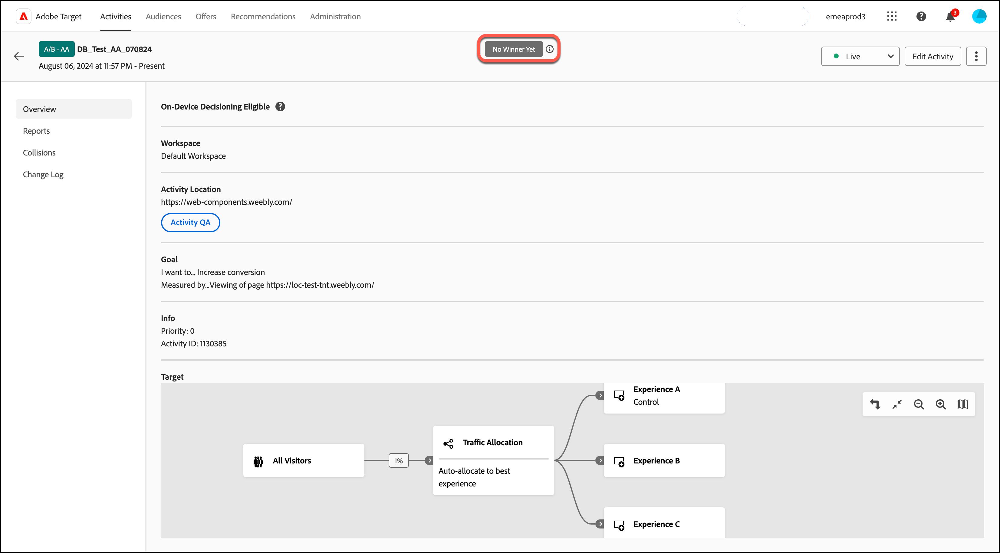

# [!UICONTROL 自動割り当て] レポートを解釈 {#interpret-auto-allocate-reports}

>[!BEGINSHADEBOX]

**このページで：**&#x200B;統計的に&#x200B;**[!UICONTROL 自動配分]**&#x200B;が提供する&#x200B;**[!UICONTROL 自動配分]** アクティビティの勝者エクスペリエンスを特定する方法、およびレポートの上昇率と信頼度の数値を読み取る方法について説明します。

>[!ENDSHADEBOX]

[!DNL Adobe Target]の&#x200B;**[!UICONTROL 自動割り当て]** A/B アクティビティのレポートは、アクティビティが勝者を見つけたかどうか、および[!DNL Target]がその結果にどの程度自信を持っているかを示します。 勝者バッジ、リフト、信頼性などの指標は、結果を解釈するのに役立ちます。

多くのマーケターは、結果が明確な勝者を示す前に、勝者エクスペリエンスを早い段階で宣言してしまうという間違いを犯します。 [!DNL Target]を使用すると、より簡単に勝者を決定できます。 勝者の宣言に関する一般的な情報については、[A/B テストによくある 10 の落とし穴とその回避方法](/help/main/c-activities/t-test-ab/common-ab-testing-pitfalls.md)を参照してください。

## 勝者エクスペリエンスの特定 {#identify-winner}

**[!UICONTROL 自動割り当て]**&#x200B;機能を使用すると、[!DNL Target]はアクティビティページの上部にバッジを表示します。 このバッジは、アクティビティが十分な信頼性を持ってコンバージョンの最小数に達するまで「勝者なし」を示します。

明確な勝者が宣言されると、[!DNL Target]には「勝者：エクスペリエンス *X*」バッジが表示されます。

勝者バッジは、**[!UICONTROL アクティビティ]** リストのアクティビティの情報ポップアップにも表示されるので、**[!UICONTROL 自動配分]** アクティビティのステータスを開かずに確認できます。

>[!NOTE]
>
>**[!UICONTROL 自動割り当て]** アクティビティは、コントロールとのペア比較だけでなく、すべてのオプションの中で最適なエクスペリエンスを見つけるように設計されています。

## [!UICONTROL 自動配分]の統計的保証 {#statistical-guarantees}

A/B アクティビティの終了時に、**[!UICONTROL 自動配分]**&#x200B;は、決定された勝者の実効偽陽性率が5%であることを保証します。 これはその時点のみの 5 ％を意味し、決定された勝者が実際にアクティビティのすべてのエクスペリエンスの中で最高のエクスペリエンスというわけではありません。

[A/A テスト &#x200B;](/help/main/c-activities/t-test-ab/aa-testing.md) （同じエクスペリエンスを使用）の場合、[!DNL Target]は5%未満の確率でテストを終了します。 A/A テストの動作は無期限に実行されるので、勝者バッジが表示されることはありません。

### 信頼性とp値 {#confidence-p-values}

[!DNL Target]は、**[!UICONTROL 自動配分]**&#x200B;に対してp値ベースの信頼性を使用しません。 **[!UICONTROL 自動配分]** アクティビティの&#x200B;**[!UICONTROL Confidence]**&#x200B;列には、エクスペリエンスが1%の許容誤差の範囲内で勝者になる可能性が表示されます。 アルゴリズムは、最適なコンバージョン率と2番目に高いコンバージョン率の間に1%の最小検出可能な効果を使用し、この確率を計算するために[Bernstein Inequality](https://en.wikipedia.org/wiki/Bernstein_inequalities_%28probability_theory%29)を使用します。

通常のA/B テストでは、p値に基づいて信頼性が計算され、特定のエクスペリエンスがコントロールと異なる確率が「緩やかに」計算されます。 これらの p 値は、エクスペリエンスが対照と異なるかどうかを判定するためにのみ使用できます。 これらの関数は、あるエクスペリエンスが別のエクスペリエンス（コントロールではなく）と異なるかどうかを判断するために使用することはできません。

>[!IMPORTANT]
>
>[!DNL Target]には、事前に定義された最小数のコンバージョンの後に勝者が表示されます。 ただし、勝者を選択する最終的な決定は、常に[!DNL Adobe Target] サンプルサイズ計算ツールの結果に基づいて行う必要があります。 [!DNL Target] では、アクティビティの期間を決定するために、サイトのベースコンバージョン率や、計算ツールに入力されるその他の重要な側面は考慮しません。 その結果、[!DNL Target]は、コンバージョンの最小数に基づいて、保証よりも早い方で勝者を表示する場合があります。 詳しくは、[サンプルサイズ計算ツール](/help/main/c-activities/t-test-ab/sample-size-determination.md#section_6B8725BD704C4AFE939EF2A6B6E834E6)を参照してください。

## 上昇率と信頼性のレポート {#lift-confidence}

**[!UICONTROL 自動配分]** アクティビティの「**[!UICONTROL レポート]**」タブには、次の図が表示されます。

| 図 | 説明 |
|---|---|
| **エクスペリエンスの制御** | 最初のエクスペリエンス（デフォルトではエクスペリエンス Aという名前）は、常に&#x200B;**[!UICONTROL レポート]** タブの「コントロール」エクスペリエンスとして定義されます。 このエクスペリエンスは、エクスペリエンスのパフォーマンスを決定するために使用されるモデリングでは真の統計的コントロールとして扱われませんが、レポート内の一部の図に対する参照またはベースラインとして扱われます。 |
| **上昇率** | 「リフト」値と各エクスペリエンスの95%境界は、常に定義された「コントロール」エクスペリエンスを参照して計算されます。 「コントロール」エクスペリエンスは、それ自体に対してリフトを持つことができないため、レポートには、このエクスペリエンスに対して空白の「 – 」値が表示されます。 A/B テストとは異なり、**[!UICONTROL 自動配分]** テストでは、エクスペリエンスが定義されたコントロールよりも悪いパフォーマンスを示した場合、負の上昇率の値はレポートされません。 代わりに、「 – 」が表示されます。 |
| **信頼区間** | 表示される&#x200B;**[!UICONTROL 信頼区間]** バーは、エクスペリエンスのコンバージョン率の平均推定値の周りの95%信頼区間を表します。 バーは、定義された「コントロール」エクスペリエンスに関して色分けされます。<ul><li>「コントロール」エクスペリエンスのバーは常にグレーです。</li><li>「Control」エクスペリエンスの信頼区間より下の信頼区間の部分は赤になります。</li><li>「Control」エクスペリエンスの信頼区間より上の信頼区間の部分は緑です。</li></ul> |
| **勝者** | 上位エクスペリエンスの95% **[!UICONTROL 信頼区間]**&#x200B;が他のエクスペリエンスと重複しない場合、勝者が見つかります。 勝者エクスペリエンスには、エクスペリエンス名の左側に緑色の星印が付き、「勝者」のバナーに表示されます。 星が表示されていない場合、バナーには「まだ勝者がありません」と表示され、勝者が見つかっていない状態です。 |
| **信頼番号** | 現在リードしているエクスペリエンス、もしくは勝者のエクスペリエンスの横には「信頼性」の数値もレポートされます。 この数値は、先行体験の&#x200B;**[!UICONTROL Confidence]**&#x200B;が少なくとも60%に達するまで報告されません。<ul><li>**[!UICONTROL 自動配分]** アクティビティに2つのエクスペリエンスが存在する場合、この数値は、エクスペリエンスが他のエクスペリエンスよりもパフォーマンスが高いという信頼性レベルを表します。</li><li>2つ以上のエクスペリエンスが存在する場合、その数は、エクスペリエンスが定義された「コントロール」エクスペリエンスよりも優れたパフォーマンスを発揮しているという信頼性レベルを表します。</li><li>「コントロール」エクスペリエンスが勝者である場合、「信頼性」の数値はレポートされません。</li></ul> |

## よくある質問 {#faq}

よくある質問に対して、次の回答を考えてみましょう。

+++ アクティビティに入って数日が経過しました。 すべての信頼性の値が 0％のままなのはなぜですか。

次のいずれかの理由は、すべてのエクスペリエンスについて、レポートの&#x200B;**[!UICONTROL Confidence]**&#x200B;列に0%が表示される理由を示しています。

* 手動A/B テストと&#x200B;**[!UICONTROL 自動割り当て]**&#x200B;では、異なる統計を使用して&#x200B;**[!UICONTROL 信頼性]**&#x200B;値を表示します。

  手動の A/B テストは、[Welch の t 検定](https://en.wikipedia.org/wiki/Welch%27s_t-test)に基づく p 値を使用します。 p値は、実際にはそのような違いがないことを考えると、経験と制御の間に観察された（またはより極端な）違いを見つける確率です。 これらのp値は、観測されたデータが特定のエクスペリエンスと一致し、制御が同じであるかどうかを判断するためにのみ使用できます。 これらの関数は、あるエクスペリエンスが別のエクスペリエンス（コントロールではなく）と異なるかどうかを判断するために使用することはできません。

  **[!UICONTROL 自動割り当て]**&#x200B;は、特定のエクスペリエンスがアクティビティ内のすべてのエクスペリエンスで真の勝者になる可能性を示します。 勝者エクスペリエンス（勝者になる可能性が最も高いエクスペリエンス）のみがゼロ以外の信頼値を持ちます。 その他の人は敗者になる可能性が最も高く、0%を表示します。

* **[!UICONTROL 自動割り当て]**&#x200B;は、勝者エクスペリエンスが60%の信頼性を集めた後にのみ、信頼性を示し始めます。 これらの信頼性レベルは通常、通常のA/B テストが完了するまでに要する時間の約半分の時間で表示されます（ただし、この時間枠は保証されません）。 通常のA/B テストを実行する時間を決定するには、[!DNL Adobe Target] [&#x200B; サンプルサイズ計算](/help/main/c-activities/t-test-ab/sample-size-determination.md#section_6B8725BD704C4AFE939EF2A6B6E834E6)を使用します。「ベースラインのコンバージョン率」、「上昇率」の「5%」、「信頼性」の「95%」にコントロールのコンバージョン率を入力します。 通常、各エクスペリエンスが1つのエクスペリエンスにつき必要なサンプルの50%以上を集めると、信頼性が表示され始めます。 これは、信頼がいつ現れるかについてのアイデアを提供します。

* レポートが全体的に0%を示している場合、アクティビティが早すぎる可能性があります。

+++

+++ [!UICONTROL Analytics]をレポートソース （A4T）として使用する[!UICONTROL 自動配分] アクティビティで、「勝者なし」、「勝者」および「スター」バッジを使用できますか？

「**[!UICONTROL アクティビティ]**」リストのアクティビティ情報ポップアップに、「まだ勝者なし」と「勝者」のバッジが表示されます。 これらは、[!DNL Analysis Workspace]の&#x200B;**[!UICONTROL A4T]** パネルや、[!DNL Target]の同じレポートを表示する際には表示されません。 A4T **[!UICONTROL 自動配分]** アクティビティの[!DNL Target] レポートに勝者「星」バッジが表示されている場合は、無視します。

この制限と他の注意事項について詳しくは、[!UICONTROL 自動配分]および[!UICONTROL 自動ターゲット &#x200B;] アクティビティ *の* A4T サポートの[自動配分](/help/main/c-integrating-target-with-mac/a4t/a4t-at-aa.md#aa)を参照してください。

+++
