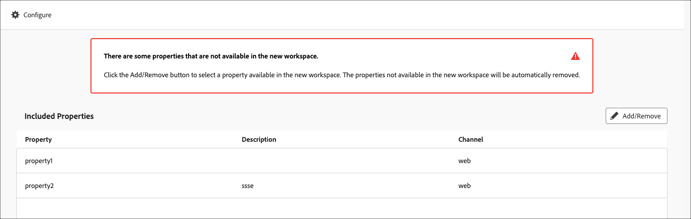
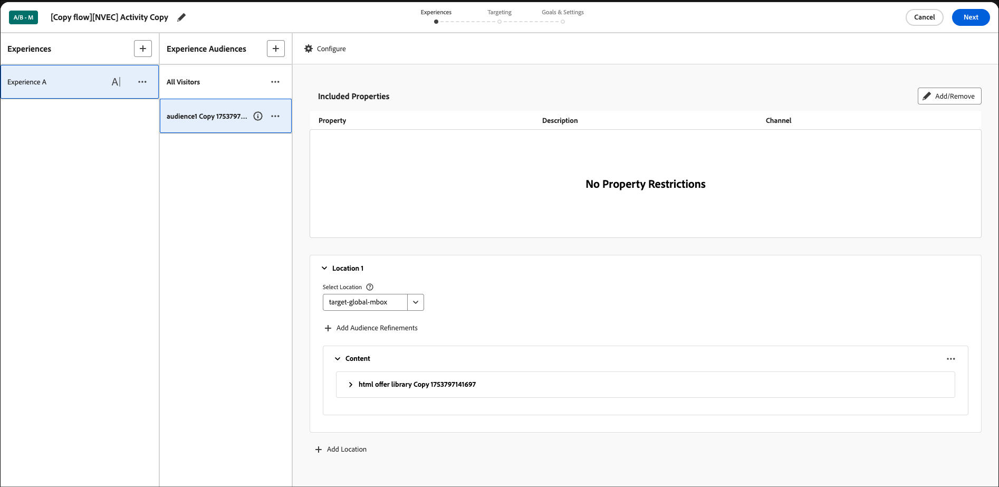

# アクティビティの編集 {#edit-activity}

>[!BEGINSHADEBOX]

**このページ：**&#x200B;では、**[!UICONTROL アクティビティ]** ページから既存のアクティビティを編集する方法、ワークスペースを使用する際にアクティビティをコピーする方法、およびレガシーアクティビティに適用されるアクションについて説明します。

>[!ENDSHADEBOX]

既存のアクティビティは、[!DNL Adobe Target] インターフェイスの複数の場所から編集できるため、エクスペリエンス、ターゲティングルール、目標の変更では、アクティビティを再作成する必要はありません。 手順は、選択した方法によって異なります。 **[!UICONTROL ドラフトとして保存]**&#x200B;機能は使用できなくなりました。 詳細については、[&#x200B; アクティビティ リストにフィルターを適用](/help/main/c-activities/activities.md#filters)の下の&#x200B;**[!UICONTROL ステータス]**&#x200B;を参照してください。

## [!UICONTROL その他のアクション &#x200B;] アイコンから編集 {#section_29EE2ECA6B88473A8F9AC5600FFBB174}

3つの手順でガイド付きワークフローを進めて、アクティビティを編集するには、次の手順に従います。

1. **[!UICONTROL アクティビティ]** ページで、アクティビティの横にある&#x200B;**[!UICONTROL 詳細アクション]** アイコン （）をクリックし、**[!UICONTROL 編集]**&#x200B;をクリックします。

   [!DNL Target]は&#x200B;**[!UICONTROL Visual Experience Composer]** （VEC）でアクティビティを開き、ワークフローの最初のステップである&#x200B;**[!UICONTROL Experiences]** ページを表示します。

   

1. [VEC オプション &#x200B;](/help/main/c-experiences/c-visual-experience-composer/viztarget-options.md)を使用してアクティビティを編集します。

1. 「**[!UICONTROL 次へ]**」をクリックして次の手順に進み、必要な編集をおこないます。

1. **[!UICONTROL 目標と設定]** ページで、次のいずれかのオプションを使用して変更を保存します。

   * **[!UICONTROL 保存して閉じる]:**&#x200B;変更を保存し、アクティビティの&#x200B;**[!UICONTROL 概要]** ページを表示します。
   * **[!UICONTROL 保存]:** **[!UICONTROL その他のアクション]** アイコン （）をクリックし、**[!UICONTROL 保存]**&#x200B;を選択して変更を保存し、VECに残り、引き続き変更を行うことができます。 保存が完了するまで待ってから次の変更作業に移ってください。 保存が完了すると VEC が再読み込みされ、変更内容が反映されます。

     

## アクティビティ名から編集 {#section_176180DAD17E40CEA441903F39E0AA1C}

ワークフローを進めることなく、変更が必要なステップに直接移動するには、次の手順に従います。

1. **[!UICONTROL アクティビティ]** ページで、アクティビティをクリックして開き、**[!UICONTROL アクティビティを編集]** ドロップダウンリストからオプションのいずれかを選択します。

   * **[!UICONTROL エクスペリエンスを編集]:** **[!UICONTROL エクスペリエンス]** ページを開きます（ワークフローの最初のステップ）。
   * **[!UICONTROL ターゲティングを編集]:** **[!UICONTROL ターゲティング]** ページを開きます（ワークフローの2番目の手順）。
   * **[!UICONTROL 目標と設定]:** **[!UICONTROL 目標と設定]** ページを開きます（ワークフローの3番目のステップ）。

     

1. 変更を加えてから、前の節で説明したように、**[!UICONTROL 保存して閉じる]**&#x200B;または&#x200B;**[!UICONTROL 保存]**&#x200B;でアクティビティを保存します。

## ワークスペースを使用したコピーと編集 {#section_45A92E1DD3934523B07E71EF90C4F8B6}

ワークスペースを使用すると、組織は特定のユーザーのセットを特定のプロパティのセットに割り当てることができます。 多くの点で、ワークスペースは [!DNL Adobe Analytics] のレポートスイートに似ています。

>[!NOTE]
>
>ワークスペースは、[!DNL Target Premium] ソリューションの一部として利用できる&#x200B;**[!UICONTROL プロパティと権限]**&#x200B;機能の一部です。 [!DNL Target Premium] ライセンスのない [!DNL Target Standard] では利用できません。

多国籍組織に属している場合、欧州向け Web ページ、プロパティまたはサイトのワークスペースと、米国向け Web ページ、プロパティまたはサイトの別のワークスペースがあるかもしれません。 複数ブランドを取り扱う組織に属している場合、ブランドごとに別のワークスペースがあるかもしれません。

ワークスペースとエンタープライズユーザー権限機能について詳しくは、[&#x200B; エンタープライズユーザー権限](/help/main/administrating-target/c-user-management/property-channel/property-channel.md)を参照してください。

環境で&#x200B;**[!UICONTROL エンタープライズユーザー権限]**&#x200B;を有効にしている場合、アクティビティを同じワークスペースまたは別のワークスペースにコピーできます。 現時点では、アクティビティを別のワークスペースに移すことはできません。 アクティビティを別のワークスペースにコピーするには、**[!UICONTROL アクティビティ]** ページから、コピーするアクティビティの横にある&#x200B;**[!UICONTROL その他のアクション]** アイコン（）をクリックし、**[!UICONTROL コピー]**&#x200B;をクリックします。

ワークスペースでコピー／編集機能を使用する際の重要なポイントは次のとおりです。

* 同じワークスペース内またはデフォルトのワークスペースからデフォルト以外のワークスペースにアクティビティをコピーすると、アクティビティウィザードが自動的に開きます。 クロスワークスペースコピーでは、アクティビティプロパティを更新するだけで済む場合があります。
* アクティビティがデフォルト以外のワークスペースから別のワークスペースにコピーされた場合（デフォルトまたはデフォルト以外の場合）、アクティビティウィザードが開き、設定を完了するには手動入力が必要です。
  * **[!UICONTROL プロパティ]**: ワークスペース間でプロパティが異なる場合があります。 この状況は警告をトリガーする可能性があります：

    * **[!UICONTROL フォームベースのExperience Composer]**&#x200B;では、警告がユーザーインターフェイス内に直接表示され、すぐに確認できます。

      

    * VECでは、**[!UICONTROL Configure]** > **[!UICONTROL Properties]**&#x200B;をクリックすると、警告が表示されます。

      この問題を解決するには、**[!UICONTROL 追加/削除]**&#x200B;をクリックして、宛先ワークスペースで使用可能なプロパティのみが選択用に表示されるようにします。

  * **オーディエンスとオファー**: アクティビティを新しいワークスペースにコピーする場合、関連付けられたすべての[!DNL Target]または元のワークスペースからのアドホックオーディエンスとオファーが、[!DNL Target]個のオーディエンスとアドホックオファー`<Entity Name>`の形式`<Entity Name> Copy <Date>`を使用して複製されます。

    動作の詳細：

    * コピーしたオーディエンスとオファーは、アクティビティを保存して再度開くまで、**[!UICONTROL オーディエンス]**&#x200B;および&#x200B;**[!UICONTROL オファー]**&#x200B;のリストには表示されません。
    * これらのエンティティは、コピー後すぐに編集することはできません。 お客様は、最初の編集セッション中にこれらの項目に対してVECで空のコンテンツが表示される場合があります。
    * 顧客は、必要に応じて、コピーしたオーディエンスやオファーを、コピー先のワークスペースから他のオーディエンスに置き換えることができます。

    このプロセスにより、カスタマイズの柔軟性を維持しながら、ワークスペース間のアクティビティの複製をよりスムーズに行うことができます。

    アクティビティ、非ターゲットオーディエンス、および現在のワークスペースまたはデフォルトのワークスペースに保存されていないオファーをコピーする場合は、手動で置き換える必要があります。

    これらの非ターゲットオーディエンスとオファーを手動で置き換えることで、コピーされたアクティビティで有効でアクセス可能なエンティティのみが使用され、編集または配信中のエラーを防ぐことができます。

    

>[!NOTE]
>
>環境で&#x200B;**[!UICONTROL エンタープライズユーザー権限]**&#x200B;機能が有効になっていない場合、すべてのアクティビティはコピー前に編集モードで開きます。

## レガシー[!DNL Recommendations Classic] アクティビティ {#classic}

**[!UICONTROL アクティビティ]**&#x200B;のリストには、[!DNL Recommendations Classic]を含む様々なソースで作成されたアクティビティが表示されます。 [!DNL Recommendations Classic]で作成されたレガシーアクティビティでは、次のアクションを使用できます。

* **[!UICONTROL アクティブ化]**
* **[!UICONTROL 非アクティブ化]**
* **[!UICONTROL アーカイブ]**
* **[!UICONTROL コピー]**
* **[!UICONTROL Delete]**

[!DNL Recommendations] アクティビティは直接編集できません。 編集するには、[!DNL Target Premium]を使用してアクティビティのコピーを作成し、新しいアクティビティを保存して、必要に応じて編集できます。
