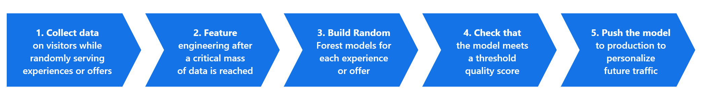

# ランダムフォレストアルゴリズム {#random-forest-algorithm}

>[!BEGINSHADEBOX]

**このページ：**&#x200B;では、[!DNL Target]がランダムフォレスト アルゴリズムを使用して、**[!UICONTROL Automated Personalization]**&#x200B;および&#x200B;**[!UICONTROL 自動ターゲット]** アクティビティのパーソナライゼーションモデルを構築する方法を説明します。

>[!ENDSHADEBOX]

**[!UICONTROL Automated Personalization]** （AP）と&#x200B;**[!UICONTROL 自動ターゲット]** アクティビティの両方で使用される主なパーソナライゼーションアルゴリズムは、ランダムフォレストです。 これは、学習しているときに多数の決定木を構築することによって動作する分類または回帰方法です。

ランダムフォレストはアンサンブルメソッドです。 統計学の観点から見ると、結果の予測に使用される単一の回帰モデルが思い浮かぶかもしれません。 最新のデータサイエンス研究では、同じデータセットから複数のモデルを作成し、インテリジェントに組み合わせる「アンサンブル手法」が、単一のモデルだけで予測するよりも、構成済みの学習アルゴリズムから得られるよりも優れた結果を生み出すことが示唆されています。

## 決定木とは？ {#section_7F5865D8064447F4856FED426243FDAC}

ディシジョンツリーは、システムが学習できるすべての訪問データをグループに分割します。 各グループ内の訪問回数は、目標指標（コンバージョン率など）に関して可能な限り類似し、グループ間の訪問回数はできるだけ異なります。 これを行うには、ツリーはトレーニングセット内の変数を見て、データをMECE （Mutually Exclusive Collectively Exhaustive）方式で、この目標を最大化するグループ（または「リーフ」）に分割します。

次の簡単な例では、目標指標はコンバージョンで、2つの入力変数があります。

* 性別（値は男性と女性の 2 つ）
* 郵便番号（小さなデータセットに5つの潜在的な値11111、22222、33333、44444、または55555）

### 最初の分割 {#first-split}

ツリーは、最初に、2つの変数のうち、訪問データのコンバージョン率の最も大きな変動を説明する変数を決定します。 郵便番号が最も予測的であると仮定します。 この変数は、ツリーの最初の「分岐」を形成します。 その後、ツリーは訪問データを上記のようにグループに分割します。 11111、22222、33333が1つの分割であり、44444と55555が2番目の分割であると仮定します。

{width="440" align="center"}

### 各ブランチ内で分割 {#second-split}

木は「最も予測変数は何か？」という質問を投げかけています。 再び、各ブランチ内のデータ *を分割する同様の演習を完了します*。 性別だけが残っているので、それはここで答えです。 11111、22222、および33333の分岐では、男性と女性の間にコンバージョンに違いがあると仮定します。 それから2枚の葉（男性と女性）があり、この枝は完成しています。 44444と55555の分岐では、女性と男性のコンバージョン方法に統計的な違いがないと仮定します。 この場合、最初の分割は最終的な分割です。

{width="480" align="center"}

## 決定木はランダムフォレストでどのように使用されますか？ {#section_536C105EF9F540C096D60450CAC6F627}

決定木は有用な統計的ツールです。 デメリットもあります。 最も重要なのは、個々のツリーが最初のツリーの構築に使用されなかった将来のデータを不十分に予測できるように、データを「オーバーフィット」できることです。 これは、統計学習における[バイアス／バリアンストレードオフ](https://en.wikipedia.org/wiki/Bias%E2%80%93variance_tradeoff)と呼ばれる問題です。

ランダムな森林がこの課題を克服するのに役立ちます。 ランダムフォレストとは、同じデータセットに対して少し異なるビルドを行い、個々のツリーよりも優れたモデルを生成するために一緒に「投票」する数百もの決定木のコレクションです。 ツリーは、代わりに訪問レコードのサブセットをランダムに選択し（バギングと呼ばれます）、属性のサブセットをランダムに選択することで構築されます。これにより、フォレストは少し異なる決定木で構成されます。 この方法は、木に小さなバリエーションを導入します。 この制御された量の分散を追加すると、アルゴリズムの予測精度が向上します。

## [!DNL Target] パーソナライゼーションアルゴリズムはランダムフォレストをどのように使用しますか？ {#section_32FB53CAD8DF40FB9C0F1217FBDBB691}

### モデルの構築方法

[!DNL Target]は、自動的に収集するデータと、ユーザーから提供されたカスタム データを使用して、パーソナライゼーション アルゴリズムを構築します。 次の図は、**[!UICONTROL 自動ターゲット]**&#x200B;および&#x200B;**[!UICONTROL Automated Personalization]** アクティビティ用のモデルの構築方法をまとめたものです。

{width="850" zoomable="yes"}

1. [!DNL Target]は、エクスペリエンスやオファーをランダムに提供しながら、訪問者に関するデータを収集します。
1. [!DNL Target]がクリティカルマスのデータに当たった後、[!DNL Target]は機能工学を実行します。
1. [!DNL Target]は、各エクスペリエンスまたはオファーに対してランダム フォレスト モデルを構築します。
1. [!DNL Target]は、しきい値の品質スコアを満たしているかどうかを確認して、モデルを検証します。
1. [!DNL Target]は、将来のトラフィックをパーソナライズするために、モデルを実稼動環境にプッシュします。

このモデルによって、訪問者に表示する最適なエクスペリエンスやオファーが予測されます。 一般的に、1つのモデルは、エクスペリエンスごとに（**[!UICONTROL 自動ターゲット]** アクティビティで）またはオファーごとに（**[!UICONTROL Automated Personalization]** アクティビティで）構築されます。 [!DNL Target]は、予測される成功指標が最も高いエクスペリエンスまたはオファー（コンバージョン率など）を表示します。 モデルは、予測に使用する前に、ランダムに提供された訪問でトレーニングする必要があります。 その結果、パーソナライズされたグループ内の訪問者でも、アクティビティが最初に開始されたときに、パーソナライゼーションアルゴリズムの準備が整うまで、異なるエクスペリエンスやオファーがランダムに表示されます。

モデルは曲線の下の領域（AUC）に基づいて検証され、各モデルがアクティビティで使用される前に訪問者の行動を予測するのに適していることを確認します。 モデルがパーソナライズされた体験を提供し始める正確な時間は、データの詳細によって異なります。なぜなら、そのモデルは最初に検証する必要があるからです。 トラフィックのプランニングの観点からの目安としては、モデルが有効になるまでには、最低限のコンバージョン数が必要になるのが一般的です。

モデルがエクスペリエンスまたはオファーに対して有効になると、エクスペリエンスまたはオファー名の左側にある時計アイコンが緑色のチェックボックスに変わります。 少なくとも2つのエクスペリエンスやオファーに有効なモデルがあると、一部の訪問がパーソナライズされ始めます。

### 機能変換

データがパーソナライゼーションアルゴリズムを通過する前に、特徴変換が行われます。これは、パーソナライゼーションモデルで使用するために、トレーニングレコードで収集されたデータを準備すると考えることができます。 変換は、属性のタイプ（またはデータサイエンティストが説明する場合もある「機能」）によって異なります。

| 機能タイプ | 説明 | 変換 |
|---|---|---|
| **カテゴリ** | カウントすることはできませんが、国、性別、郵便番号など、異なるグループに分類できます。 | 可能なすべての特徴のセットが維持され、可能性の変換がデータサイズを削減するために使用されます。 |
| **数値** | 年齢や収入など、測定または数えることができます。 | 再スケーリングすることで、機能がボード全体で同等であることを確認します。 |

### マルチアームドバンディットによる、学習とパーソナライゼーションのバランス

[!DNL Target]がパーソナライゼーションモデルを構築すると、アクティビティへの将来の訪問者のトレードオフに直面します。 現在のモデルに基づいてすべてのトラフィックをパーソナライズすることも、ランダムなオファーを提供することで、新規訪問者から学習を続けることもできます。 パーソナライゼーションアルゴリズムは、トラフィックのほとんどをパーソナライズしながら、常に訪問者の新しいトレンドを把握する必要があります。 マルチアームドバンディットは、[!DNL Target]がこの目標を達成する方法です。このモデルは、アクティビティのライフタイムを通じて学習を継続し、以前に学習したトレンドの過度な利用を防ぐために、常に小さなトラフィックを「消費」することを保証します。

データサイエンスの世界では、マルチアームドバンディット問題は、それぞれ報酬の確率が未知の1つのアームドバンディットのコレクションが与えられる、探査と搾取のジレンマの典型的な例です。 重要なアイデアは、得られる総報酬が最大化されるように、成功の可能性が最も高い腕がプレーされる結果をもたらす戦略を開発することです。 マルチアームドバンディットは、オンラインモデルが構築された後、オンラインスコアリングシステムで使用されます。 このプロセスは、探索中のオンライン学習に役立ちます。 現在のマルチアームドアルゴリズムはイプシロン（ε）の欲張りアルゴリズムである。 このアルゴリズムでは、確率1 - εで、最適なアームが選択されます。 確率εでは、他の任意のアームがランダムに選択される。
