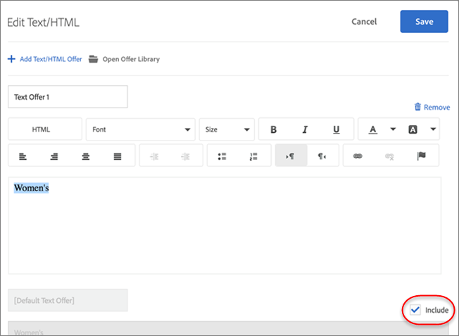

# 除外の管理 {#manage-exclusions}

>[!BEGINSHADEBOX]

**このページ：**&#x200B;で、**[!UICONTROL Automated Personalization]**&#x200B;のアクティビティで、オファーの重複を防止し、特定のエクスペリエンスを除外し、デフォルトコンテンツを除外する方法を説明します。

>[!ENDSHADEBOX]

除外は、**[!UICONTROL Automated Personalization]** （AP）アクティビティが提供するオファーとエクスペリエンスを制御します。 これにより、同じオファーが2回表示されるのを防ぎ、連携しないオファーの組み合わせを削除し、デフォルトのコンテンツを削除します。これにより、目標やオーディエンスに合わせて、よりクリーンで関連性の高いエクスペリエンスを提供するためのアクティビティを構築できます。

## 重複するオファーを許可または禁止 {#allow-duplicate-offers}

AP アクティビティの異なる場所で使用する場合、オファーライブラリのオファーが重複するのを防ぎます。

アクティビティには、例えば、12件のオファーを含むページ上の6つの場所を含めることができるため、同じオファーを複数の場所に配置できます。 重複するオファーを許可しないと、同じアクティビティ内の異なる場所に同じオファーが同時に表示されなくなります。

1. [AP アクティビティの作成または編集中](/help/main/c-activities/t-automated-personalization/create-ap-activity.md#create-ap-activity)、**[!UICONTROL 設定]** アイコン （）をクリックします。

1. 「**[!UICONTROL オファーの重複を許可]**」をクリックして、必要に応じてこの機能のオンとオフを切り替えます。

   

## 特定のエクスペリエンスの除外 {#exclude-experiences}

特定のエクスペリエンスを除外して、AP アクティビティから特定のオファーの組み合わせを削除します。 一部の組み合わせが連携しない場合や、アクティビティのトラフィック要件を軽減するために、テストするエクスペリエンスの数を制限する場合があります。

1. [AP アクティビティの作成または編集中](/help/main/c-activities/t-automated-personalization/create-ap-activity.md#create-ap-activity)、**[!UICONTROL コンテンツの管理]** アイコン（）をクリックします。

   **[!UICONTROL エクスペリエンス]**&#x200B;のリストに、すべてのコンテンツと場所のオプションの順列を基に作成された各エクスペリエンスが表示されます。

1. テストしないエクスペリエンスは除外します。

   * 1つのエクスペリエンスを除外するには、**[!UICONTROL 詳細アクション]** アイコン （）をクリックし、**[!UICONTROL 除外]**&#x200B;をクリックします。
   * 複数のエクスペリエンスを一度に除外するには、各エクスペリエンスのチェックボックスを選択し、**[!UICONTROL 除外]**&#x200B;をクリックします。 1つ以上のエクスペリエンスを選択すると、**[!UICONTROL 除外]** アイコンが表示されます。

   

   エクスペリエンスはアクティビティから除外され、その&#x200B;**[!UICONTROL ステータス]**&#x200B;は&#x200B;**[!UICONTROL 除外]**&#x200B;と表示されるようになりました。

## デフォルトコンテンツを除外 {#exclude-default-content}

AP アクティビティに含めない場合は、デフォルトコンテンツを除外します。これにより、デフォルトコンテンツとは異なるオファーが1つだけ場所に含まれるようになります。 このアプローチでは、テストするオファーに合わせて、ページの残りの部分のルック&amp;フィールも変更できます。 例えば、オファーのカラーパレットを一致させるために、ページの背景色を変更し、デフォルトの背景色を除外することができます。

1. [AP アクティビティの作成または編集中](/help/main/c-activities/t-automated-personalization/create-ap-activity.md#create-ap-activity)に、置き換えるコンテンツを選択し、**[!UICONTROL テキストの変更/HTML]**、**[!UICONTROL 画像オファーの変更]**、**[!UICONTROL 背景色の変更]**&#x200B;をクリックします。 利用可能なオプションは、コンテンツの種類によって異なります。

   

1. 新しいコンテンツの制作。

1. 「**[!UICONTROL その他のアクション]**」アイコン（）をクリックし、「**デフォルトのオファーを除外/デフォルトのオファーを含める**」トグルをクリックして、デフォルトのオファーを除外または含めます。

   <!--
   Depending on the content or offer type, the [!UICONTROL Include] checkbox is in a slightly different place. 

   For Text/HTML content: 

   

   For Image/Video content: 

   

   For background color: 

   
   -->

<!--
1. Click **[!UICONTROL Save]**.

   You can see the experiences created from the offers you specified under [!UICONTROL Manage Content]. You notice that no experiences are created in [!UICONTROL Manage Content] using the default offer you excluded. 

   

**To exclude default content using the [!UICONTROL Form-Based Experience Composer]:** 

1. While creating or editing an AP activity, click **[!UICONTROL Change Text/HTML]** or **[!UICONTROL Change Image Offer]** under **[!UICONTROL Content]**. 
1. In the dialog box, create your new content and uncheck **[!UICONTROL Include]** to the right of the default content (or uncheck the Default Image/Video in the [!UICONTROL Select Content] screen). 

   Depending on the content or offer type, the [!UICONTROL Include] checkbox is in a slightly different place. 

   For Text/HTML content: 

   

   For Image/Video content: 

   

1. Click **[!UICONTROL Save]**. 

   You can see the experiences created from the offers you specified under [!UICONTROL Manage Content]. You notice that no experiences are created in [!UICONTROL Manage Content] using the default offer you excluded. 

   
-->
