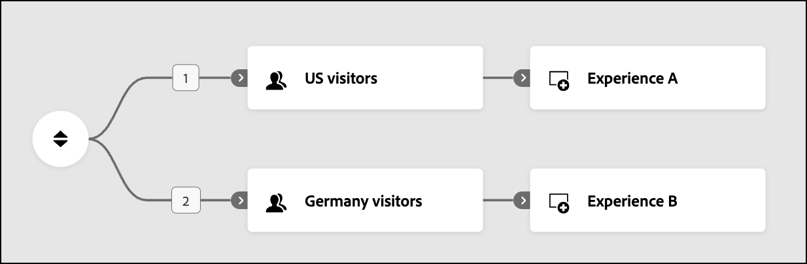

# [!UICONTROL &#x200B; エクスペリエンスのターゲット設定]でのエクスペリエンスの切り替え {#switching-experiences}

>[!BEGINSHADEBOX]

**このページ：**&#x200B;では、**[!UICONTROL エクスペリエンスのターゲット設定]** アクティビティでの優先度の仕組みと、プロファイルの進化に伴うエクスペリエンス間の訪問者の切り替えについて説明します。

>[!ENDSHADEBOX]

**[!UICONTROL エクスペリエンスのターゲット設定]**&#x200B;を使用すると、プロファイルの進化に合わせて表示されるエクスペリエンス訪問者を制御できます。 訪問者のプロファイルにはいくつかの変化があり、その変化に基づいて異なるコンテンツを表示することができます。 次の表に、いくつかの例を示します。

| シナリオ | 詳細 |
|--- |--- |
| 地理的な位置 | 訪問者が出張または旅行により、異なる地理的位置から Web サイトまたはモバイルアプリを表示します。 |
| 顧客ステータス | 訪問者は、アカウントを作成したり、商品を購入する前に、見込み客と見なされる可能性があります。 |
| カテゴリ親和性 | [!DNL Target]の[&#x200B; カテゴリー親和性](/help/main/c-target/c-visitor-profile/category-affinity.md)機能は、訪問者が表示するカテゴリーを自動的にキャプチャし、ターゲティング目的で各カテゴリーの訪問者の親和性を計算します。 例えば、特定のテーマに関する記事をweb サイトで複数閲覧した訪問者には、そのテーマに関連するコンテンツが表示されます。 |
| 曜日 | 週末の取り組みとして、訪問者に映画、食事またはその他の娯楽に関するコンテンツを表示できます。 |

[!DNL Target]でこれらの機能を使用するには、**[!UICONTROL エクスペリエンスのターゲット設定]** アクティビティで作業する際に、次の情報を理解することが重要です。

## 訪問者へのサービス提供方法 {#how-visitors-are-served}

[!DNL Target] UIのエクスペリエンスの優先順位は上から下まで制御されるので、よりターゲットを絞ったエクスペリエンスを広いエクスペリエンスの前に定義します。 次の表に、それぞれの状況で訪問者が見る情報を示します。

| 状況 | 訪問者が目にするもの |
|--- |--- |
| 訪問者は複数のオーディエンスに適格です。 | エクスペリエンスのコンテンツが優先されます。 |
| 訪問者は、より優先度の高いエクスペリエンスのオーディエンスのクオリフィケーションを開始します。 | 訪問者は優先度の高いエクスペリエンスに切り替えます。 |
| 訪問者は現在のオーディエンスの適格を停止しますが、優先度の低いエクスペリエンスの適格を開始します。 | 訪問者は優先度の低いエクスペリエンスに切り替えます。 |
| 訪問者は現在のエクスペリエンスの対象を停止し、別のエクスペリエンスの対象にはなりません。 | デフォルトコンテンツ： |
| 訪問者は他のエクスペリエンスに適格ではなく、最後のエクスペリエンスは「すべての訪問者」をターゲットとしています。 | 「すべての訪問者」エクスペリエンス。 このエクスペリエンスは、他のエクスペリエンスに適格でない訪問者を「キャッチ」します。 |
| 「すべての訪問者」をターゲットにしたエクスペリエンスは、順序が最後ではありません。 | 「すべての訪問者」エクスペリエンスよりも低くリストされているターゲットエクスペリエンスは、引き続き評価されます。 |
| アクティビティには単一のエクスペリエンスがあり、訪問者はオーディエンスの資格を失います。 | 訪問者はエクスペリエンス内に残ります。 |

## 例 {#examples}

次の例は、これらの状況を示しています。

### 優先度：ニューヨークとアメリカ

2つのエクスペリエンスがある場合、1つは「米国」をターゲットとし、1つは「ニューヨーク」をターゲットとする場合、両方のオーディエンスの対象となります。 したがって、[!DNL Target] UIの「米国」エクスペリエンスの前に「ニューヨーク」エクスペリエンスを定義する必要があります。 この方法では、次の例に示すように、よりターゲットを絞った「ニューヨーク」エクスペリエンスの優先度が高くなります。

### 優先度の高いエクスペリエンスへの切り替え：米国からドイツへ

次のアクティビティ設定では、訪問者は米国からweb サイトにアクセスし、その後ドイツに移動し、Web サイトに2回訪問しました。 最初の訪問中、この訪問者はエクスペリエンス A（米国の訪問者）の資格を得ます。 ドイツから Web サイトを表示した後、この訪問者は、エクスペリエンス B（ドイツの訪問者）に切り替えます。

### オーディエンスからの離脱：米国からフランスへ

次のアクティビティ設定では、訪問者は米国からweb サイトにアクセスし、その後フランスに移動し、web サイトに2回訪問しました。 最初の訪問中、この訪問者はエクスペリエンス A（米国の訪問者）の資格を得ます。 フランスからweb サイトを表示した後、この訪問者は元のエクスペリエンスに残ります。

### すべての訪問者を対象としたエクスペリエンス

次のアクティビティ設定では、訪問者は米国からweb サイトにアクセスし、その後ドイツに移動し、Web サイトに2回訪問しました。 最初の訪問中、この訪問者はエクスペリエンス A（米国の訪問者）の資格を得ます。 ドイツからweb サイトを表示した後、この訪問者はエクスペリエンス A （米国の訪問者）に残ります。

これが望ましくない場合、次の例に示すように、ターゲットオーディエンスの正反対として明示的に定義された新しいオーディエンスを作成できます。

### 単一エクスペリエンスの活用

単一のエクスペリエンス **[!UICONTROL エクスペリエンスのターゲット設定]** アクティビティを使用すると、訪問者がエクスペリエンスに参加するオーディエンスの資格を失っても、訪問者はエクスペリエンスに残ります。 これが望ましくない場合は、逆のオーディエンスを対象とした別のエクスペリエンスを作成できます（例えば、「米国」ではなく「米国」です）。 別のオプションとして、次の例に示すように、100%のトラフィック配分を使用して、目的のオーディエンスをターゲットとする&#x200B;**[!UICONTROL A/B テスト]** アクティビティを作成できます。

