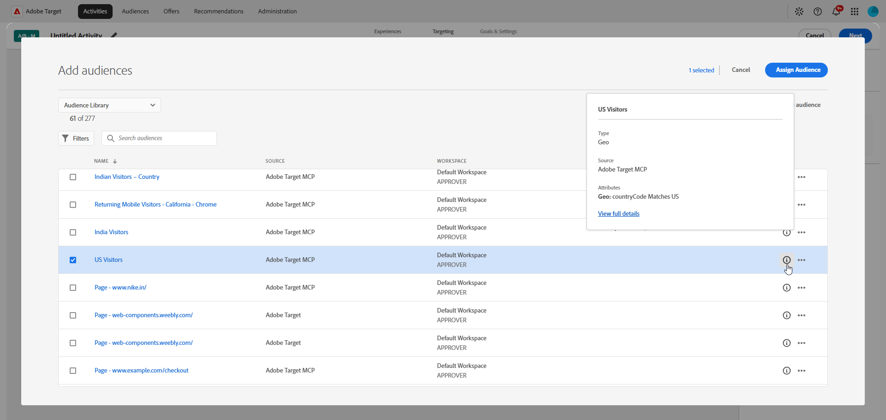

# オーディエンスの選択 {#select-audience}

>[!BEGINSHADEBOX]

**このページ：**&#x200B;では、A/B アクティビティのオーディエンスを選択、作成、結合、表示、編集、コピーする方法と、含める訪問者の割合を設定する方法について説明します。

>[!ENDSHADEBOX]

オーディエンスは、どの適格な訪問者を[!DNL Adobe Target] アクティビティに入力するかを決定します。

アクティビティを作成する[の3つの部分で構成されるガイド付きワークフローの&#x200B;**[!UICONTROL ターゲティング]** ステップには、オーディエンスとそのトラフィック率の割り当て、トラフィック配分方法の選択、アクティビティの各エクスペリエンスのトラフィック配分の指定の手順を示すフロー図が表示されます。](/help/main/c-activities/t-test-ab/t-test-create-ab/test-create-ab.md)

フロー図のすべてのオプションについて詳しくは、[A/B テストアクティビティの作成](/help/main/c-activities/t-test-ab/t-test-create-ab/test-create-ab.md)を参照してください。

## アクティビティのオーディエンスの選択

オーディエンスは、アクティビティの閲覧者を制御します。 オーディエンスに一致する訪問者のみが入力でき、その訪問者のシェアを決定します。 デフォルトでは、アクティビティはすべての訪問者をターゲットにします。

1. 「**[!UICONTROL すべての訪問者]**」コントロールをクリックして、アクティビティ用の別のオーディエンスを選択します。

   **[!UICONTROL すべての訪問者]**&#x200B;がデフォルトのオーディエンスです。 特定のオーディエンスターゲティングを使用しないA/B テストの場合は、デフォルトを維持します。 別のオーディエンスを選択すると、その名前が一番左のコントロールに表示されます。

1. **[!UICONTROL 置換] アイコン** （）をクリックします。

   

1. **[!UICONTROL オーディエンスを追加]** ダイアログボックスで、**[!UICONTROL オーディエンスライブラリ]**&#x200B;から選択したオーディエンスを参照するか、アクティビティのみのオーディエンスを作成できます。

   **[!UICONTROL オーディエンスライブラリ]**&#x200B;には、以前に定義されたオーディエンスが含まれています。これには、[!DNL Target]の一部として事前に構築された一般的なオーディエンスも含まれます。

   

1. オーディエンスの横にある&#x200B;**[!UICONTROL 情報]** アイコン （）をクリックして、そのオーディエンスのソースと属性を含む詳細を表示します。

   

   「**[!UICONTROL 詳細を表示]**」をクリックして、オーディエンスに関する詳細を表示することもできます。

1. （条件付き）複数のオーディエンスを組み合わせるオーディエンスを作成するには、**[!UICONTROL オーディエンスを組み合わせる]**&#x200B;から[をクリックします](/help/main/c-target/combining-multiple-audiences.md)。

   +++ 新しいオーディエンスを作成する手順

   まだ&#x200B;**[!UICONTROL オーディエンスライブラリ]**&#x200B;にない新しいオーディエンスを作成するには、**[!UICONTROL オーディエンスの作成]**&#x200B;をクリックし、オーディエンスを定義してから、**[!UICONTROL 完了]**&#x200B;をクリックします。

   [create-audience ワークフロー](/help/main/c-target/c-audiences/audiences.md)中に、次のオプションから選択できます。

   * **[!UICONTROL オーディエンスライブラリ]**: **[!UICONTROL オーディエンスライブラリ]**&#x200B;に保存され、他のアクティビティで再利用できるオンデマンドオーディエンスを作成します。
   * **[!UICONTROL このアクティビティのみ]**: **[!UICONTROL オーディエンスライブラリ]**&#x200B;に保存されていない[&#x200B; アクティビティ固有のオーディエンス &#x200B;](/help/main/c-target/creating-activity-only-audience.md)を作成し、現在のアクティビティでのみ使用できます。

   +++

1. オーディエンスを編集またはコピーするには、目的のオーディエンスの横にある&#x200B;**[!UICONTROL その他のアクション]** アイコン （）をクリックします。

1. オーディエンスを選択したら、「**[!UICONTROL オーディエンスを割り当て]**」をクリックします。

1. 右側のペインで「**[!UICONTROL 訪問者の割合]**」をクリックし、アクティビティに含める対象となる訪問者の割合を指定します。

1. オーディエンスに問題がなければ、**[!UICONTROL 次へ]**&#x200B;をクリックして、3段階のガイド付きワークフローの3番目のステップに移動します。

>[!NOTE]
>
>**[!UICONTROL Audience]** リストを開くと、読み込まれたオーディエンスはバックグラウンドで自動的に読み込まれ、読み込まれたオーディエンスが10分以上経過しています。
