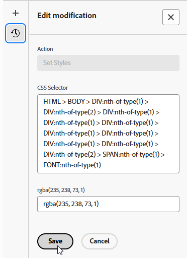

# 修正を始める {#vec-code-editor}

>[!BEGINSHADEBOX]

**このページ：** [!UICONTROL Visual Experience Composer] （VEC）の&#x200B;**[!UICONTROL 変更]** パネルで変更を表示、編集、削除、追加する方法と、カスタムコードの使用方法について説明します。

>[!ENDSHADEBOX]

[!DNL Adobe Target]の&#x200B;**[!UICONTROL 変更]** パネルには、[!UICONTROL Visual Experience Composer] （VEC）でページに加えられたすべての変更が表示され、ページ上の各要素をクリックして[&#x200B; アクションを選択すると](/help/main/c-experiences/c-visual-experience-composer/viztarget-options.md)追加の変更が可能になります。 各変更は、**[!UICONTROL 変更]** リストに個別のアクションまたは要素として表示されます。 CSS セレクター、Mbox、およびカスタムコードのタイプの変更を直接追加することもできます。

## 変更の概要 {#modifications-overview}

**[!UICONTROL 変更]** ページでは、VECがコンテンツの配信方法を設定する際に[!DNL Target]が選択するセレクターに小さな変更を加えます。 コンテンツまたはHTML属性のいずれかを変更できます。 コードを編集して、mbox内でHTML オファーと同等のものを作成することもできます。

のアクションが一覧表示されたVisual Experience Composer

**[!UICONTROL 変更]** ページは、次の目的で使用できます。

* Visual Experience Composer でおこなったアクションの表示。

  の3つのアクションが表示されています

* 既存のアクションの編集。 詳細メニューにアクセスし、**[!UICONTROL 編集]**&#x200B;を選択します。

  

  変更を加えます。

  

* 既存のアクションを削除します。 詳細メニューにアクセスし、**[!UICONTROL 変更を削除]**&#x200B;を選択します。

  

* 新しい変更の追加。 **[!UICONTROL 変更]** メニューの詳細メニューにアクセスし、**[!UICONTROL 変更を追加]**&#x200B;を選択してから、[変更を追加](#add-modifications)の説明に従って変更を指定します。

  

## 修正を追加 {#add-modifications}

変更は、VECで選択されたエクスペリエンスの&#x200B;**[!UICONTROL 変更]** パネルから追加されます。

1. **[!UICONTROL 変更]**&#x200B;を表示するには、**[!UICONTROL 変更を表示]**&#x200B;をクリックします。

   

   フォームベースのExperience Composerで&#x200B;**[!UICONTROL 変更]** パネルを開くには、HTML オファーを作成または編集します。 詳しくは、[フォームベースの Experience Composer](/help/main/c-experiences/form-experience-composer.md) を参照してください。

1. 変更を追加するには：

   * エクスペリエンスに対して以前の変更が行われていない場合は、**[!UICONTROL 変更]** パネルから&#x200B;**[!UICONTROL 変更を追加]**&#x200B;をクリックします。
   * エクスペリエンスに以前の変更がある場合は、**[!UICONTROL 変更]** メニューの詳細メニューにアクセスし、**[!UICONTROL 変更を追加]**&#x200B;を選択します。

   **[!UICONTROL 変更]** パネルに次の情報が表示されます。

   

1. 「**[!UICONTROL 変更タイプ]**」ドロップダウンリストから、目的のタイプを選択します。

   | 修正タイプ | 詳細 |
   |--- |--- |
   | CSS セレクター | **[!UICONTROL CSS エレメントセレクター]** ボックスで、変更するCSS要素を指定し、アクションタイプ （**[!UICONTROL コンテンツを設定]**&#x200B;または&#x200B;**[!UICONTROL 属性を設定]**）を選択してから、必要な情報と目的のコンテンツを入力します。 |
   | mbox | mbox名と目的のコンテンツを指定します。 |
   | カスタムコード | オプションの名前を指定し、必要に応じて「`<HEAD>` セクション **」チェックボックスで「** コードを追加」を選択または選択解除してから、カスタムコードを追加します。 詳しくは、[&#x200B; カスタムコード &#x200B;](#custom-code)を参照してください。 |

   >[!NOTE]
   >
   >at.js 2.*x*&#x200B;を使用するページでは、VECでMBOXがサポートされなくなりました。 回避策として：
   >
   >* at.js 2.*x*&#x200B;を使用している場合は、Mboxの変更の代わりにCSS セレクターの変更を追加し、mboxが使用していたセレクターにコンテンツを追加します。
   >* フォームベースのアクティビティを使用します（mboxおよびat.js 1.*x*&#x200B;およびat.js 2.*x*&#x200B;で動作）。
   >* VECでat.js 1.*x*&#x200B;を使用します。

1. 必要に応じて、さらに変更を加えます。

## カスタムコード {#custom-code}

カスタムコードでは、非ビジュアルインターフェイスを使用して、VEC、フォームベースの Experience Composer、HTML オファーエディター内でアクションを表示および編集したり、新規で追加したりできます。 このパネルには、エクスペリエンスのコードビューが表示され、より複雑なエクスペリエンスの構築、既存のエクスペリエンスの微調整、問題のトラブルシューティングに役立ちます。

カスタムコードは、HTML、JavaScript および CSS の使用に慣れた上級ユーザー向けの機能です。 コードビューは、変更の微調整や調整、セレクターの問題の修正に役立ちます。 新しいカスタムコードおよびアクションを追加することもできます。 複数のカスタムコードを追加でき、それぞれオプションで名前を付けることができます。

を含む変更パネル

カスタムコードは次のように動作します。

* `<HEAD>` セクション **の** コードを追加を選択すると、`<head>` セクションにカスタムコードが追加され、その実行は本文イベントまたはページ読み込みイベントを待ちません。 `<script>`要素と`<style>`要素のみを追加します。 `<div>`個のタグやその他の要素を追加すると、残りの`<head>`個の要素が`<body>`に入り込む可能性があります。 at.jsを使用すると、すべてのオファーが非同期で配信されます。
* 「`<HEAD>`」セクション **の「** コードを追加」が選択解除されると、`<body>` タグの直後にカスタムコードが実行されます。 DOM構造を保持するために、すべてのコードを1つの`<div>`にラップします。 at.jsを使用すると、すべてのオファーが非同期で配信されます。
* `<BODY>`のHTMLに`<SCRIPT>`と`<DIV>`が含まれている場合、`<DIV>`は`<BODY>`に追加され、`<SCRIPT>`は`<HEAD>`に実行されます。 外部ファイルを読み込む`<SCRIPT>`も`<HEAD>`に追加されます。
* スクリプトは非同期で実行されます。 つまり、`document.write`と同様のスクリプトメソッドは使用できません。
* カスタムコードは、現在、A/Bおよびエクスペリエンスターゲティング（XT）アクティビティでのみ使用できます。 オーバーレイの場合とリダイレクトオファーが適用されている場合、カスタムコードは無効になります。

カスタムコードでは、次のような操作をおこなうことができます。

* ページ上部で実行するカスタム JavaScript、HTML、またはCSSを追加します
* 変更を加えた後にVECによって生成されたコードを表示または編集します
* セレクターに対する HTML コンテンツの設定（CSS セレクターのみ）
* HTML 要素に対する属性の設定
* リージョナル mbox に配信するオファーコンテンツの追加
* DOM 準備完了時の置き換え（jQuery 使用）
* DOM 準備完了時の置き換え（jQuery 不使用）（Internet Explorer 8 は非対応）
* 「elementOnLoad」プラグインを使用したDOM ポーリングとのスワップ
* カスタムリダイレクト

カスタムコードには次の特長があります。

* わかりやすさを考慮した行番号
* 構文の強調表示は、HTML オファーの構文が正しくないことを防ぐのに役立ちます。
* 複数のカスタムコードを作成し、オプションでそれぞれに名前を指定できる機能 複数のカスタムコードを作成すると、今後のデバッグが容易になります。 例えば、複数の変更を実行するために1つのカスタムコードを作成する代わりに、それぞれの変更に対して、わかりやすい名前のカスタムコードを個別に作成できます。 それぞれのカスタムコードを使用することで、変更をよりモジュール化して管理しやすくなります。 アクティビティ内の複数のカスタムコードの実行は、作成されたシーケンス内で行われることが保証されません。

**[!UICONTROL 変更]** パネルでは、ビジュアルモードとコードモードの間で画面が分割されます。 両方のモードが同期された状態になります。 ビジュアルモードで変更をおこなうと、コードビューの対応する行が変更されます。 同様に、コードビューで変更を確定するたびに、ビジュアルエクスペリエンスに変更が表示されます。 コードビューで任意の行をクリックすると、ビジュアルページ上の対応する要素が選択されます。

カスタムコードでは、HTML、スクリプトおよびスタイルをサポートしています。 有効な HTML コードまたはスクリプトを追加または編集できます。

## カスタムコードの例 {#custom-code-examples}

**[!UICONTROL カスタムコード]**&#x200B;パネルには、ページ読み込みの開始時に実行されるコードが含まれています。 JavaScript コードは`<head>` タグで実行できます。 コードの実行は、`<body>` タグがDOMに存在するのを待ちません。 後続のビジュアルアクションのセレクターは、このタブで追加される HTML 要素に依存します。

**[!UICONTROL カスタムコード]** パネルは、一般的に、JavaScriptまたはCSSをページの先頭に追加するために使用されます。

「**[!UICONTROL カスタムコード]**」タブを使用して、次のことをおこなうことができます。

* JavaScript のインラインでの使用、または外部 JavaScript ファイルへのリンク

  例えば、エレメントのカラーを変更するには、次の操作を行います。

  ```javascript
  <script type="text/javascript"> 
  document.getElementById("element_id").style.color = "blue"; 
  </script> 
  ```

* インラインでのスタイルの設定、または外部スタイルシートへのリンク

  例えば、オーバーレイ要素のクラスを定義するには、次のように入力します。

  ```html
  <style> 
  .overlay 
  { position: absolute; top:0; left: 0; right: 0; bottom: 0; background: red; } 
  </style> 
  ```

* HTML スニペットを追加して新しい要素を定義

  例えば、次のHTML スニペットを使用して、上記で定義されたCSS クラスを使用するオーバーレイ `<div>`を作成します。

  ```html
  <div class="overlay"></div>
  ```

* DOM 準備完了時の置き換え（jQuery 使用）

  次の例では、[!DNL Target]がオファーを実行する際に、顧客のweb サイトにjQueryがページ上で使用可能であると仮定しています。

  ```javascript
  <style>#default_content {visibility:hidden;}</style> 
  <script> 
  jQuery( document ).ready(function() { 
      jQuery("#default_content").html( "<span style='color:red'>Hello <strong>Again</strong></span>" ); 
      jQuery("#default_content").css("visibility","visible"); 
  }); 
  </script> 
  ```

* DOM 準備完了時の置き換え（jQuery 不使用）（Internet Explorer 8 は非対応）

  ```javascript
  <style>#default_content {visibility:hidden;}</style> 
  <script> 
  document.addEventListener("DOMContentLoaded", function(event) {  
      document.getElementById("default_content").innerHTML = "<span style='color:red'>Hello <strong>Again</strong></span>"; 
      document.getElementById("default_content").style.visibility="visible"; 
  }); 
  </script> 
  ```

* 既存のパラメーター、Analyticsとの従来の統合の`s_tnt` パラメーター、リファラーパラメーター、およびmbox セッションを渡すカスタムリダイレクト

  ```javascript
  <style type="text/css">body{display:none!important;}</style> 
  <script type="text/javascript"> 
   var qs='';window.location.search?qs=window.location.search+'&':qs='?'; 
   window.location.replace('//www.mywebsite.com/'+qs+'s_tnt=${campaign.id}:${campaign.recipe.id}:${campaign.recipe.trafficType}&s_tntref='+encodeURIComponent(document.referrer)+'&mboxSession='+mboxFactoryDefault.getSessionId().getId()+''+window.location.hash+''); 
  </script> 
  ```

* カスタムコードで使用する[!DNL Adobe Target] エクスペリエンステンプレートを追加

  エクスペリエンステンプレートは、マーケターの一般的なユースケースを実行するために使用される、設定可能な入力を含む事前にコード化されたサンプルです。 VECまたはフォームベースのExperience Composerを通じて、一般的なユースケースを実行するための出発点として、開発者やマーケターに無料で提供されます。 ユースケースには、ライトボックス、カルーセル、カウントダウンなどがあります。 詳しくは、[エクスペリエンステンプレート](/help/main/c-experiences/c-visual-experience-composer/c-vec-code-editor/experience-templates.md)を参照してください。

## カスタムコードのベストプラクティス {#custom-code-best-practices}

* **カスタムコードは、必ず 1 つの要素にまとめます。**

  次に例を示します。

```html
<div id="custom-code"> 
// My Code goes here 
</div>
```

変更が必要な場合は、このコンテナ内で変更を行います。 カスタムコードが不要になった場合は、このコンテナを空のままにしますが、削除しないでください。 これにより、他のエクスペリエンスの変更に影響を与えずに済みます。

* **コードエディターでのページに対する変更では、要素 ID「CDQID」を使用しないでください。**

  [!DNL Target]は、値「CDQID」を持つ新しい要素IDを、[!DNL Target]によって変更されたページ上の任意の要素に適用します。 このIDは[!DNL Target]によって適用されるので、コードエディターでこれ以上の変更や調整に使用しないでください。

* **カスタムコードスクリプトで`document.write` アクションを実行しません。**

  スクリプトは、非同期で実行されます。 これは、多くの場合、`document.write`個のアクションがページ上の間違った場所に表示されます。 カスタムコードで作成されたスクリプトで `document.write` を使用することはお勧めしません。

* **要素が作成され、その後変更された場合は、元の要素を削除しないでください。**

  変更ごとに、**[!UICONTROL 変更]** パネルに新しい要素が作成されます。 2番目のアクションは要素1を変更するので、要素1が削除された場合、そのアクションには変更するものがなくなり、変更は機能しなくなります。 詳しくは、[&#x200B; カスタムコードのトラブルシューティング &#x200B;](#troubleshooting-custom-code)を参照してください。

* **同じURLをターゲットとする2つのアクティビティでカスタムコード機能を使用する場合は注意してください。**

  カスタムコード機能を同じURLをターゲットとする2つのアクティビティに使用すると、JavaScriptが両方のアクティビティからページに挿入されます。 [!DNL Target]は、配信されたコンテンツの順序を自動的に決定します。 コードが配置に依存していないことを確認します。 コードの作成者は、コードに競合がないことを確認する責任があります。

## カスタムコードのトラブルシューティング {#troubleshooting-custom-code}

+++ `triggerView`の使用時にカスタムコードが実行されないのはなぜですか？

オプションとして `{page: false}` を使用して `triggerView()` が呼び出される場合、VEC のカスタムコードオファーは再レンダリングされません。

+++

+++ ページの構造変更によりアクションを適用できないという警告は、何を意味しますか？

このメッセージは、アクティビティが最後に保存されてから、ページの構造が変更されたことを示します。


参照モードを使用して存在しないセレクターにアクセスしている可能性がります。 Adobeでは、警告メッセージに示されているように、コンテンツが期待どおりに表示されるように、各エクスペリエンスを削除してから再作成することをお勧めします。

+++

+++ 「このアクションを削除すると、その後のアクションに影響を与える可能性がある」という警告の意味は何ですか？

例えば、次の2つのアクションが実行された場合があります。

* クラスに要素 1 を追加
* 要素 1 の HTML を編集

変更ごとに、**[!UICONTROL 変更]** パネルに新しい要素が作成されます。 2番目のアクションは要素1を変更するので、要素1が削除された場合、2番目のアクションには変更するものがなくなり、変更は機能しなくなります。

つまり、エレメントがテキストで追加され、その後、別のアクションで異なるテキストでエレメントが編集された場合、**[!UICONTROL 変更]** パネルには、両方のアクションが別々のエレメントとして表示されます。 要素を編集すると、元の要素を変更し、編集したテキストを含む新しい要素が作成されます。 元のエレメントが削除された場合、編集したテキストは編集したエレメントを見つけることができず、表示されません。 2番目の要素は要素のリストに残りますが、変更される要素が存在しなくなったため、ページには影響しません。

+++

+++ スクリプト内の`document.write`で作成された要素が期待どおりに表示されないのはなぜですか？

スクリプトは、非同期で実行されます。 これは、多くの場合、`document.write`個のアクションがページ上の間違った場所に表示されます。 アドビでは、カスタムコードで作成するスクリプト内で `document.write` を使用しないことをお勧めします。

+++

+++ JavaScriptでカスタムコードにエラーが表示されるのはなぜですか？

JavaScriptが無効なインライン JavaScriptでは、カスタムコードにエラーが表示されます。

+++

+++ カスタムコードの変更を元に戻せないのはなぜですか？

現在、**[!UICONTROL 変更]** パネルおよびカスタムコードでの編集および削除アクションでは、取り消しはサポートされていません。 これらのいずれかの操作を取り消すと、VEC のエクスペリエンスの表示が、カスタムコードに表示されている実際のアクションと食い違っているように見える場合があります。 ただし、カスタムコードのアクションは正しい状態であり、配信に影響はありません。 これは、UI の問題です。 エクスペリエンスを更新するには、保存してから再度開くか、または次のステップに移動して戻ります。 これらのアクションのいずれかがエクスペリエンスを再読み込みするので、期待どおりに表示され、**[!UICONTROL 変更]** パネルのアクションと一致しています。

+++

+++ カスタムコードがInternet Explorer 8で期待される結果を生成しないのはなぜですか？

[!DNL Target]はInternet Explorer 8をサポートしなくなりました。

+++
