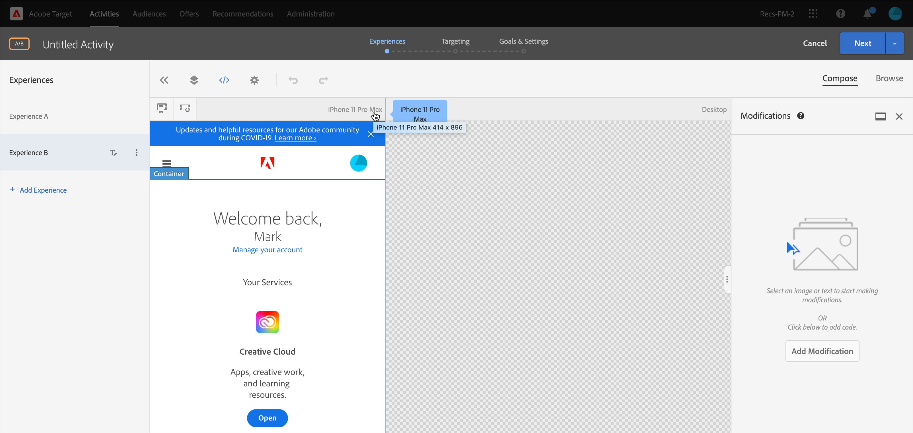

# レスポンシブエクスペリエンスのためのモバイルビューポート {#mobile-viewports}

>[!BEGINSHADEBOX]

**このページ：** モバイルビューポートを設定し、それを使用して様々なサイズの画面のプレビューやエクスペリエンスを構築する方法を説明します。

>[!ENDSHADEBOX]

モバイルビューポートには、様々なデバイスの画面サイズで[!DNL Adobe Target]個のアクティビティが表示されます。 レスポンシブサイト向けに設計されており、デスクトップ PC、ノート PC、タブレット、携帯電話に自動的に対応できます。これにより、それぞれのサイトでエクスペリエンスが適切に表示されているかどうかを確認できます。

>[!NOTE]
>
> * サイトがレスポンシブで、モバイルページがデスクトップページの要素を別のレイアウトで再利用する場合は、モバイルビューポートを使用します。 モバイルサイトが分離されていて、`m.mysite.com`などの独自の構造がある場合は、代わりに[&#x200B; マルチページアクティビティ &#x200B;](/help/main/c-experiences/c-visual-experience-composer/multipage-activity.md#multipage-activity)を使用します。
>
>* モバイルビューポートは、リダイレクトオファーオーバーレイが重なっている場合は使用できません。

## ビューポートとCSS ブレークポイント

ビューポートは、web ページが画面に表示される領域です。ブラウザーウィンドウのサイズからスクロールバーとツールバーを差し引いたサイズです。 ブラウザーはCSS ピクセルで測定するため、Retina スクリーンを備えたデバイスなど、多くのデバイスでは、ビューポートは広告デバイスの解像度よりも小さくなります。 常に[!DNL Target]のビューポート サイズを使用してください。 次の表に、一般的なデバイスの両方の値を示します。

+++ 一般的なデバイスのビューポートと解像度

>[!NOTE]
>
>人気のデバイスのビューポートのサイズは様々な web サイトに表記されています。 例えば、`https://viewportsizer.com/devices/` を参照してください。 最も正確な最新の情報については、デバイスメーカーの web サイトを参照してください。
>
>「est」とマークされたビューポートサイズ。 は見積もりです。

| デバイス | ビューポートのサイズ（幅 x 高さ） | デバイスの解像度（幅 x 高さ） |
|---|---|---|
| iPhone 18 Pro Max | 440 x 956 | 1320 x 2868 |
| iPhone 18 Pro | 402 x 874 | 1206 x 2622 |
| iPhone 17 Pro Max | 440 x 956 | 1320 x 2868 |
| iPhone 17 Pro | 402 x 874 | 1206 x 2622 |
| iPhone航空 | 420 x 912 | 1260 x 2736 |
| iPhone 17 | 402 x 874 | 1206 x 2622 |
| iPhone 16e | 390 x 844 | 1170 x 2532 |
| iPad（A16） | 820 x 1180 | 1640 x 2360 |
| iPad mini （A17 Pro） | 744 x 1133 | 1488 x 2266 |
| iPad Air 11&quot; （M3 / M4） | 820 x 1180 | 1640 x 2360 |
| iPad Pro 11 インチ （M5） | 834 x 1210 | 1668 x 2420 |
| Google Pixel 11 | 412 x 924 （推定） | 1080 x 2424 |
| Google Pixel 11 Pro | 410 x 914 （推定） | 1280 x 2856 |
| Google Pixel 11 Pro XL | 448 x 997 （推定） | 1344 x 2992 |
| Google Pixel 10 | 412 x 924 | 1080 x 2424 |
| Google Pixel 10 Pro | 410 x 914 （推定） | 1280 x 2856 |
| Google Pixel 10 Pro XL | 448 x 997 （推定） | 1344 x 2992 |
| Samsung Galaxy S26 | 360 x 780 | 1080 x 2340 |
| Samsung Galaxy S26 Ultra | 412 x 891 | 1440 x 3120 |
| iPhoneデュオ（展開） | 890 x 626 （推定） | 2670 x 1878 |
| iPhoneデュオ（折り畳み） | 466 x 678 （推定） | 1398 x 2034 |
| Samsung Galaxy Z Fold 7 （フォールド） | 412 x 960 （推定） | 1080 x 2520 |
| Samsung Galaxy Z Flip 8 | 360 x 840 （推定） | 1080 x 2520 |
| Google Pixel 11 Pro Fold （展開） | 791 x 820 （推定） | 2076 x 2152 |

+++

レスポンシブサイトでは、特定の画面サイズで別のレイアウトに切り替えます。 これらのサイズは、CSS ブレークポイントまたは[&#x200B; メディアクエリ &#x200B;](https://developer.mozilla.org/en-US/docs/Web/CSS/Media_Queries/Using_media_queries)と呼ばれます。 サイトのCSS ブレークポイントを[!DNL Target]に保存すると、各ビューをプレビューでき、ディスプレイの上部にあるビューポートをクリックすると、その画面サイズのビューが開きます。

特定のデバイスにアクティビティを配信するには、アクティビティ図でそのデバイスのオーディエンスを選択し、Mobile Web Composerでそのデバイスのページを編集します。 同じツールを使用して、アクティビティが特定のデバイスをターゲットにした場合に応答しないサイトを表示します。 すべてのデバイスでアクティビティを実行するには、ターゲティングを適用せず、モバイルビューポートを使用して各画面サイズでアクティビティをプレビューします。

>[!IMPORTANT]
>
>エクスペリエンスはモバイルビューポート内から編集できますが、変更内容は、使用中のビューポートだけでなく、すべてのビューポートとデバイスに適用されます。 同様に、デスクトップビューでエクスペリエンスを編集すると、すべての画面サイズのページが変更されます。 [!DNL Target]は現在、ビューポート固有のページ変更をサポートしていません。

## モバイルビューポート設定 {#task_B4B161499DC0470584ED922A4D20FCAB}

エクスペリエンスの作成時に使用できるモバイルビューポートを定義します。

1. **[!UICONTROL 管理]** > **[!UICONTROL Visual Experience Composer]**&#x200B;をクリックします。
1. **[!UICONTROL モバイルビューポート設定]** セクションで、**[!UICONTROL 追加]**&#x200B;をクリックします。

   

   または

   既存のモバイルビューポートの設定を変更するには、そのビューポートを選択し、**[!UICONTROL 編集]** （鉛筆）アイコンをクリックします。

1. モバイルビューポートのわかりやすい名前を入力します。 名前は、36 文字まで入力できます。
1. モバイルデバイスの画面サイズを入力します。 幅は150～968 ピクセル、高さは150～1280 ピクセルにすることができます。
1. （オプション）デバイスのオペレーティングシステムを選択します。

   オプション：

   * Android
   * iOS
   * Windows
   * Symbian
   * BlackBerry

   [Enhanced Experience Composer](/help/main/c-experiences/c-visual-experience-composer/experience-composer-best-practices.md#enable-eec)が有効になっていて、オペレーティングシステムが選択されている場合、[!DNL Target]はページが表示されるとそのデバイスをエミュレートします。 例えば、AndroidのレスポンシブサイトのルックアンドフィールがiOSと異なる場合、[!DNL Target]はそのビヘイビアーを模倣します。

1. 「**[!UICONTROL Save]**」をクリックします。

>[!NOTE]
>
>使用中のモバイルビューポートを削除しようとすると、次のメッセージが表示されます。「このビューポートは現在、1つまたは複数のアクティビティに関連付けられています。 ビューポートを削除する前に、これらのアクティビティからビューポートを削除する必要があります。」というメッセージが表示されます。

## レスポンシブエクスペリエンスの作成 {#task_D6332438B5EE48CCA8AF199270F1CAEF}

[!DNL Target]のアクティビティにモバイルビューポートを追加して、モバイルスクリーン向けのレスポンシブなエクスペリエンスを作成します。

1. [目的のアクティビティ](/help/main/c-activities/activities.md)を作成します。
1. **[!UICONTROL Visual Experience Composer]** （VEC）で、**[!UICONTROL 設定]**&#x200B;歯車アイコンをクリックし、**[!UICONTROL モバイルビューポートの追加]**&#x200B;を選択します。

   

1. **[!UICONTROL デバイス]** アイコンをクリックし、モバイルビューポートを持つ必要がある各デバイスを有効にします。

   

   モバイルビューポートは、幅が最小のものから最大のものへと順番にリストされます。

1. 必要に応じて、モバイルビューポートのエクスペリエンスを編集します。 すべてのデバイス上のエクスペリエンスには、任意の変更（見出しのテキストの変更など）が適用されます。 ビューポート名にカーソルを合わせると、ビューポートのサイズが表示されます。

   

1. （オプション）向きアイコンをクリックして、縦モードと横モードを切り替えます。

   

## トレーニングビデオ

次のビデオには、モバイルビューポートに関する詳細が記載されています。

### Visual Experience Composer （2/2） （7:29） 

次のデモ動画では、Visual Experience Composerを使用してモバイルビューポートを操作する方法について説明します。

* エクスペリエンスの名前の変更と複製
* リダイレクトエクスペリエンスの作成
* 単一の URL または URL のグループに対するアクティビティのターゲット化
* 複数ページのアクティビティの作成
* レスポンシブ Web サイト用のエクスペリエンスのプレビューおよび構築
* オーバーレイを使用した要素のタイプのハイライト

>[!VIDEO](https://video.tv.adobe.com/v/17401)

### Adobe Target のアカウント環境設定

このビデオでは、ビデオの4:40から始まるモバイルビューポートの設定に関する情報を説明します。

>[!VIDEO](https://video.tv.adobe.com/v/17379)
