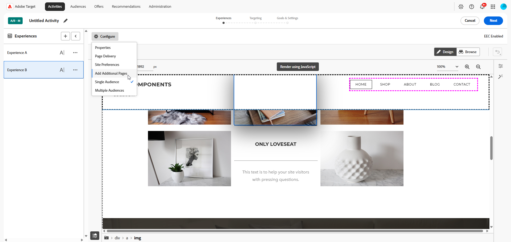

# 複数ページアクティビティ {#multipage-activity}

>[!BEGINSHADEBOX]

**このページ：**&#x200B;では、複数ページのアクティビティを使用して、各ページに固有のデザインを持つ複数ページにわたるストーリーを作成する方法を説明します。

>[!ENDSHADEBOX]

[!DNL Adobe Target]のマルチページアクティビティでは、各ページに固有のデザインを持つ、複数ページにわたるストーリーが作成されます。

たとえば、一定額を超える購入をした場合の送料無料オファーをテストすることができます。 オファーは、ランディングページ、カテゴリーページ、特定の製品ページに、サイズが異なり、各ページタイプで異なる場所に表示されます。 ホームページに目立つオファーを表示し、他の関連ページに小さなオファーを配置して強化することができます。

マルチページアクティビティは、デスクトップとレスポンシブ以外のモバイルサイトに対して異なるレイアウトを定義することもできます。 サイトに[!DNL `www.mysite.com`]ではなく[!DNL m.mysite.com]などの個別のモバイルサイトがある場合は、マルチページアクティビティを作成し、[!DNL m.mysite.com]を個別のページとして追加してから、モバイル編集を適用して、デスクトップ版とモバイル版を同じエクスペリエンスで適切に変更します。 レスポンシブモバイルサイトでは、[モバイルエクスペリエンスの編集](/help/main/c-experiences/c-visual-experience-composer/mobile-viewports.md)を使用します。

>[!NOTE]
>
>複数ページアクティビティは、同じオファーを複数のページで異なる外観で表示するアクティビティのためのものです。 すべてのページでオファーを同じ外観で表示する場合は、[テンプレートテスト](/help/main/c-experiences/c-visual-experience-composer/temtest.md#similar-pages)のほうがより効率的です。

テンプレートルールは、マルチページテストの各ページに対して指定できます。 例えば、マルチページテストでは、マルチページテストのカテゴリページにテンプレートルールを適用することで、ホームページとすべてのカテゴリページにわたってテストを実行できます。 [類似ページに同じエクスペリエンスを含める](/help/main/c-experiences/c-visual-experience-composer/temtest.md#similar-pages)を参照してください。

## ページをアクティビティに追加 {#add-pages}

アクティビティに追加されたページごとに、オファーの独自のデザインを設定できます。

1. **[!UICONTROL 設定]** アイコン（）をクリックします。

1. 「**[!UICONTROL 追加ページを追加]**」をクリックします。

   画面の左側に&#x200B;**[!UICONTROL ページ]** ペインが表示されます。

   

1. ページを指定し、デフォルトページを設定します。

   **[!UICONTROL ページを追加]** （）をクリックして追加ページを追加し、ページ名とURLを指定して、**[!UICONTROL 保存]**&#x200B;をクリックします。

1. [!UICONTROL Visual Experience Composer]を使用して、各ページでのオファーの表示方法をデザインします。
