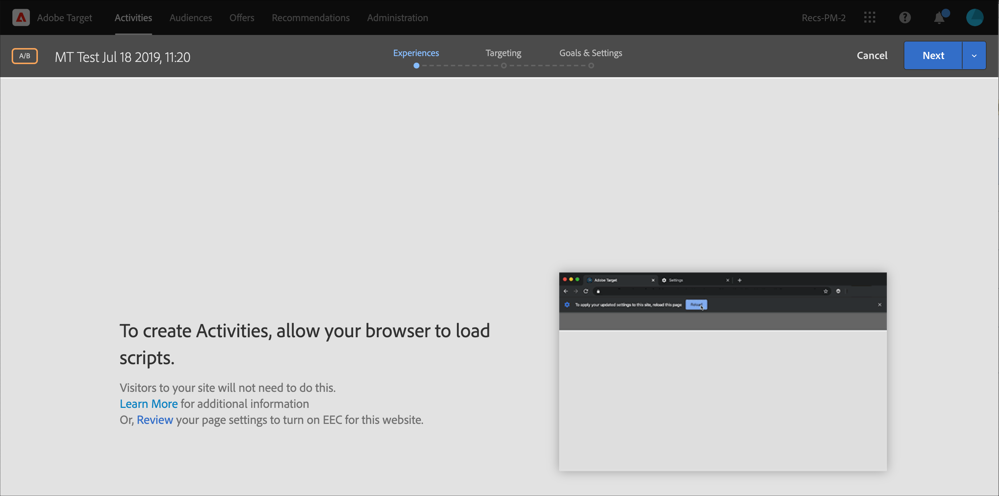

# ブラウザーでの混在コンテンツの有効化 {#mixed-content}

>[!BEGINSHADEBOX]

**このページ：**&#x200B;混在コンテンツを[!DNL Google Chrome]、[!DNL Mozilla Firefox]、[!DNL Microsoft Edge]で有効にして、**[!UICONTROL Visual Experience Composer]** （VEC）で混在コンテンツを含むHTTP サイトとサイトを開く方法を説明します。

>[!ENDSHADEBOX]

ページには、HTTPS経由で安全にリクエストされた場合に混在コンテンツが含まれますが、HTTPSとHTTP コンテンツの両方が読み込まれます。 HTTPS コンテンツは安全ですが、HTTP コンテンツは安全ではないため、最新のブラウザーでは、そのようなページをブロックしたり、警告メッセージを表示したりする可能性があります。

[!DNL Adobe Target]の&#x200B;**[!UICONTROL Visual Experience Composer]** （VEC）が混在コンテンツを含むページを開こうとすると、ブラウザーでブロッキングを無効にする指示を含む警告メッセージが表示されます。 ブロッキングを無効にすると、HTTP サイトまたは混在コンテンツ（HTTPSとHTTP）を持つサイトを開くことができます。

以前は、3段階のガイド付きワークフローの手順1の一部のアクションは、混在コンテンツが許可されていない場合でも使用できたままでした。 [!DNL Target]は、手順1のすべてのアクションをブロックするようになりました。アクティビティの作成を続行するには、混在コンテンツを有効にする必要があります。

ブラウザーのセキュリティ設定により、VECなどのセキュア（HTTPS）ページまたはフレームに読み込まれる安全でない（HTTP）コンテンツがブロックされる場合があります。 これらの設定を変更する代わりに、HTTPS web サイトを使用します。 Web サイトが安全でない（HTTP） ドメインで実行されている場合、VECはアクティブな混在コンテンツの読み込みを許可する必要があります。

>[!IMPORTANT]
>
>混在コンテンツを許可すると、VECにのみ影響し、ライブ web サイトには影響しません。

詳しくは、*Mozilla Developer Network*（MDN）の Web サイトにある[混在コンテンツ](https://developer.mozilla.org/ja/docs/Web/Security/Mixed_content)を参照してください。

## [!DNL Google Chrome]で混在コンテンツを有効にする

[!DNL Chrome]は、安全な接続を通じて要求されたページのコンテンツが安全に送信されたかどうかを確認します。 Google Chrome ヘルプの[安全でないサイトに関する警告の管理](https://support.google.com/chrome/answer/99020?hl=ja)を参照してください。

最新バージョンの[!DNL Chrome] （バージョン 79.0.3945.117以降）でVECを使用するには、次のようにサイト設定を更新します。 サイトへの訪問者は、これらの手順を完了する必要はありません。

1. ロック（注意）アイコンをクリックし、**[!UICONTROL サイト設定]**&#x200B;をクリックします。

   

1. **[!UICONTROL 安全でないコンテンツ]**&#x200B;で、ドロップダウンリストの「ブロック（デフォルト）」を「許可」に変更します。

   のChrome サイト設定

1. VEC ページをリロードします。

## [!DNL Mozilla Firefox]で混在コンテンツを有効にする

既定では、[!DNL Firefox]は安全でないコンテンツを混在させるページをブロックするので、[!DNL Target]を使用するには、この設定を完全に変更する必要があります。 サイトへの訪問者は、これらの手順を完了する必要はありません。

1. [!DNL Firefox]に、アドレスバーに`about:config`と入力します。
1. [!DNL Firefox]が表示する警告メッセージを確認します。

   

1. 検索バーに`block_active`と入力します。

   security.mixed_content.block_active_contentがtrue](/help/main/c-experiences/c-visual-experience-composer/r-troubleshoot-composer/assets/firefox3.png)に設定されているblock_activeをに設定されていることを示す![Firefox about:config

1. この設定を変更した後、コンピューターを再起動します。

## [!DNL Microsoft Edge]で混在コンテンツを有効にする

[!DNL Edge]は、安全な接続を通じて要求されたページのコンテンツが安全に送信されたかどうかを確認します。 最新バージョンの[!DNL Edge]でVECを使用するには、次のようにサイト設定を更新します。 サイトへの訪問者は、これらの手順を完了する必要はありません。

1. [!DNL Edge]で、メニューバーの&#x200B;**[!DNL Microsoft Edge]**&#x200B;をクリックし、**[!UICONTROL 設定]**&#x200B;をクリックしてから、**Cookieとサイト権限**&#x200B;をクリックします。
1. **[!UICONTROL 安全でないコンテンツ]**&#x200B;までスクロールして、クリックします。
1. **[!UICONTROL 許可]**&#x200B;の横にある&#x200B;**[!UICONTROL 追加]**&#x200B;をクリックし、安全でないコンテンツを許可するサイトを入力してから、**[!UICONTROL 追加]**&#x200B;をクリックします。
1. VEC ページをリロードします。
