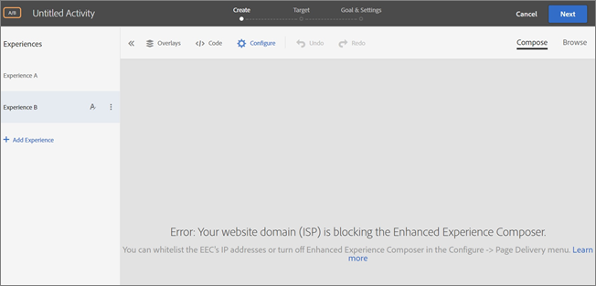

# [!UICONTROL Enhanced Experience Composer]に関する問題のトラブルシューティング {#eec-issues}

>[!BEGINSHADEBOX]

**このページ：**&#x200B;では、EEC プロキシのIP アドレスがブロックされているためページが読み込まれないなど、**[!UICONTROL Enhanced Experience Composer]** （EEC）のみに影響する問題を解決する方法について説明します。

>[!ENDSHADEBOX]

特定の条件下で、[!DNL Adobe Target] **[!UICONTROL Enhanced Experience Composer]** （EEC）で表示の問題が発生することがあります。 次の項目では、EECのみに影響する問題とその解決方法について説明します。

## EEC プロキシのIP アドレスを許可リストに加えるする {#eec-ip-addresses}

EECは、パブリック IP アドレスでアクセスできない内部QA URLを読み込みません。 EEC プロキシに使用される[!DNL Adobe] サーバーのIP アドレスを許可リストに加えるすると、この問題を解決できます。 これらのIP アドレスは、アクティビティの編集にのみ必要であり、サイトへの訪問者は許可リストに加えるする必要はありません。 IT部門に次のIP アドレスを許可リストに加えるするように依頼します。

### 米国（va7）

```
40.70.154.136/29
52.254.106.240/28
52.254.106.160/28
52.254.107.16/28
20.186.185.181
20.22.83.112
20.186.185.227
52.254.106.192/28
52.254.106.0/28
52.254.107.128/28
52.254.107.80/28
52.254.106.176/28
52.254.107.32/28
52.254.105.192/28
52.254.107.64/28
52.254.106.208/28
52.254.107.0/28
52.254.106.224/28
20.14.241.153
20.186.185.239
4.152.211.251
52.254.107.144/28
52.254.106.144/28
```

### EMEA （nld2）

```
51.138.17.16/28
51.138.17.48/28
51.138.16.128/28
51.138.17.32/28
51.138.16.240/28
51.138.17.112/28
51.138.16.160/28
51.138.16.208/28
51.138.17.80/28
51.138.17.0/28
51.138.17.96/28
51.138.16.144/28
20.31.145.248
20.126.189.248
51.138.16.224/28
51.138.16.192/28
51.138.12.94
51.138.12.11
51.138.16.176/28
51.138.12.100
51.138.17.64/28
51.138.12.160/28
```

### APAC （aus）

```
20.43.104.160/28
20.227.35.177
20.40.188.227
20.43.104.112/28
20.43.104.128/28
20.43.104.144/28
20.40.188.166
20.53.206.128
20.43.104.80/28
20.43.104.16/28
20.43.105.48/28
20.43.104.96/28
20.43.104.48/28
20.40.188.194
20.43.104.32/28
20.40.191.224/28
20.43.105.16/28
20.40.191.96/28
20.43.104.176/28
20.40.191.240/28
20.43.104.64/28
20.43.105.32/28
20.43.104.192/28
20.43.105.0/28
20.43.104.0/28
```

### レガシーIP アドレス

以下のレガシーIP アドレスは、追って通知があるまで引き続き許可リストに加えるする必要があります。

```
34.254.77.200
54.73.207.147
54.229.152.123
3.224.194.242
54.90.51.39
34.228.136.112
54.150.116.11
18.178.142.8
54.199.107.77
99.80.139.221
54.78.56.224
54.247.179.246
54.80.219.243
34.201.235.54
54.196.224.236
35.75.212.45
52.199.184.130
18.180.161.176
```

+++ EECは、Web サイト ドメインがブロックしているというエラーメッセージを表示します

次のエラーメッセージが[!DNL Target]に表示される可能性があります：

`Error: Your website domain (ISP) is blocking the Enhanced Experience Composer. You can allowlist the Enhanced Experience Composer's IP addresses or turn off Enhanced Experience Composer in Configure > Page Delivery menu.`



このエラーメッセージには、次の2つの原因があります。

* Web サイトドメイン（ISP）は、EECをブロックします。 この問題を解決するには、[に記載されているIP アドレスを許可リストに加えるします。EEC プロキシ ](#eec-ip-addresses)のIP アドレスを許可リストに加えるします。
* IP アドレスは許可リストに加えるされますが、Web サイトはTLS 1.2をサポートしていません。 この問題を解決するには、次の項目を参照してください。

+++

+++ EECは、TLS 1.0を使用するサイトの安全なページで読み込まれません

前述のエラーメッセージは、IP アドレスが許可リストに加えるされた場合に表示される場合がありますが、Web サイトはTLS 1.2をサポートしていません。 [!DNL Target]は現在、バージョン 1.2を既定の設定として使用しています。 [!DNL Target] 18.4.1 （2018年4月25日）より前のデフォルト設定では、TLS 1.0がサポートされていました。 詳しくは、[TLS（トランスポートレイヤーセキュリティ）暗号化の変更](https://experienceleague.adobe.com/docs/target-dev/developer/implementation/tls-transport-layer-security-encryption.html?lang=ja){target=_blank}を参照してください。

FirefoxでウェブサイトのTLS バージョンを確認するには（他のブラウザーでも同様の手順があります）:

1. Firefox で対象の Web サイトを開きます。
1. ブラウザーのアドレスバーにある「**[!UICONTROL サイト情報を表示]**」アイコンをクリックします。

   

1. **[!UICONTROL 接続の詳細を表示]**／**[!UICONTROL 詳細を表示]**&#x200B;をクリックします。

   の横に「接続の詳細を表示」矢印が強調表示されたFirefox サイト情報パネル

1. **[!UICONTROL 技術情報]**&#x200B;の下にあるTLS バージョン情報を確認します。

   

1. Web サイトにTLS 1.0が表示されている場合は、[!DNL Target]のTLS サポートポリシーについて詳しくは、[TLS （Transport Layer Security）暗号化変更](https://experienceleague.adobe.com/docs/target-dev/developer/implementation/tls-transport-layer-security-encryption.html?lang=ja){target=_blank}を参照してください。 この問題を解決するには（2018年9月12日まで有効）、TLS バージョンとドメインを使用した設定については、[ カスタマーケア ](/help/main/cmp-resources-and-contact-information.md#reference_ACA3391A00EF467B87930A450050077C)にお問い合わせください。

+++

+++ プロキシを有効にしてサイトを読み込むと、タイムアウトまたは「アクセス拒否」エラーが表示される

プロキシ IP アドレスが環境内でブロックされていないことを確認します。 アドレスは、[EEC プロキシ ](#eec-ip-addresses)のIP アドレスを許可リストに加えるするに記載されています。

+++
