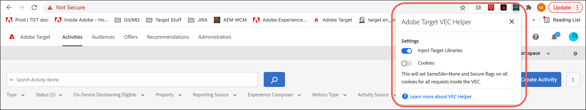
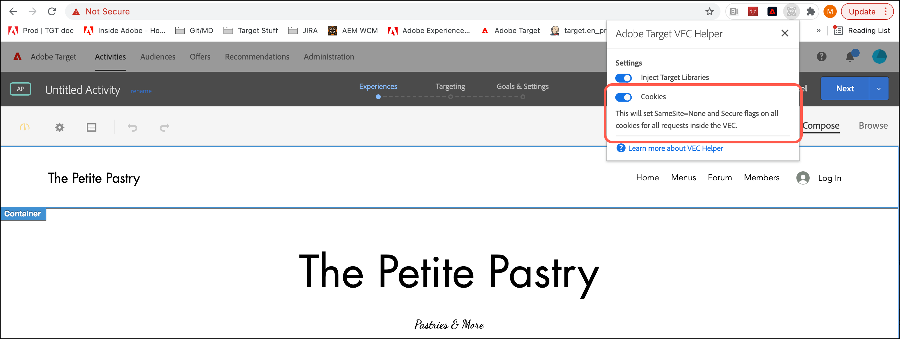

# [!UICONTROL Visual Experience Composer] ヘルパー拡張機能 {#vec-helper-extension}

>[!BEGINSHADEBOX]

**このページで：**&#x200B;従来のVEC Helper ブラウザー拡張機能が&#x200B;**[!UICONTROL Visual Experience Composer]** （VEC）にWeb サイトをどのように読み込むか、またそれをインストールして使用する方法について説明します。

>[!ENDSHADEBOX]

[!DNL Google Chrome]の[!DNL Adobe Target] **[!UICONTROL Visual Experience Composer]** （VEC） Helper ブラウザー拡張機能は、VECでWeb サイトを確実に読み込むため、Web エクスペリエンスの作成とチェックをより迅速に行うことができます。 [!DNL Mozilla Firefox]では拡張機能は必要ありません。

>[!IMPORTANT]
>
>* この記事に記載されている従来の[!DNL Target] VEC Helper拡張機能は、Manifest V2で作成されました。 [!DNL Google]は、2024年6月からManifest V2で作成された拡張機能の許可を停止すると発表しました。 詳しくは、*Chrome for Developers* サイトの[!DNL Google]の[Manifest V2 サポートタイムラインのお知らせ](https://developer.chrome.com/docs/extensions/develop/migrate/mv2-deprecation-timeline){target=_blank}を参照してください。
>
>* 2024年6月以降、[!DNL Google]は、この記事で説明されている拡張機能を含め、Manifest V2で作成された拡張機能を無効にします。 [!DNL Adobe]さんは、可能な限り早く新しい[Visual Editing Helper拡張機能](/help/main/c-experiences/c-visual-experience-composer/r-troubleshoot-composer/visual-editing-helper-extension.md)に移行することをお勧めします。

## VECで一部のWeb サイトが確実に開かない理由

次の理由により、WEB サイトがVECで確実に開かない場合があります。

* Web サイトには厳格なセキュリティポリシーがあります。
* Web サイトで iframe が使用されています。
* Web サイトに at.js ライブラリがまだ実装されていません。
* お客様のQAまたはステージングサイトは内部サイトであり、ネットワーク外では利用できません。
* このWeb サイトでは、[Service Workers](https://developer.mozilla.org/ja-JP/docs/Web/API/Service_Worker_API){target=_blank} （SW）が使用されていますが、VECは現在サポートしています。これには制限があります。 次の節を参照してください。
* Web サイトは[!DNL Chrome] 80以降で開かれており、SameSite クッキーポリシーが適用されます。 詳しくは、[Google Chrome SameSite cookie policies](/help/main/c-experiences/c-visual-experience-composer/r-troubleshoot-composer/issues-related-to-the-visual-experience-composer-vec-and-enhanced-experience-composer-eec.md#samesite)を参照してください。

[!DNL Chrome]のVEC Helper ブラウザー拡張機能は、顧客が[!DNL Target] [Enhanced Experience Composer](/help/main/administrating-target/visual-experience-composer-set-up.md#eec)またはRequestlyなどのサードパーティ拡張機能に依存しているサイト読み込みの問題を解決します。

### サービスワーカー

サービスワーカー（SW）とは、web ページがそのドメインに対する要求をインターセプトするためにインストールするweb テクノロジーです。 SW はページの訪問中は存続し、以降の訪問時にはアクティブになります。 どのリクエストを経由するか、どのリクエストを傍受してキャッシュから提供するかを決定します。

SWは、web ページ自体、JS、CSS、IMG、AJAX リクエストなどの静的リソース、その内容、および応答ヘッダーをキャッシュできます。 これらのヘッダーには、[Target VEC Helper拡張機能](/help/main/c-experiences/c-visual-experience-composer/r-troubleshoot-composer/vec-helper-browser-extension.md)が削除しようとしているものが含まれます（`X-Frame-Options: SAMEORIGIN`、CSP （`Content-Security-Policy`）、および`Set-Cookie`）。

Web リクエストをインターセプトする[!DNL Chrome]拡張機能APIは、SWがインターセプトして処理したリクエストを受信しません。 したがって、SWがキャッシュからweb ページ リクエストを送信する場合、拡張機能はヘッダーとCookieを修正できず、キャッシュされた`X-Frame-Options`またはCSP ヘッダーが原因でページがVEC内で読み込まれません。

回避策として、[!DNL Chrome]開発者ツール > **アプリケーション** タブでService Workerを無効にし、Service Worker セクションの「ネットワークをバイパス」チェックボックスを有効にします。

## VEC Helper拡張機能の利点

* **Iframe-busting ヘッダーが削除されました：**&#x200B;拡張機能は`X-Frame-Options`や`Content-Security-Policy`などのヘッダーをWeb サイトから暗黙的に削除するため、複雑なRequestly ルールは必要ありません。
* **at.js インジェクション：** web ページに[!DNL Target] at.js JavaScript ライブラリがまだ含まれていない場合、拡張機能はそれを挿入できます。 web サイト向けにエクスペリエンスを作成し、プレビューリンクを使用してアクティビティを作成および確認できます。 拡張Experience Composer （EEC）では、拡張機能はat.jsを挿入しませんが、SameSite Cookie機能は残ります。 Web ページにat.jsを挿入するには、EECをオフにします。
* **モバイルビューポート：** [&#x200B; モバイルビューポート &#x200B;](/help/main/c-experiences/c-visual-experience-composer/mobile-viewports.md)は、**[!UICONTROL Enhanced Experience Composer]** （EEC）がなくてもサポートされます。
* **新しい[!DNL Target]のお客様：**&#x200B;この拡張機能を使用すると、IT開発者がweb サイトに[!DNL Target]を実装していない場合でも、[!DNL Target]を試すことができます。
* **パートナー：**&#x200B;複数の顧客のweb サイトと[!DNL Target] アカウントにサービスを提供するパートナーには、サードパーティツールの複数のルールの代わりに、VECの読み込みをサポートする1つのメカニズムが用意されています。

## VEC ヘルパーブラウザー拡張の取得とインストール

[!DNL Chrome]に拡張機能をインストールすると、iframeをブロックするweb サイトや、at.jsがまだ実装されていないweb サイトなど、VECでWeb サイトを確実に読み込むことができます。

1. Chrome Web ストアの[Adobe Target VEC Helper ブラウザー拡張機能](https://chromewebstore.google.com/detail/adobe-experience-cloud-vi/kgmjjkfjacffaebgpkpcllakjifppnca)に移動します。
1. **[!UICONTROL Chromeに追加]** > **[!UICONTROL 拡張機能を追加]**&#x200B;をクリックします。
1. [!DNL Target] で VEC を開きます。
1. VECまたは[QA モード &#x200B;](/help/main/c-activities/c-activity-qa/activity-qa.md)で、[!DNL Chrome]のツールバーにあるVEC ヘルパーブラウザー拡張機能アイコン（）をクリックします。
1. （条件付き） web ページに[!DNL Target] at.js JavaScript ライブラリがまだ含まれていない場合は、**[!UICONTROL ターゲットライブラリの取り込み]** トグルをオンに切り替えます。

   次の図は、**[!UICONTROL ターゲットライブラリの挿入]**&#x200B;設定が有効になっているVEC ヘルパーを示しています。

   「ターゲットライブラリを挿入」トグルと「Cookie」トグルがオンになっている内のリクエストに対するすべてのCookieに対して、Cookie設定がSameSite=NoneとSecure フラグを設定していることを示します

   次に、VEC ヘルパーは、オーサリングを有効にするために、ページに[!DNL Target] ライブラリを挿入するかどうかを尋ねます。

   

1. （条件付き） **[!UICONTROL Cookie]** トグルを切り替えて、`SameSite=None`属性ブラウザーの修正を自動的に追加します。

   サンプルページを表示するVisual Experience Composer上で、Cookie切り替えスイッチをオンにしてハイライト表示した

   `SameSite=None`属性ブラウザーの修正について詳しくは、[Google Chrome SameSite Cookie ポリシー](/help/main/c-experiences/c-visual-experience-composer/r-troubleshoot-composer/issues-related-to-the-visual-experience-composer-vec-and-enhanced-experience-composer-eec.md#samesite)を参照してください。

## 使用状況メモ

* 拡張機能の&#x200B;**[!UICONTROL ターゲットライブラリの挿入]** フラグは、デフォルトでオフになっています。 オンにすると、[!DNL Target]がまだ実装されていないサイトでVECを使用できます。

  フラグはグローバル設定なので、VECで開かれたすべてのWeb サイトに対して有効または無効になります。 例えば、フラグがオンの場合、at.jsが既に実装されているweb サイトを開くと、at.jsが既に読み込まれているというメッセージが表示されます。 [!DNL Adobe]では、ほとんどの顧客が既にat.jsをページに実装しており、デフォルト設定のoffを使用していることを想定しています。

* 拡張機能は、**[!UICONTROL 管理]** > **[!UICONTROL 実装]**&#x200B;の下の[!DNL Target] UIで利用できる最新バージョンのat.jsを読み込みます。
* 拡張機能を使用して[QA Mode](/help/main/c-activities/c-activity-qa/activity-qa.md)でat.jsを挿入するには、別のChrome タブを開く必要があります。 このタブは、アクティビティが作成されたのと同じ[!DNL Adobe Experience Cloud]組織に対して認証する必要があります。
* VECは、次の場合にメッセージを表示します。

  * VECでweb サイトの読み込みに失敗する。 このメッセージは、VEC Helper ブラウザー拡張機能のインストールを提案します。
  * at.jsはまだweb サイトに実装されていません。 このメッセージは、拡張機能のインストールを提案します。
  * 拡張機能が有効になり、読み込みを強化します。 必要に応じて、拡張機能がat.js ライブラリを挿入するか、VECで確実にweb サイトを開くのに役立つ場合に、メッセージが表示されます。
