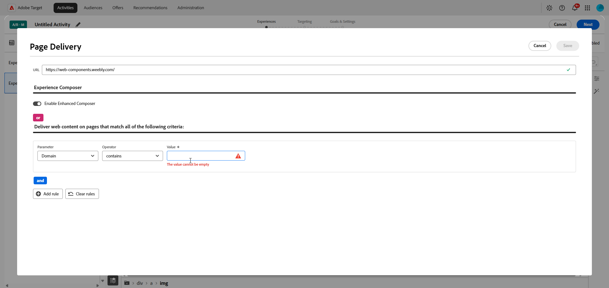

# 類似のページに同じエクスペリエンスを組み込む {#similar-pages}

>[!BEGINSHADEBOX]

**このページ：** [!UICONTROL Visual Experience Composer] （VEC）でページ配信ルールを使用して、同じ構造のページに同じエクスペリエンスを含める方法を説明します。

>[!ENDSHADEBOX]

[!DNL Adobe Target]のページテンプレートは、ページに構造を提供します。 ページに類似の要素が含まれている場合、それらの類似の構造化ページ要素のバリエーションを、複数のページまたはドメイン全体でテストできます。

この機能を正しく機能させるには、構造が類似しているページや、すべてのページで同じ構造のテンプレート要素が含まれているページで使用する必要があります。

>[!IMPORTANT]
>
>この機能を使用して、異なるページ間で要素を変更すると、予期しない結果が発生する可能性があります。

この機能は、例えば、次のいずれかを行うために使用できます。

* 要素を並べ替えたり、削除したりして、グローバルナビゲーションバーをテストします。
* 特定のページテンプレートを使用するすべての製品ページから、アイテムを削除します。
* すべての製品ページにバナーを追加します。
* 記事テンプレートのレイアウトの変更

## エクスペリエンスのページの指定 {#specify-pages}

エクスペリエンスが表示されるページは、ページ配信ルールで指定します。 ルールには、特定のページを含めたり、サイトやドメイン全体に変更を適用したりすることができます。

1. 「[&#x200B; アクティビティ &#x200B;](/help/main/c-activities/activities.md)」の説明に従って、アクティビティを作成または編集します。

1. [!UICONTROL Visual Experience Composer] （VEC）で、**[!UICONTROL 設定]** アイコン（）をクリックし、**[!UICONTROL ページ配信]**&#x200B;を選択します。

   

1. 「**[!UICONTROL ルールを追加]**」をクリックし、エクスペリエンスを追加するページの条件を指定します。

1. ページ範囲を指定します：**[!UICONTROL URL]**、**[!UICONTROL ドメイン]**、**[!UICONTROL パス]**、**[!UICONTROL ハッシュ （#） フラグメント]** （#記号に続くURLの一部）、**[!UICONTROL クエリ]**、または&#x200B;**[!UICONTROL カスタム]**。

   [!DNL Target]がURLを評価する方法について詳しくは、[&#x200B; ターゲットとオーディエンスに関するFAQ](/help/main/c-target/c-troubleshooting-targets-and-audiences/troubleshooting-targets-and-audiences.md)を参照してください。

   

1. 演算子を選択します。 演算子は、演算子の後ろに指定された項目がどのようにページ範囲を規定するかを指定するものです。

1. ドメインや、ページ名に含まれる文字列など、エクスペリエンスを追加する場所を定義する文字列を入力します。

   例えば、**[!UICONTROL Domain]**&#x200B;と&#x200B;**[!UICONTROL Is （大文字と小文字を区別）]**&#x200B;を選択した場合、エクスペリエンスがすべてのページに追加されるドメインを入力します。

   複数の項目を含めることができます。 複数の項目はOR ロジックを使用します。つまり、リスト内の単一の項目が条件をtrueにします。

1. （オプション）「**[!UICONTROL ルールを追加]**」をクリックし、手順3 ～ 6を繰り返して追加の条件を入力します。

   複数の条件は AND のロジックで連結されます。 [!DNL Target]は、指定された条件に一致するすべてのページにエクスペリエンスを追加します。

>[!IMPORTANT]
>
>[!DNL Target]はページを確認して、期待どおりに表示できるかどうかを確認できません。そのため、この機能を使用して影響を受けるページを公開する前にテストする場合は、常に重要な手順です。

## ユースケース {#use-cases}

テンプレートルールは、次のユースケースに示すように、サイトでさまざまな方法で使用できます。

### ドメイン全体で同じアクティビティをレンダリングします {#entire-domain}

テンプレートルールは、ドメイン全体で同じアクティビティをレンダリングできます。次に例を示します。

* グローバルヘッダーまたはフッターを含めるには
* グローバルバナー（COVID-19の発表など）を含めるには
* グローバルな送料無料プロモーションを含めるには

1. 「[&#x200B; アクティビティ &#x200B;](/help/main/c-activities/activities.md)」の説明に従って、アクティビティを作成または編集します。

1. エクスペリエンスが表示されるドメインを指定するには、[!UICONTROL Visual Experience Composer]で「**[!UICONTROL 設定]**」アイコン（）をクリックし、**[!UICONTROL ページ配信]**」を選択します。

1. **[!UICONTROL ルールを追加]** > **[!UICONTROL ドメイン]**&#x200B;をクリックします。

1. **[!UICONTROL 評価者を選択]** ドロップダウンから、**[!UICONTROL 含む]**&#x200B;を選択し、ドメインを指定します。

   
