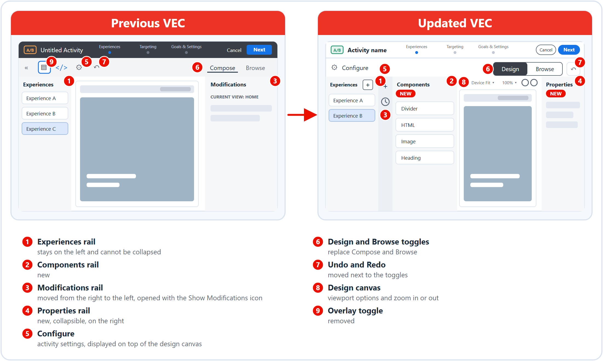

# [!UICONTROL Visual Experience Composer]の変更 {#vec-changes}

>[!BEGINSHADEBOX]

**このページ：**&#x200B;では、[!DNL Adobe Target Standard/Premium] 25.2.1 リリースで導入された更新された[!UICONTROL Visual Experience Composer] （VEC）が以前のバージョンとどのように異なるかを説明します。

>[!ENDSHADEBOX]

[!DNL Adobe Target Standard/Premium] 25.2.1 リリース（2025年2月17日（PT））では、更新された[!UICONTROL Visual Experience Composer] （VEC）が導入されています。 この記事では、VECの以前のバージョンと更新されたバージョンの違いについて説明します。

>[!IMPORTANT]
>
>更新された[!UICONTROL Visual Experience Composer]には、[!DNL Chrome Web Store]で利用できる[!DNL Adobe Experience Cloud] [**[!UICONTROL Visual Editing Helper ]**拡張機能](/help/main/c-experiences/c-visual-experience-composer/r-troubleshoot-composer/visual-editing-helper-extension.md)が必要です。

VECは、アクティビティの作成時または既存のアクティビティの編集時に表示されます。

## VECの主な変更点

以下の節では、更新されたVECの主な変更点を以前のバージョンと比較して説明します。

### [!UICONTROL  エクスペリエンス ] パネル

以前のバージョンと同様に、**[!UICONTROL エクスペリエンス]** パネルはVECの左側に残ります。 **[!UICONTROL エクスペリエンス]** レールを折りたたむことはできません。

エクスペリエンスは、**[!UICONTROL エクスペリエンス]** パネルを使用して作成、名前変更、または削除されます。

**[!UICONTROL 追加]** アイコン （）をクリックして、新しいエクスペリエンスを追加します。 **[!UICONTROL 詳細アクション]** アイコン （）をクリックして、エクスペリエンスを複製、削除、またはリダイレクトします。

### [!UICONTROL  コンポーネント ] パネル （新規）

新しい&#x200B;**[!UICONTROL コンポーネント]** パネルは、web ページに多数のコンポーネントを追加し、必要に応じて編集できます。

新しいコンポーネントを追加するには、**[!UICONTROL コンポーネント]** パネルから目的のコンポーネントを選択し、ページ内の既存の要素にカーソルを合わせ、選択した要素の前後にコンポーネントを挿入します。

**[!UICONTROL コンポーネント]** パネルではなく、**[!UICONTROL 変更]** パネルがこの領域に表示される場合は、「**[!UICONTROL コンポーネントを表示]**」アイコン（）をクリックします。 **[!UICONTROL コンポーネントを表示]** アイコン （）と&#x200B;**[!UICONTROL 変更を表示]** アイコン （）は、適切なオプションを表示するトグルとして機能します。

**[!UICONTROL コンポーネント]** パネルを折りたたみ、**[!UICONTROL コンポーネント]** パネルが開いている間に&#x200B;**[!UICONTROL デザイン]** キャンバスを拡大するには、（）アイコンをクリックします。

### [!UICONTROL 変更] パネル

**[!UICONTROL 変更]** レールを開くには、**[!UICONTROL コンポーネント]** レールの&#x200B;**[!UICONTROL 変更を表示]** アイコン （）をクリックします。 **[!UICONTROL 変更]** パネルが、編集キャンバスの右側から左側に位置を変更しました。

>[!NOTE]
>
>**[!UICONTROL 変更]** レールを折りたたみ、**[!UICONTROL 変更]** レールが開いている間に&#x200B;**[!UICONTROL デザイン]** キャンバスを拡大するには、**[!UICONTROL 変更を表示]** アイコン （）をクリックします。

**[!UICONTROL 変更]** パネルには、VECのページに加えられたすべての変更が表示され、追加の変更（CSS セレクター、Mbox、カスタムコードなど）が可能になります。

**[!UICONTROL 詳細オプション]** アイコン （）をクリックして、変更を追加するか、すべての変更を削除するか、無効なすべての変更を削除します。 「**[!UICONTROL 選択]**」をクリックして一括操作を実行します：**[!UICONTROL すべてのページに適用]**&#x200B;または&#x200B;**[!UICONTROL 削除]**。

**[!UICONTROL 変更]** レールを再度表示するには、**[!UICONTROL 変更]** レールの&#x200B;**[!UICONTROL 変更を非表示]** アイコン （）をクリックします。

### [!UICONTROL  プロパティ ] パネル （新規）

**[!UICONTROL プロパティ]** レールは、選択した要素がHTMLの要素であるか、レコメンデーションやオファーなど[!DNL Target]に固有のオブジェクトであるかを問わず、ページ上の選択した要素のプロパティを変更します。

パネルの上部にあるアイコンをクリックして、HTML コードを編集したり、エレメントを削除、複製、非表示にしたりできます。 変更が&#x200B;**[!UICONTROL 変更]** パネルに表示されます。

**[!UICONTROL プロパティ]** レールは、右側のレールで折りたたむことができます。 パネルの右側にある&#x200B;**[!UICONTROL プロパティ]** アイコン（）をクリックして、**[!UICONTROL プロパティ]** パネルを折りたたんだり表示したりします。

### アクティビティ設定/設定

デザインキャンバスの上に表示されている&#x200B;**[!UICONTROL 設定]** アイコン（）をクリックして、アクティビティプロパティメニューを表示します。

プロパティの割り当て、ページ配信ルールの編集、サイトの環境設定の指定、追加ページの追加、複数ページまたは複数のオーディエンスアクティビティの有効化または無効化など、様々なオプションがあります。 割り当て&#x200B;**[!UICONTROL プロパティ]**&#x200B;は[[!DNL Target Premium]](/help/main/c-intro/intro.md#premium)機能です。

位置と機能は、以前のVEC UIと似ています。

### [!UICONTROL  デザイン ]/[!UICONTROL 参照] モード

**[!UICONTROL プロパティ]** パネルの上に表示される&#x200B;**[!UICONTROL デザイン]**/**[!UICONTROL 参照]**&#x200B;の切り替えスイッチを使用して、デザイン モードと参照モードを切り替えます。

**[!UICONTROL 参照]** モードを使用して、サイトを移動し、更新するビューまたはページを選択します。 変更を追加または編集するには、**[!UICONTROL デザイン]** モードに切り替えます。

### [!UICONTROL 取り消し]/[!UICONTROL やり直し]

変更は、**[!UICONTROL 取り消し]** アイコン （）をクリックして取り消すことができます。

VEC](/help/main/c-experiences/c-visual-experience-composer/assets/undo.png)の![取り消しアイコン

アクションをやり直すには、**[!UICONTROL 取り消し]**/**[!UICONTROL やり直し]** ボタングループを展開し、**[!UICONTROL やり直し]**&#x200B;を選択します。

### [!UICONTROL  デザイン ] キャンバス

**[!UICONTROL デザイン]** キャンバスでは、画面サイズに合わせたビューポート、**[!UICONTROL デスクトップ]**、**[!UICONTROL タブレット]**、**[!UICONTROL モバイルランドスケープ]**、**[!UICONTROL モバイルポートレート]**&#x200B;などのビューポートを選択できます。

更新されたVECでは、適切なアイコン（または）をクリックしてズームインまたはズームアウトすることもできます。

## UIの変更を示すビジュアルイラスト

次の図は、更新されたVECに対して行われた高レベル UIの変更を示しています。 図の左側には前のVEC UIが表示され、右側には更新されたUIが表示されます。 一致する数値は、さまざまな要素が移動または変更された場所を示します。

{width="800" zoomable="yes"}

## 更新された UI に関する詳細情報

* [[!DNL Target Standard/Premium]  25.2.1（2025年2月17日（PT））リリースノート](/help/main/r-release-notes/release-notes-for-previous-releases.md#ui-update-2)：[!DNL Target] の&#x200B;**[!UICONTROL アクティビティ]**、**[!UICONTROL レコメンデーション]**、[!UICONTROL Visual Experience Composer]（VEC）に関する主な UI の変更の概要について説明します。

* [[!DNL Target Standard/Premium]  25.1.1（2025年1月9日（PT））リリースノート](/help/main/r-release-notes/release-notes-for-previous-releases.md#ui-update-1)：[!DNL Target] の&#x200B;**[!UICONTROL オファーライブラリ]** に関する主な UI の変更の概要について説明します。

* [ [!DNL Target] UI](/help/main/c-intro/understand-the-target-ui.md)について：[!DNL Target]の概要を簡単に説明します。詳細な情報と手順ごとの説明については、リンクを参照してください。

* [[!UICONTROL Visual Experience Composer] オプション ](/help/main/c-experiences/c-visual-experience-composer/viztarget-options.md)：更新されたVEC UIとそのオプションについて説明します。

* [[!DNL Target] UIの更新に関するFAQ](/help/main/c-intro/updated-ui-faq.md): ナビゲーションの変更、機能の場所、一時的なUI バージョンの廃止トグルなど、新しい[!DNL Target] UIと[!UICONTROL Visual Experience Composer] （VEC）に関するよくある質問に対応します。
