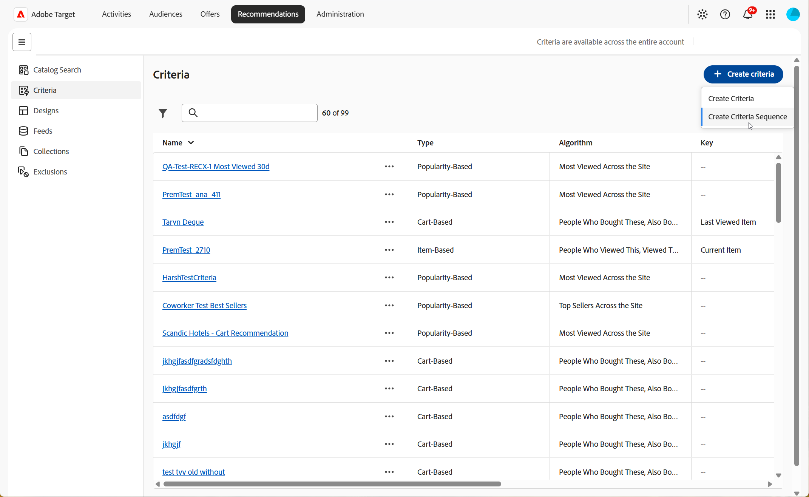

# 条件のシーケンスの作成 {#create-criteria-sequence}

>[!BEGINSHADEBOX]

**このページで：**&#x200B;条件シーケンスを作成して、[!DNL Adobe Target Recommendations] アクティビティに表示される項目を制御する方法を説明します。

>[!ENDSHADEBOX]

最大5つの条件のシーケンスを使用すると、[!DNL Adobe Target] **[!UICONTROL Recommendations]** アクティビティに表示される項目をより詳細に制御できます。 返されるアイテムの数を制限することもできます（「スロットレベル制御」と呼ばれることもあります）。

基準がデザインを満たすのに十分な結果を返さない場合、基準シーケンスは、より一般的なバックアップの推奨事項の代わりに、追加のターゲットを絞った推奨事項を提供します。 通常、基準シーケンスは、より具体的なターゲティング（結果が少ない場合がある）から、より一般的なターゲティング（通常はより多くの結果が返される）に移行します。

>[!NOTE]
>
>条件シーケンスは、[!DNL Target Premium]の2016年10月リリースより前に作成された&#x200B;**[!UICONTROL Recommendations]** アクティビティでは使用できません。

基準シーケンスを作成するには、まずシーケンスに含める基準を作成します。 詳しくは、[条件の作成](/help/main/c-recommendations/c-algorithms/create-new-algorithm.md)を参照してください。

条件シーケンスの順序は、次の例に示すように、ページタイプによって異なる場合があります。

| ページタイプ | 可能なシーケンス順序 |
| --- | --- |
| 製品ページ | <ol><li>現在のアイテムに基づいて、同じブランドから</li><li>現在の品目に基づいて、すべてのブランドから</li><li>コンテンツの類似性に基づいて</li><li>トップセラーに基づいて</li><li>サイト全体で最もよく閲覧された品目に基づいて</li></ol> |
| ホームページ | <ol><li>訪問者の最後の購入に基づいて </li><li>訪問者のお気に入りの品目に基づいて</li><li>訪問者のお気に入りのカテゴリーに基づいて</li><li>トップセラーに基づいて</li><li>サイト全体で最もよく閲覧された品目に基づいて</li></ol> |

## 基準シーケンスの作成

条件シーケンスは、**[!UICONTROL 条件シーケンスを作成]**&#x200B;画面から作成されます。 この画面に到達する方法はいくつかあります。 一部の画面オプションは、画面の到達方法によって異なります。

* **[!UICONTROL レコメンデーション]**／**[!UICONTROL 条件]**&#x200B;ライブラリ画面で、**[!UICONTROL 条件を作成]**／**[!UICONTROL 条件のシーケンスを作成]**&#x200B;をクリックします。 ここで作成された条件は、すべての&#x200B;**[!UICONTROL Recommendations]** アクティビティで自動的に利用できるようになります。
* **[!UICONTROL Recommendations]** アクティビティを作成する際、**[!UICONTROL 条件を選択]**&#x200B;画面で、**[!UICONTROL 新規作成]** > **[!UICONTROL 条件シーケンスを作成]**&#x200B;をクリックします。 新しい条件シーケンスは、他の&#x200B;**[!UICONTROL Recommendations]** アクティビティで使用するために保存できます。
* **[!UICONTROL Recommendations]** アクティビティを編集する際に、ページの&#x200B;**[!UICONTROL Recommendations Location]** ボックスをクリックし、**[!UICONTROL 条件の変更]**&#x200B;を選択します。 **[!UICONTROL 条件を選択]**&#x200B;画面で、**[!UICONTROL 新規作成]**／**[!UICONTROL 条件のシーケンスを作成]**&#x200B;をクリックします。 新しい条件は、他の&#x200B;**[!UICONTROL Recommendations]** アクティビティで使用するために保存できます。

次の手順では、**[!UICONTROL 条件]** メニューから&#x200B;**[!UICONTROL 条件シーケンスを作成]**&#x200B;画面にアクセスすることを前提としています。

1. **[!UICONTROL Recommendations]** > **[!UICONTROL Criteria]**&#x200B;をクリックします。

1. **[!UICONTROL 条件を作成]** > **[!UICONTROL 条件シーケンスを作成]**&#x200B;をクリックします。

   

1. 「[基本情報](/help/main/c-recommendations/c-algorithms/create-new-algorithm.md#info)」セクションに情報を入力します。

1. **[!UICONTROL 条件シーケンス]** セクションで、プラス（+）記号をクリックして、1つ以上の条件シーケンスを追加します。

   シーケンス順序は、デザインが入力される順序を定義します。 条件1にデザインを埋めるために十分な推奨事項がない場合は、残りのスロットに条件2などが埋められます。

   5つの条件フィールドと条件1のプラス記号が選択された条件シーケンスを作成ダイアログボックスの

1. **[!UICONTROL 条件を選択]**&#x200B;画面で、条件を選択し、**[!UICONTROL 保存]**&#x200B;をクリックします。

   **[!UICONTROL 検索]** ボックスとフィルターオプションを使用して、目的の条件を見つけることができます。

1. （オプション）「**[!UICONTROL 返されるアイテムの数を制限]**」を有効にし、アイテムの数を指定します（1 ～ 50の範囲）。

   

   次の使用例は、**[!UICONTROL 返されるアイテムの数を制限]** オプション（「スロットレベル制御」とも呼ばれます）の値を示しています。

   +++ 返されるアイテム数を制限するユースケース

   * **ユースケース 1**:1つのレコメンデーショントレイに様々な種類のアイテムを混在させたアイテム。例えば、上着（ジャケット）と上着（シャツ、T シャツ）を混在させたものです。 これを実現するには、デザインの任意のスロットに表示できるすべての製品タイプを含むアクティビティのコレクションを使用します。 次に、アウターウェアのみを含む静的フィルターを使用して最初の条件を設定し、トップスのみを含む静的フィルターを使用して2番目の条件を設定します。 最後に、両方の条件を条件シーケンスに追加し、最初の条件を2つのスロットに制限します。

     サイトのレコメンデーショントレイは次のようになります。

     

   * **ユースケース 2**：代替項目と補完項目の両方の組み合わせ。 表示/表示アルゴリズムと、推奨される項目を現在の項目のカテゴリに制限する動的フィルターを使用するための1つの条件を設定します。 2つ目の条件を設定して、閲覧済み/購入済みアルゴリズムと、現在のアイテムのカテゴリに一致しない推奨アイテムのみを含むダイナミックフィルターを使用します。 最後に、両方の条件をシーケンスに追加し、最初の条件を2つのスロットに制限します。

   +++

1. 引き続き、シーケンスに条件を追加します。 シーケンスには最大5つの条件を追加できます。

1. [ コンテンツのバックアップ オプション ](/help/main/c-recommendations/c-algorithms/create-new-algorithm.md#content)を有効にします。

1. 「**[!UICONTROL 作成]**」をクリックします。

条件シーケンスが&#x200B;**[!UICONTROL 条件]** リストに表示されます。

レコメンデーションロジックのオプションについて詳しくは、[条件の基本を学ぶ](/help/main/c-recommendations/c-algorithms/algorithms.md)を参照してください。
