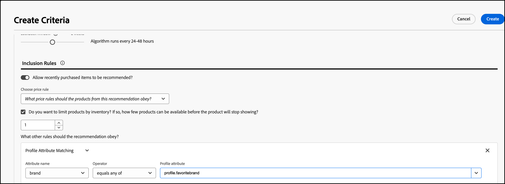
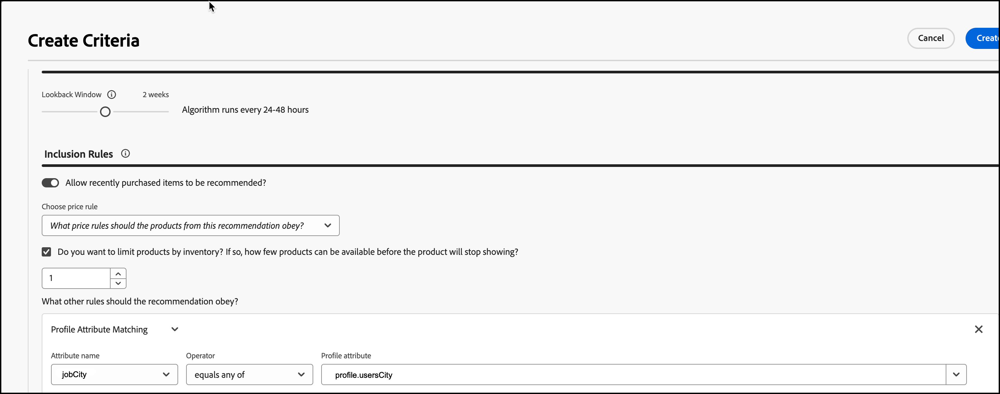

# プロファイル属性のマッチング {#profile-attribute-matching}

>[!BEGINSHADEBOX]

**このページ：**&#x200B;では、項目（エンティティ）を訪問者のプロファイルの値と比較して、[!DNL Adobe Target Recommendations]で推奨事項を動的にフィルタリングする方法を説明します。

>[!ENDSHADEBOX]

**[!UICONTROL プロファイル属性一致]**&#x200B;を使用して、サイズやお気に入りのブランドなど、訪問者のプロファイルに保存されている値に一致する推奨事項を表示します。 条件とプロモーションでは、インクルージョンルールを作成、使用する方法は類似しています。使用例やサンプルも同様です。 詳しくは、[動的および静的インクルージョンルールの使用](/help/main/c-recommendations/c-algorithms/use-dynamic-and-static-inclusion-rules.md)を参照してください。

次のシナリオは、**[!UICONTROL プロファイル属性の一致]**&#x200B;を使用する方法を示しています。

* 眼鏡を販売する会社は、訪問者の好みのフレームの色を「クルミ」として保存します。 この訪問者に対しては、レコメンデーションが設定され、色が「クルミ」に一致する眼鏡フレームのみが返されます。
* プロファイルパラメーターは、訪問者が会社のweb サイトを移動する際の訪問者の服のサイズ（小、Medium、大など）に対して定義できます。 レコメンデーションは、プロファイルパラメーターに一致するように設定でき、訪問者の好みの服のサイズの商品のみを返します。

## プロファイル属性の一致の例

**[!UICONTROL プロファイル属性の一致]**&#x200B;は、次の例のように、訪問者のプロファイルの属性に一致する項目のみを推奨します。

### 利用者が好むブランドの商品を勧める

**[!UICONTROL プロファイル属性一致]** オプションを使用すると、ブランドが`profile.favoritebrand`に保存されている値またはテキストと等しい場合にのみアイテムを推奨するルールを作成できます。 このようなルールでは、訪問者が特定のブランドのランニングショーツを見ている場合、その訪問者のお気に入りのブランドに一致するレコメンデーション（訪問者のプロファイルに`profile.favoritebrand`に保存されている値）のみが表示されます。



```
Profile Attribute Matching
brand - equals - the value/text stored in - profile.favoritebrand
```

### 求職者と求人のマッチング

求職者に求人を一致させるには、求職者と同じ都市にある求人のみが推奨されます。 インクルージョンルールは、次の例のように、訪問者のプロファイルからジョブリストへのジョブシーカーの場所を一致させることができます。



```
Profile Attribute Matching
jobCity - equals - the value/text stored in - profile.usersCity
```

### サイズに応じた商品のレコメンデーション

次の例は、プロファイル属性のマッチングが、電動ファンを販売するweb サイトのレコメンデーションにどのような影響を与えるかを示しています。

訪問者がこのweb サイト上のファンの様々な画像をクリックすると、各ページは、画像内のファンのサイズが小さいか大きいかに基づいて`entity.size` パラメーターの値を設定します。 プロファイルスクリプトは、`entity.size`の値が小さい値と大きい値に設定された回数を追跡およびカウントします。

その後、訪問者がホームページに戻ると、より多くのスモールファンまたは大規模なファンがクリックされたかどうかに基づいて、フィルタリングされたレコメンデーションが表示されます。

web サイトでより多くの小規模なファンを表示することに基づくレコメンデーション：


web サイトでより多くのファンを表示することにもとづくレコメンデーション：


