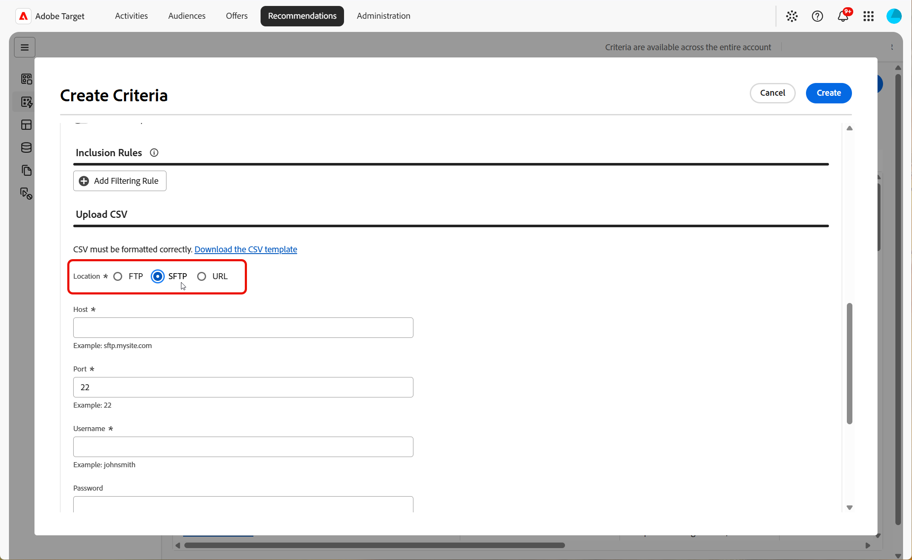

# カスタム条件のアップロード {#upload-custom-criteria}

>[!BEGINSHADEBOX]

**このページで：**&#x200B;推奨事項のCSV ファイルをアップロードして、[!DNL Adobe Target Recommendations]でカスタム条件を作成する方法を説明します。

>[!ENDSHADEBOX]

カスタム条件では、[!DNL Target]にアップロードされたレコメンデーションのCSV ファイルを使用します。 これにより、[!DNL Target]外で計算されたレコメンデーションを[!DNL Recommendations]のアクティビティで配信できます。 カスタム基準の仕組みについて詳しくは、[Targetのレコメンデーションアルゴリズムの背後にある科学](/help/main/c-recommendations/c-algorithms/recommendations-algorithms.md)を参照してください。

カスタム条件は、**[!UICONTROL 新規条件の作成画面]**&#x200B;から作成されます。 この画面に到達する方法については、[新しい条件の作成画面へのアクセス ](/help/main/c-recommendations/c-algorithms/create-new-algorithm.md#access-create-criteria)を参照してください。 次の手順は、**[!UICONTROL Recommendations]** > **[!UICONTROL Criteria]** ライブラリ画面から開始します。

1. **[!UICONTROL Recommendations]** > **[!UICONTROL Criteria]**&#x200B;をクリックします。

1. **[!UICONTROL 条件を作成]** > **[!UICONTROL 条件を作成]**&#x200B;をクリックします。

   が表示されている

1. 「[基本情報](/help/main/c-recommendations/c-algorithms/create-new-algorithm.md#info)」セクションに情報を入力します。

1. 「**[!UICONTROL アルゴリズムの種類]**」ドロップダウンリストから、**[!UICONTROL カスタム条件]**&#x200B;を選択します。 「**[!UICONTROL アルゴリズム]**」ドロップダウンリストから、「**[!UICONTROL カスタムアルゴリズム]**」を選択します。

   アルゴリズムの種類としてカスタム条件を使用し、アルゴリズムとしてカスタムアルゴリズムを使用する

1. （条件付き）「[ バックアップコンテンツ ](/help/main/c-recommendations/c-algorithms/create-new-algorithm.md#content)」および「[ インクルージョンルール ](/help/main/c-recommendations/c-algorithms/create-new-algorithm.md#inclusion)」セクションに情報を入力します。

1. 「**[!UICONTROL CSVをアップロード]**」セクションで、CSV ファイルの&#x200B;**[!UICONTROL 場所]**&#x200B;を選択します。

   アップロードを成功させるには、CSV ファイルが正しくフォーマットされている必要があります。 正しい形式のCSV ファイルを取得するには、**[!UICONTROL CSV テンプレートのダウンロード]**&#x200B;をクリックします。

   次の場所オプションを使用できます。

   * **FTP**: FTP サーバーからCSV ファイルをアップロードするには、**[!UICONTROL FTP]**&#x200B;を選択し、必要な情報を入力します。 SSLを使用すると、FTPS プロトコルを使用してCSV ファイルを安全に転送できます。

   * **SFTP**: SFTP サーバーからCSV ファイルをアップロードするには、**[!UICONTROL SFTP]**&#x200B;を選択し、ホスト名またはIP アドレス、ポート（デフォルト 22）、ユーザー名、パスワードおよび/またはSSH秘密鍵、ディレクトリ、ファイル名を入力します。 詳しくは、[ サポートされているSFTP サーバー設定](/help/main/c-recommendations/c-products/feeds.md#steps)を参照してください。

     SFTPでは、カスタム条件のCSV形式は変更されません。 `# Key,Recommendation_1,...`形式を使用します。 別のフィードタイプの形式のCSV ファイルでは、読み込みが失敗します。

   * **URL**: URLからCSV ファイルをアップロードするには、**[!UICONTROL URL]**&#x200B;を選択し、フィード URLを入力します。

     

1. 「**[!UICONTROL 作成]**」をクリックします。

## 注意点

* カスタム条件エンティティ（行）は、最大 1,000 のレコメンデーション品目（列）を含むことができます。

* カスタム基準の更新は、デフォルトでは「累積」です。 CSV アップロードファイルの新しいキーと値のペアは、既存のキーと値のペアを上書きします。 キーがCSV アップロードに含まれていない既存のキーと値のペアは、引き続き配信に使用でき、CSV ファイルの一部として最後にアップロードされてから31日後に有効期限が切れます。

  次のCSV アップロードに含まれていない既存の結果を破棄するには、クライアントケアに連絡して、対応する設定を有効にします。 この設定を有効にすると、カスタム CSV フィード ファイルに存在するキーのみが配信できます。 この設定は、すべてのカスタム条件に適用されます。

* カスタム条件フィードは 24 時間ごとに更新されます。

  各カスタム条件のアップロードと同期のステータスは、**[!UICONTROL Recommendations]** > **[!UICONTROL Criteria]** ページに表示されます。 カスタム条件を編集すると、ステータスは&#x200B;**[!UICONTROL 編集]** ダイアログボックスにも表示されます。

* エラーのないアップロードのフローは、**[!UICONTROL スケジュール済み]** > **[!UICONTROL フィードファイルのダウンロード]** > **[!UICONTROL インポート]** > **[!UICONTROL 成功]**&#x200B;です。

* [!DNL Target]がアップロードで問題が発生した場合、次のエラーメッセージが表示される可能性があります。

  | エラーメッセージ | 詳細 |
  |--- |--- |
  | 不明なエラー | 技術的な内部エラーを示します。 |
  | 解析エラー | フィードファイルの形式に問題がある可能性があります。 ファイル形式を修正し、アルゴリズムを再保存して、ファイルのダウンロードプロセスを再開します。 |
  | サーバーが見つかりません | インターネット上に表示されるIPまたはホスト名を指定します。 |
  | 資格情報エラー | サーバーでアクティブなアカウントの有効なユーザー名とパスワードを指定します。 |
  | ディレクトリが見つかりません | サーバーに存在するディレクトリを指定します。 |
  | ファイルが見つかりません | 指定したディレクトリ内のサーバーに存在するファイルの名前を指定します。 |
