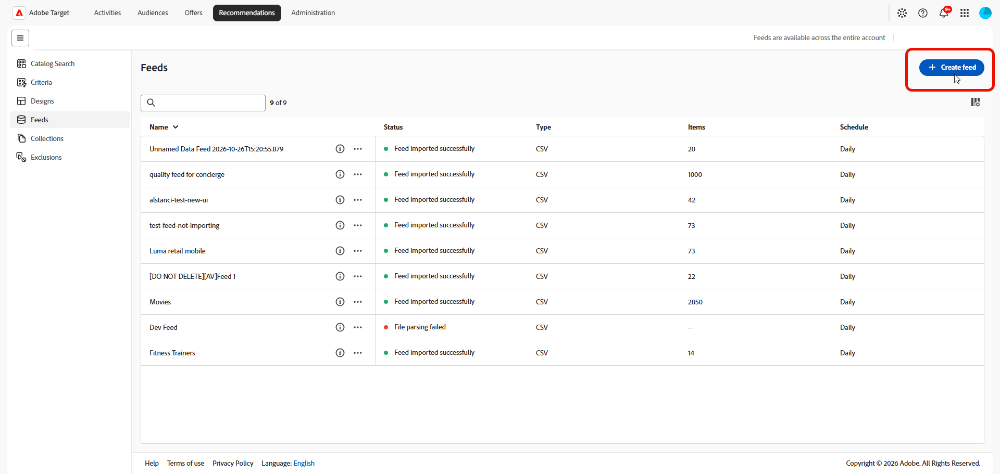

# [!DNL Adobe Analytics] での[!DNL Recommendations] の使用 {#use-analytics-with-recommendations}

>[!BEGINSHADEBOX]

**このページ：**&#x200B;では、[!DNL Adobe Analytics]を[!DNL Adobe Target Recommendations] アクティビティの行動データソースとして使用する方法を説明します。

>[!ENDSHADEBOX]

[!DNL Adobe Analytics]を行動データソースとして使用すると、[!DNL Adobe Target Recommendations]のアクティビティで、[!DNL Analytics]のビューベースおよび購入ベースの行動データを使用できます。 これは、[!DNL Target Recommendations]設定が新しく、[!DNL Analytics]に使用する履歴データが多い場合に便利です。 データには、サードパーティのソースまたはフィードからの情報も含まれている可能性があります。この情報は、[!DNL Analytics]とのみ共有されます。

データソースは、**[!UICONTROL ビヘイビアーデータ Source]** オプションを使用して選択されます。一方、[!DNL Recommendations]で[条件を作成](/help/main/c-recommendations/c-algorithms/create-new-algorithm.md#data-source): **[!UICONTROL Adobe Target]**&#x200B;または&#x200B;**[!UICONTROL Analytics]**。

>[!NOTE]
>
>これらの2つのオプションがアカウントに表示されない場合は、[&#x200B; カスタマーケア &#x200B;](/help/main/cmp-resources-and-contact-information.md#reference_ACA3391A00EF467B87930A450050077C)にお問い合わせください。

## [!DNL Target]の[!DNL Analytics] データの使用例 {#use-cases}

[!DNL Analytics]を行動データソースとして使用すると、特定のユースケースを、すべての[!DNL Target] エンティティパラメーターでエンティティページをタグ付けすることなくデプロイすることもできます。 これには特定の前提条件が必要であり、「製品変数」の利用は最も重要です。 通常のeVarとpropでは、[!DNL Analytics]と[!DNL Target]がこのデータを自動的に交換するには十分ではありません。

[!DNL Analytics]を行動データソースとして使用すると、次のことが可能になります。

* [!DNL Analytics] のデータを使用して、先月に同じカテゴリで購入した他のユーザーに基づいて、小売サイトでレコメンデーションを製品詳細ページで表示します。
* [!DNL Analytics] のデータに基づいて、現在トレンドとなっている特定のカテゴリ内で最も人気のあるコンテンツのコンテンツをメディアサイトのホーム画面に表示します。

## [!DNL Analytics] での実装

### 前提条件：[!DNL Analytics] での製品変数の設定 {#prerequisites}

[!DNL Target Recommendations]に必要な属性を使用して、[!DNL Analytics]に製品変数を実装します。 [!DNL Target Recommendations]のサンプル フィード形式は、製品変数で定義する必要がある属性をガイドします。 これらの値は、後で[!DNL Target] UIでそれぞれの[!DNL Target] エンティティ値に「マッピング」する必要があります。

>[!NOTE]
>
>コンテンツサイトの場合は、それぞれのコンテンツ部分を「製品」として扱い、そのコンテンツの関連する属性を属性として渡す必要があります。 このような属性には、作成者名、公開日、コンテンツタイトル、リリース月などが含まれます。 企業は、ユースケースの要件にもとづいて、カテゴリーレベルまたはカテゴリータイプの詳細を決定する必要があります。

product 変数の設定方法について詳しくは、『 [Adobe Analyticsの実装 *ガイドの* products](https://experienceleague.adobe.com/ja/docs/analytics/implementation/vars/page-vars/products) を参照してください。 このドキュメントの一部のメモ（例えば、カテゴリに関するメモ）は、それをデプロイするチームの判断を必要とします。 このアクティビティを推奨する前に、[!DNL Adobe]に相談してください。

### 注意点 {#considerations}

[!DNL Analytics]個のデータが毎日フィードを通じて送信されます。 行動結果は、サイト上のレコメンデーション結果に反映されるまでに最大24時間かかる場合があります。 すべての[!DNL Recommendations]条件の設定と同様に、このデータソースをテストする必要があります。

データソースを選択するには：

* ユーザーが毎日、多くのオーガニックデータを生成し、過去のデータへの依存をほとんど必要としない場合、[!DNL Target] mboxは適しています。
* [!DNL Analytics]は、最近生成されたオーガニックデータが少なく、[!DNL Analytics] データを使用する必要がある場合に適しています。

`entity.id`と`entity.categoryId`の値は、[!DNL Target] mbox呼び出しで引き続き渡す必要があります。 他の属性は、このページで説明されているように、[!DNL Analytics] フィードを通じて渡すことができます。

エンティティ パラメーターとプロファイル属性の照合などの動的インクルージョン ルールは、[!DNL Analytics] フィード アプローチで使用できます。 この方法は、[!DNL Target] スタンドアロンの使用と似ていますが、タイミングを考慮する必要があります。プロファイル変数と一致すると想定されるエンティティ変数は、データ層によって異なり、ページではずっと後に表示される可能性があります。

## [!DNL Target] への実装 {#implement-target}

製品変数は、行動データを継続的に提供するために[!DNL Target]にマッピングされます。

1. [!DNL Target]で「**[!UICONTROL Recommendations]**」をクリックし、「**[!UICONTROL フィード]**」タブをクリックします。

1. 「**[!UICONTROL フィードを作成]**」をクリックします。

   「フィードを作成」ボタンがハイライト表示された

1. 「**[!UICONTROL Analytics Classifications]**」を選択し、レポートスイートを指定します。

1. **[!UICONTROL 次]**&#x200B;をクリックして&#x200B;**[!UICONTROL スケジュール]**&#x200B;設定に進み、フィードの頻度を選択します：**[!UICONTROL 毎日]**、**[!UICONTROL 毎週]**、**[!UICONTROL 2週間ごとに]**、または&#x200B;**[!UICONTROL 絶対]**。 フィードを処理する時間帯も選択できます。

   

1. 「**[!UICONTROL 次へ]**」をクリックして&#x200B;**[!UICONTROL マッピング]**&#x200B;設定に進み、フィールド列ヘッダーを適切な&#x200B;**[!UICONTROL 推奨事項]** フィールド名にマッピングします。

1. 「**[!UICONTROL Save]**」をクリックします。

フィードの作成について詳しくは、[&#x200B; フィードの作成](/help/main/c-recommendations/c-products/feeds.md#steps)を参照してください。
