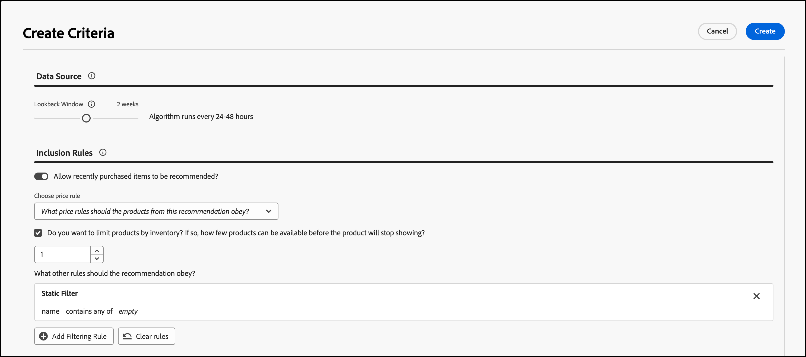
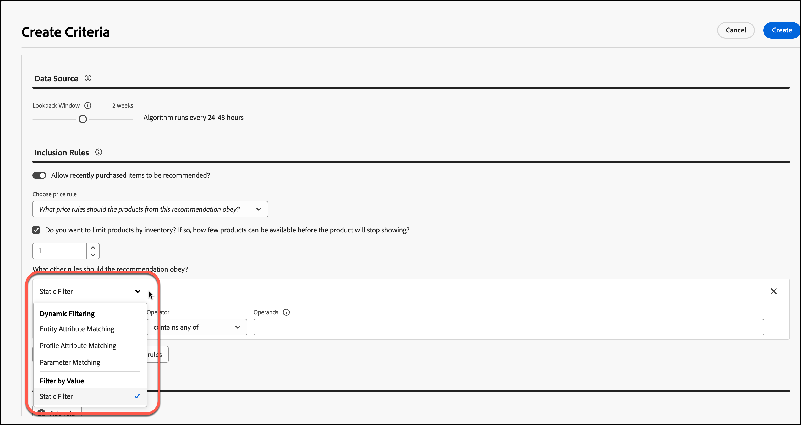

# 動的および静的インクルージョンルールの使用 {#inclusion-rules}

>[!BEGINSHADEBOX]

**このページで：**&#x200B;動的および静的フィルタールールを[!DNL Adobe Target Recommendations]の条件とプロモーションに追加する方法を説明します。

>[!ENDSHADEBOX]

包含ルールは、レコメンデーションに表示される項目を絞り込みます。 これらは、動的または静的フィルタールールを使用して、[!DNL Adobe Target]の条件とプロモーション用に作成されます。 プロセス、ユースケース、例は、基準とプロモーションが似ているので、このページではその両方を取り上げます。

## フィルタールールの追加 {#add-filtering-rules}

次の手順では、条件にフィルタリングルールを追加します。

1. [条件の作成](/help/main/c-recommendations/c-algorithms/create-new-algorithm.md#create-criteria) （**[!UICONTROL Recommendations]** > **[!UICONTROL Criteria]** > **[!UICONTROL 条件の作成]** > **[!UICONTROL 条件の作成]**）中、**[!UICONTROL 包含ルール]**&#x200B;の下の&#x200B;**[!UICONTROL フィルタリングルールを追加]**&#x200B;をクリックします。

   

1. 「他のルールに従うレコメンデーション」ボックスで、**[!UICONTROL 静的フィルター]** ドロップダウンリストをクリックし、目的のオプションを選択します。

   

   利用できるオプションは、選択した業種とレコメンデーションキーによって変わります。

プロモーションにフィルタリングルールを追加するには、**[!UICONTROL 属性によるプロモーション]**&#x200B;を選択し、[ プロモーションの作成](/help/main/c-recommendations/t-create-recs-activity/adding-promotions.md)を選択してから、**[!UICONTROL フィルタリングルールの追加]**&#x200B;をクリックします。

## フィルタータイプ {#filter-types}

次の節では、条件とプロモーションの両方について、**[!UICONTROL 動的フィルタリング]**&#x200B;および&#x200B;**[!UICONTROL 値によるフィルタリング]**&#x200B;のフィルタリングオプションについて説明します。

### 動的フィルタリング

動的インクルージョンルールは訪問者またはリクエストに適応しますが、静的インクルージョンルールは固定値を使用します。

* 動的インクルージョンルールは、ユーザーのプロファイルパラメーターまたはmbox呼び出しの属性を一致させることにより、推奨事項を提供します。

  例えば、「最も人気のある基準」レコメンデーションを作成できます。 返されるレコメンデーションのセットから、ユーザーがレコメンデーションが表示されるページにアクセスしたときに渡される属性に対して、レコメンデーションをリアルタイムでフィルタリングできます。

* 任意の数の動的インクルージョンルールを作成できます。 包含ルールはAND演算子と結合されるため、レコメンデーションに含める項目に対してすべてのルールを満たす必要があります。

動的フィルタリングでは、次のオプションを使用できます。

| 動的フィルターオプション | 詳細 |
| --- | --- |
| [**[!UICONTROL エンティティ属性のマッチング]**](/help/main/c-recommendations/c-algorithms/entity-attribute-matching.md) | 潜在的な推奨アイテムのプールを、訪問者が操作した特定のアイテムと比較することで、動的にフィルタリングします。
**[!UICONTROL エンティティ属性一致]**&#x200B;を使用して、訪問者のお気に入りのブランドなど、訪問者にアピールする可能性が最も高い推奨事項を表示します。 |
| [**[!UICONTROL プロファイル属性のマッチング]**](/help/main/c-recommendations/c-algorithms/profile-attribute-matching.md) | 訪問者のプロファイル内の値に対してアイテム（エンティティ）を比較することで、動的にフィルタリングします。
**[!UICONTROL プロファイル属性一致]**&#x200B;を使用して、サイズやお気に入りのブランドなど、訪問者のプロファイルに保存されている値に一致する推奨事項を表示します。 |
| [**[!UICONTROL パラメーターのマッチング]**](/help/main/c-recommendations/c-algorithms/parameter-matching.md) | アイテム（エンティティ）をリクエストの値（APIまたはmbox）と比較して、動的にフィルタリングします。
**[!UICONTROL パラメーターマッチング]**&#x200B;を使用して、ページパラメーターや訪問者のパラメーター（デバイスのサイズや位置情報など）に一致するコンテンツをレコメンドします。 |

### 値でフィルター

静的ルールは、コレクションを使用する代わりに、レコメンデーションに含めるアイテムを制限します。 値によるフィルタリングには、次のオプションを使用できます。

| 値によるフィルタリング オプション | 詳細 |
| --- | --- |
| [**[!UICONTROL 静的フィルター]**](/help/main/c-recommendations/c-algorithms/static-value.md) | 手動で入力された1つ以上の静的値でフィルタリングします。 |

## 使用可能な演算子 {#operators}

次の例は、動的なプロモーションと除外をマーケティングに使用する方法を示しています。

>[!NOTE]
>
>「リスト」演算子では、エンティティとプロファイル属性の両方を配列として格納する必要があります。 コンマ区切りのリストは機能しません。

| 演算子 | 次で利用可能 | 例 |
|--- |--- |--- |
| **[!UICONTROL が]**&#x200B;のいずれかに等しい | **[!UICONTROL エンティティ属性の一致]**、**[!UICONTROL プロファイル属性の一致]**、**[!UICONTROL パラメーターの一致]**、および&#x200B;**[!UICONTROL 静的フィルター]** | 訪問者がweb サイト上のアイテム（製品、記事、映画など）を閲覧している場合、「次と等しい」演算子を使用する動的プロモーションでは、次の項目から他のアイテムを宣伝できます。<ul><li>同じブランド</li><li>同じカテゴリ</li><li>同じカテゴリのANDをハウスブランドから</li><li>同じ店舗</li></ul> |
| **[!UICONTROL は]**&#x200B;と等しくありません | **[!UICONTROL エンティティ属性の一致]**、**[!UICONTROL プロファイル属性の一致]**、**[!UICONTROL パラメーターの一致]**、および&#x200B;**[!UICONTROL 静的フィルター]** | 訪問者がweb サイト上のアイテム（製品、記事、映画など）を閲覧している場合、「**[!UICONTROL 」演算子を使用する動的プロモーションは、]**」演算子と等しくありません。次の項目から他の項目を宣伝できます。<ul><li>別のテレビシリーズ</li><li>別のジャンル</li><li>異なる製品シリーズ</li><li>別のスタイル ID</li></ul> |
| **[!UICONTROL が]**&#x200B;以上である | **[!UICONTROL エンティティ属性の一致]**、**[!UICONTROL プロファイル属性の一致]**、**[!UICONTROL パラメーターの一致]**、および&#x200B;**[!UICONTROL 静的フィルター]** | 訪問者がweb サイト上のアイテム （製品など）を閲覧している場合、「**[!UICONTROL は]**&#x200B;以上」演算子は、次のような他のアイテムを宣伝できます。<ul><li>同じ値段か、より高額か</li></ul> |
| **[!UICONTROL が]**&#x200B;のいずれか以下である | **[!UICONTROL エンティティ属性の一致]**、**[!UICONTROL プロファイル属性の一致]**、**[!UICONTROL パラメーターの一致]**、および&#x200B;**[!UICONTROL 静的フィルター]** | 訪問者がweb サイト上のアイテム （製品など）を閲覧している場合、「**[!UICONTROL は]**&#x200B;以下です」演算子は、次のような他のアイテムを昇格できます。<ul><li>同じ値段か、安い値段です</li></ul> |
| **[!UICONTROL 次のいずれかを含む]** | **[!UICONTROL エンティティ属性の一致]**、**[!UICONTROL プロファイル属性の一致]**、**[!UICONTROL パラメーターの一致]**、および&#x200B;**[!UICONTROL 静的フィルター]** | 訪問者がweb サイト上の項目（製品など）を表示している場合、「**[!UICONTROL に]**」演算子は、次のような他の項目を昇格できます。<ul><li>タイトルに同じブランドが含まれています</li></ul> |
| **[!UICONTROL 次のいずれかを含まない]** | **[!UICONTROL エンティティ属性の一致]**、**[!UICONTROL プロファイル属性の一致]**、**[!UICONTROL パラメーターの一致]**、および&#x200B;**[!UICONTROL 静的フィルター]** | 訪問者がweb サイト上の項目（製品など）を表示している場合、「**[!UICONTROL に]**」演算子は次の項目を宣伝できます。<ul><li>タイトルに誓いの言葉が含まれていません</li></ul> |
| **[!UICONTROL いずれかの]**&#x200B;で始まる | **[!UICONTROL エンティティ属性の一致]**、**[!UICONTROL プロファイル属性の一致]**、**[!UICONTROL パラメーターの一致]**、および&#x200B;**[!UICONTROL 静的フィルター]** | 訪問者がweb サイト上のアイテム （製品など）を閲覧している場合、「**[!UICONTROL は]**」演算子で始まり、次のような他のアイテムを昇格できます。<ul><li>IPhoneで始まる製品名</li></ul> |
| **[!UICONTROL は]**&#x200B;のいずれかで終わります | **[!UICONTROL エンティティ属性の一致]**、**[!UICONTROL プロファイル属性の一致]**、**[!UICONTROL パラメーターの一致]**、および&#x200B;**[!UICONTROL 静的フィルター]** | 訪問者がweb サイト上のアイテム （製品など）を閲覧している場合、「**[!UICONTROL は]**」演算子で終わります。次の項目を宣伝できます。<ul><li>コンテンツは英語を示すENで終わります</li></ul> |
| **[!UICONTROL は]**&#x200B;の間です | **[!UICONTROL エンティティ属性の一致]**、**[!UICONTROL プロファイル属性の一致]**、および&#x200B;**[!UICONTROL パラメーターの一致]** | 訪問者がweb サイト上のアイテム（製品、記事、映画など）を閲覧している場合、「**[!UICONTROL は]**」演算子を使用する動的プロモーションは、次のような他のアイテムを宣伝できます。<ul><li>コストの増大</li><li>コストの削減</li><li>コストのプラスまたはマイナス 30%</li><li>同じシーズンの後のエピソード</li><li>シリーズの前作</li></ul> |
| **[!UICONTROL リストに]**&#x200B;の項目が含まれています（右側のリスト） | **[!UICONTROL プロファイル属性が一致]**&#x200B;と&#x200B;**[!UICONTROL パラメーターが一致]**&#x200B;しました | プロファイル属性のマッチングでは、訪問者がweb サイト上の項目（製品、記事、映画など）を表示しているときに、「**[!UICONTROL リストに項目が含まれる]**」演算子は、次のような項目を他の項目に昇格できます。<ul><li>訪問者の地域で利用可能</li></ul>**例**：訪問者の地理的領域でのみ使用できるアイテムを推奨します。
フィルタールールは次のようになります。
`availableGeographies list contains an item in user.currentGeography`
**注意**：この演算子を使用する場合、ルールの[右側](#caveats)にリストが必要です。 |
| **[!UICONTROL リストに]**&#x200B;の項目が含まれていません（右側のリスト） | **[!UICONTROL プロファイル属性が一致]**&#x200B;と&#x200B;**[!UICONTROL パラメーターが一致]**&#x200B;しました | プロファイル属性のマッチングでは、訪問者がweb サイト上の項目（製品、記事、映画など）を表示する際に、「**[!UICONTROL リストに]**」演算子に項目が含まれていない場合、次の項目を除外できます。<ul><li>訪問者が最後に閲覧した10項目のリスト</li></ul>**例**：訪問者が最近閲覧し、興味を示していない項目はプロモーションされません。
フィルタリングルールは次のようになります。
`id is not contained in list user.lastViewedItems`
**注意**：この演算子を使用する場合、ルールの[右側](#caveats)にリストが必要です。 |
| **[!UICONTROL リストには]**&#x200B;の項目が含まれています（両側のリスト） | **[!UICONTROL エンティティ属性の一致]**、**[!UICONTROL プロファイル属性の一致]**、および&#x200B;**[!UICONTROL パラメーターの一致]** | プロファイル属性のマッチングでは、訪問者がweb サイト上の項目（スポーツイベントやコンサートなど）を閲覧している場合、「**[!UICONTROL リストに]**」演算子は次の項目を含む他の項目を昇格できます。<ul><li>訪問者のお気に入りのチームのひとつに関連付けられ</li></ul>**例**：訪問者のお気に入りのチームのいずれかに関連付けられているゲームをレコメンドします。
フィルタリングルールは次のようになります。
`teamsPlaying list contains an item in user.favoriteTeams`
**注意**：この演算子を使用する場合、ルールの[両側](#caveats)にリストが必要です。 |
| **[!UICONTROL リストに]**&#x200B;の項目が含まれていません（両側のリスト） | **[!UICONTROL エンティティ属性の一致]**、**[!UICONTROL プロファイル属性の一致]**、および&#x200B;**[!UICONTROL パラメーターの一致]** | パラメーターマッチングでは、訪問者がweb サイト上の項目（製品、記事、映画など）を表示する際に、「**[!UICONTROL リストに]**」演算子に項目が含まれていない場合、次の項目を除外できます。<ul><li>禁止されているタイプのリストに含まれています</li></ul>**例**：たばこやアルコールなど、大人の訪問者のみが利用できるアイテムは除外されます。
フィルタリングルールは次のようになります。
`itemType is not contained in list mbox.prohibitedTypes`
**注意**：この演算子を使用する場合、ルールの[両側](#caveats)にリストが必要です。 |
| **[!UICONTROL リストには、]**&#x200B;のすべての項目が含まれています | **[!UICONTROL エンティティ属性の一致]**、**[!UICONTROL プロファイル属性の一致]**、および&#x200B;**[!UICONTROL パラメーターの一致]** | プロファイル属性のマッチングでは、訪問者がweb サイト上の項目（求人投稿やレシピなど）を表示する際に、「**[!UICONTROL リストに]**」オペレーターは次の項目を含む他の項目を昇格できます。<ul><li>一連のスキルを含める</li><li>必要な成分のセットを含めます</li></ul>**例1**：訪問者が一連のスキル（Java、C++、HTML）を持っている。 カタログ内の項目は、必要なスキル（JavaおよびHTML）を持つジョブです。 訪問者プロファイルには、ジョブが訪問者に推奨される前に、必要なすべてのスキルが含まれている必要があります。
フィルタリングルールは次のようになります。
`profile.jobSeekerSkills contains all items in entity.requiredSkills`
**例2**：ユーザーがパントリーの材料のリストを持っている。 レシピには必要な成分のリストがあります。 訪問者プロファイルには、レシピを訪問者に推奨する前に、必要なすべての材料を含める必要があります。
フィルタリングルールは次のようになります。
`profile.ingredientsInPantry contains all items in recipe.ingredientsRequired`
**注意**：この演算子を使用する場合、ルールの[両側](#caveats)にリストが必要です。 |
| **[!UICONTROL リストには、]**&#x200B;内のすべての項目が含まれていません | **[!UICONTROL エンティティ属性の一致]**、**[!UICONTROL プロファイル属性の一致]**、および&#x200B;**[!UICONTROL パラメーターの一致]** | エンティティ属性のマッチングでは、訪問者がweb サイト上の項目（スポーツイベントやコンサートなど）を閲覧している場合、「**[!UICONTROL リストに]**&#x200B;内のすべての項目が含まれていない」オペレーターは、次のような他の項目を宣伝できます。<ul><li>グループを含まない</li></ul>**例**: スポーツイベントには2つのチームが含まれます。 訪問者のプロファイルは、この訪問者がこれらのチームのゲームを表示したくないことを示しているので、これらのチームがプレイしている場合はゲームを推奨しないでください。
フィルタリングルールは次のようになります。
`profile.leastfavoriteTeams does not contain all items in entity.teamsPlaying`
**注意**：この演算子を使用する場合、ルールの[両側](#caveats)にリストが必要です。 |

## 空の値の処理 {#empty-values}

条件とプロモーションについて、**[!UICONTROL エンティティ属性の一致]**、**[!UICONTROL プロファイル属性の一致]**、**[!UICONTROL パラメーターの一致]**&#x200B;でフィルタリングする場合、空の値を処理するオプションがいくつかあります。

以前は、値が空の場合は何も結果が返されませんでした。 次の図に示すように、「If *x* is Empty」ドロップダウンリストは、条件に空の値がある場合に実行するアクションを指定します。

目的のアクションを選択するには、ギアアイコン（）にカーソルを合わせ、目的のアクションを選択します。

| アクション | 次で使用可能 | 詳細 |
|--- |--- |--- |
| **[!UICONTROL このフィルタリングルールを無視]** | **[!UICONTROL プロファイル属性が一致]**&#x200B;と&#x200B;**[!UICONTROL パラメーターが一致]**&#x200B;しました | このアクションは、**[!UICONTROL プロファイル属性の一致]**&#x200B;および&#x200B;**[!UICONTROL パラメーターの一致]**&#x200B;の既定値です。
ルールは無視されます。 例えば、3つのフィルタリングルールがあり、3番目のルールが値を渡さない場合、結果を返さない代わりに、空の値を持つ3番目のルールを無視できます。 |
| **[!UICONTROL この条件の結果を表示しません]**
（基準のみ） | **[!UICONTROL エンティティ属性の一致]**、**[!UICONTROL プロファイル属性の一致]**、および&#x200B;**[!UICONTROL パラメーターの一致]** | このアクションは、**[!UICONTROL エンティティ属性の一致]**&#x200B;の既定値です。
このアクションは、このオプションが追加される前に[!DNL Target]が空の値を処理した方法です。この条件には結果は表示されません。 |
| **[!UICONTROL 項目を宣伝しない]**
（プロモーションのみ） | **[!UICONTROL エンティティ属性の一致]**、**[!UICONTROL プロファイル属性の一致]**、および&#x200B;**[!UICONTROL パラメーターの一致]** | このアクションは、**[!UICONTROL エンティティ属性の一致]**&#x200B;の既定値です。
このアクションは、このオプションが追加される前に[!DNL Target]が空の値を処理した方法です。このプロモーションには結果は表示されません。 |
| **[!UICONTROL 静的な値を使用]** | **[!UICONTROL エンティティ属性の一致]**、**[!UICONTROL プロファイル属性の一致]**、および&#x200B;**[!UICONTROL パラメーターの一致]** | 値が空の場合は、静的値を使用できます。 |

## 注意事項 {#caveats}

>[!IMPORTANT]
>
>異なるデータタイプ属性は、実行時に「等しい」演算子や「等しくない」演算子を使用した動的条件やプロモーションに互換性がない場合があります。 左側に属性またはカスタム属性が事前に定義されている場合は、右側の&#x200B;**[!UICONTROL 値]**、**[!UICONTROL マージン]**、**[!UICONTROL 在庫]**、**[!UICONTROL 環境]**&#x200B;の値を慎重に選択します。

次の表に、互換性のあるルールと、実行時に互換性がないルールを示します。

| 互換性のあるルール | 互換性がない可能性のあるルール |
|--- |--- |
| value - is between - 90% and 110% of current item&#39;s - salesValue | salesValue - is between - 90% and 110% of current item&#39;s - value |
| value - is between - 90% and 110% of current item&#39;s - value | clearancePrice - is between - 90% and 110% of current item&#39;s - margin |
| margin - is between - 90% and 110% of current item&#39;s - margin | storeInventory - equals - current item&#39;s - inventory |
| inventory - equals - current item&#39;s - inventory |  |
