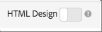

# デザインの作成 {#create-design}

>[!BEGINSHADEBOX]

**このページ：**&#x200B;では、[!DNL Adobe Target Recommendations]でデザインを作成、編集、コピー、削除する方法と、推奨事項をJSONとして返す方法について説明します。

>[!ENDSHADEBOX]

デザインによって、レコメンデーションがページに表示される方法が定義されます。 デザインは、デフォルトデザインをベースにすることも、カスタムデザインとして作成することもできます。 **[!UICONTROL Recommendations]** > **[!UICONTROL Designs]**&#x200B;の画面には、デフォルトのデザインカードと、アカウントで作成されたデザインの両方が表示されます。

* デフォルトのデザインは編集または削除できません。
* カスタムデザインは、編集、コピー、または削除できます。
* デフォルトデザインに基づいてデザインを作成するには、まずデザインをコピーしてからコピーを編集します。

デザインは、**[!UICONTROL Visual Experience Composer]** （VEC）内から、またはアクティビティ作成以外のデザインライブラリから、アクティビティ作成プロセス中に作成できます。 次の手順では、デザインがライブラリから作成されることを前提としていますが、手順は似ています。

## ライブラリからデザインを作成する {#steps}

1. **[!UICONTROL Recommendations]** > **[!UICONTROL Designs]**&#x200B;をクリックして、**[!UICONTROL Designs]** ライブラリを表示します。

1. 次のいずれかの方法でデザインを開始します。

   * デフォルトデザインまたは既存のデザインに基づいてデザインを作成するには、そのデザインの詳細アクションアイコン（）をクリックし、**[!UICONTROL コピー]**&#x200B;をクリックします。 「**[!UICONTROL デザインを作成]**」ダイアログボックスが表示されます。 編集したコピーは、新しいカスタムデザインになります。
   * ゼロからカスタムデザインを作成するには、**[!UICONTROL デザインを作成]**&#x200B;をクリックします。

     

1. **[!UICONTROL 名前]**&#x200B;を入力し、デザインカードに表示するオプションのプレビュー画像を選択します。

   デフォルトのデザインを使用すると、デザイン名の後に「コピー」が&#x200B;**[!UICONTROL コンテンツ名]** フィールドに表示されます。 名前は編集可能です。

1. （条件付き）必要に応じて、デザイン **[!UICONTROL コード]**&#x200B;を編集します。

   レコメンデーションデザインには、オープンソースの Velocity デザイン言語が使用されています。 Velocityについて詳しくは、[https://velocity.apache.org](https://velocity.apache.org)および[Velocity](/help/main/c-recommendations/c-design-overview/customizing-a-template.md)を使用したデザインのカスタマイズを参照してください。

   デザインは HTML または HTML 以外にすることができます。 デフォルトでは、HTML デザインは`<div>` タグでラップされ、Web環境でのクリックトラッキングが可能になります。 HTML 以外のデザインは、Web 環境ではない環境用のもので、クリック追跡ができません。 HTML以外のコードを使用するには、**[!UICONTROL HTML デザイン]**&#x200B;のトグルを「オフ」にスライドさせます。

   >[!NOTE]
   >
   >ハードコーディングまたはループを通じて、デザインで参照できるエンティティの最大数は99です。

1. 「**[!UICONTROL 作成]**」をクリックします。

1. 編集、コピー、削除するデザインの「その他のアクション」アイコン（）をクリックし、適切なオプション（**[!UICONTROL 編集]**、**[!UICONTROL コピー]**、または&#x200B;**[!UICONTROL 削除]**）をクリックします。

   

デザインはアカウント全体で利用できます。 デザインを削除する前に、アカウント間の使用状況を考慮する必要があります。 削除されたデザインは復元できません。

## JSONの例 {#json-example}

次の例は、[&#x200B; フォームベースのエディター](/help/main/c-experiences/form-experience-composer.md)を使用してアクティビティを設定した場合に、JSON応答を返す方法を示しています。

1. **[!UICONTROL デザインライブラリ]**&#x200B;内またはフォームベースのワークフロー内からデザインを作成します。 **[!UICONTROL Visual Experience Composer]** （VEC）ワークフロー内で作成されたデザインは、クリックトラッキング用に`<div>`でラップされたHTML デザインのみにできます。

1. 「**[!UICONTROL HTML デザイン]**」オプションがオフになっていることを確認します。

   

1. 次のようなコードをデザインに貼り付けます。

   +++ エンティティ IDのリストを返すサンプルデザインコード

   ```javascript
       #* 
       * "Return a simple list of recommended entity ids"   
       *#
   
       {   
         "notes":{   
         "purpose": "Return a simple list of recommended entity ids",   
         "use-case": "Use this approach if you prefer to do a real-time lookup of entity attribute details (such as inventory, price, rating) from another system (such as a CMS, PIM or ecommerce platform)",   
         "version": "01"   
         },   
         "recommendedItems": {   
           "key": "$key.id",   
           "slot-01": "$entity1.id",   
           "slot-02": "$entity2.id",   
           "slot-03": "$entity3.id",   
           "slot-04": "$entity4.id",   
           "slot-05": "$entity5.id",   
           "slot-06": "$entity6.id",   
           "slot-07": "$entity7.id",   
           "slot-08": "$entity8.id",   
           "slot-09": "$entity9.id",   
           "slot-10": "$entity10.id"   
         }   
       }  
   ```

   +++

1. このデザインを使用するフォームベースの[!DNL Recommendations] アクティビティを設定します。

   +++ フォームベースの[!DNL Recommendations] アクティビティを設定する方法を説明します 

   1. 「**[!UICONTROL アクティビティ]**」ページに移動します。
   1. 「**[!UICONTROL アクティビティを作成]** > **[!UICONTROL Recommendations]**」をクリックします。
   1. **[!UICONTROL Experience Composer]**&#x200B;で、**[!UICONTROL Form]**&#x200B;を選択し、**[!UICONTROL Next]**&#x200B;をクリックします。
   1. 「場所」に「Sample_Recs_Response」というテキストを入力します。
   1. 「**[!UICONTROL デフォルトコンテンツ]**」で、下矢印、「**[!UICONTROL レコメンデーションの追加]**」の順にクリックします。
   1. 「ページタイプ」を選択します。 これにより、次の画面の最初のフィルタリングが決まります。
   1. 条件カードを選択し、「**[!UICONTROL 次へ]**」をクリックします。
   1. 前の手順で作成したデザインを選択し、**[!UICONTROL 次へ]**&#x200B;をクリックします。
   1. 設定プロセスを完了します。
   1. 「**[!UICONTROL 非アクティブ]**」の横にある右矢印をクリックし、「**[!UICONTROL アクティブ化]**」を選択します。

   +++

1. アクティビティを設定してアクティブ化した後、サンプルリクエストを設定して、クリーンなJSON応答を取得できます。

   アクティビティを保存してから、[!DNL Target]は、選択した条件設定をサポートするモデルを構築する必要があります。 さまざまな要因によっては、このプロセスに時間がかかることがあります。 モデルが構築されると、結果が表示されます。

   次に例を示します。

   ```
   https://[YOUR_CLIENT_CODE].tt.omtrdc.net/m2/YOUR_CLIENT_CODE/ubox/raw?mbox=[YOUR_MBOX_NAME]&mboxContentType=text/html&mboxXDomain=disabled&entity.id=[ENTITY_ID]&mboxHost=rawbox_sample&at_property=[AT_PROPERTY_TOKEN]&mboxNoRedirect=true&mboxPC=1234-4321&mboxSession=9876-7000
   ```

   where

   | パラメーター | 値 |
   |--- |--- |
   | `[YOUR_CLIENT_CODE]` | [!DNL Target] クライアントコード （/help/target/products.html#recsSettings/Recommendations API トークン/クライアントコードで利用可能）。 |
   | `[YOUR_MBOX_NAME]` | フォームベースのRecommendations アクティビティの「場所」セクション（この場合はSample_Recs_Response）で選択された名前。 |
   | `[ENTITY_ID]` | カタログ内のアイテムの`entity.id`。 |
   | `[AT_PROPERTY_TOKEN]` | （オプション）アクティビティの設定中にプロパティ（エンタープライズ権限の一部）が選択されたときに追加されました。 |

アルゴリズムが実行され、結果が使用可能になると、応答は次のようになります。

{width="575px"}

## その他のJSON オブジェクトのヒント {#json-tips}

アイテムの単純なコンマ区切りリストは、次の構文を使用してデザインを設定することによって返すこともできます。

```
$entity1.id, $entity2.id, $entity3.id, $entity4.id, $entity5.id, 
```

応答に追加情報を送信することもできます。 次のコードは、関連するスロット（順序）を持つエンティティ IDよりもはるかに多くの値を返す、より複雑な例です。 このデザインの例では、アクティビティの詳細、**[!UICONTROL ターゲットプロファイル]**&#x200B;の詳細（該当する場合）、および返された項目に関連するその他`entity.attributes`も返します。

+++ アクティビティ、プロファイル、エンティティの詳細を返すサンプルデザインコード

```javascript
  {   
   "adobeRecommendations": {   
    "notes": {   
     "purpose": "Return a list of entity ids with their associated entity.attributes",   
     "use-case": "Use this approach to avoid looking up attribute details after receiving a response from Target",   
     "version": "01"   
    },   
    "recommendedItems": {   
     "slot-01": "$entity1.id",   
     "slot-02": "$entity2.id",   
     "slot-03": "$entity3.id",   
     "slot-04": "$entity4.id",   
     "slot-05": "$entity5.id",   
     "slot-06": "$entity6.id",   
     "slot-07": "$entity7.id",   
     "slot-08": "$entity8.id",   
     "slot-09": "$entity9.id",   
     "slot-10": "$entity10.id"   
    },   
    "activityDetails": {   
     "mbox.name": "email-mbox",   
     "campaign.name": "\${campaign.name}",   
     "campaign.id": "\${campaign.id}",   
     "campaign.recipe.name": "\${campaign.recipe.name}",   
     "campaign.recipe.id": "\${campaign.recipe.id}",   
     "offer.name": "\${offer.name}",   
     "offer.id": "\${offer.id}",   
     "criteria.title": "$criteria.title",   
     "algorithm.name": "$algorithm.name",   
     "algorithm.dayCount": "$algorithm.dayCount"   
    },   
    "visitorProfile": {   
     "profile.favorite-category": "\${profile.favorite-category}",   
     "profile.test": "\${profile.test}",   
     "user.endpoint.lastPurchasedEntity": "\${user.endpoint.lastPurchasedEntity}",   
     "user.endpoint.lastViewedEntity": "\${user.endpoint.lastViewedEntity}",   
     "user.endpoint.mostViewedEntity": "\${user.endpoint.mostViewedEntity}",   
     "user.endpoint.categoryAffinity": "\${user.endpoint.categoryAffinity}",   
     "profile.geolocation.city": "\${profile.geolocation.city}",   
     "profile.geolocation.dma": "\${profile.geolocation.dma}",   
     "profile.geolocation.state": "\${profile.geolocation.state}",   
     "profile.geolocation.country": "\${profile.geolocation.country}",   
     "profile.sessionCount": "\${profile.sessionCount}",   
     "profile.averageDaysBetweenVisits": "\${profile.averageDaysBetweenVisits}",   
     "profile.browserTime": "\${profile.browserTime}",   
     "user.activeActivities": "\${user.activeActivities}",   
     "user.pcId": "\${user.pcId}",   
     "user.isFirstSession": "\${user.isFirstSession}",   
     "user.isNewSession": "\${user.isNewSession}",   
     "user.header": "\${user.header}",   
     "user.parameter": "\${user.parameter}"   
    },   
    "recKey": {   
     "recKeyDetails": {   
      "id": "$key.id",   
      "name": "$key.name",   
      "category": "$key.category",   
      "pageUrl": "$key.pageUrl",   
      "thumbnailUrl": "$key.thumbnailUrl"   
     }   
    },   
    "recDetailedResults": {   
     "recEntity1Details": {   
      "id": "$entity1.id",   
      "name": "$entity1.name",   
      "category": "$entity1.category",   
      "pageUrl": "$entity1.pageUrl",   
      "thumbnailUrl": "$entity1.thumbnailUrl"   
     },   
     "recEntity2Details": {   
      "id": "$entity2.id",   
      "name": "$entity2.name",   
      "category": "$entity2.category",   
      "pageUrl": "$entity2.pageUrl",   
      "thumbnailUrl": "$entity2.thumbnailUrl"   
     },   
     "recEntity3Details": {   
      "id": "$entity3.id",   
      "name": "$entity3.name",   
      "category": "$entity3.category",   
      "pageUrl": "$entity3.pageUrl",   
      "thumbnailUrl": "$entity3.thumbnailUrl"   
     },   
     "recEntity4Details": {   
      "id": "$entity4.id",   
      "name": "$entity4.name",   
      "category": "$entity4.category",   
      "pageUrl": "$entity4.pageUrl",   
      "thumbnailUrl": "$entity4.thumbnailUrl"   
     },   
     "recEntity5Details": {   
      "id": "$entity5.id",   
      "name": "$entity5.name",   
      "category": "$entity5.category",   
      "pageUrl": "$entity5.pageUrl",   
      "thumbnailUrl": "$entity5.thumbnailUrl"   
     },   
     "recEntity6Details": {   
      "id": "$entity6.id",   
      "name": "$entity6.name",   
      "category": "$entity6.category",   
      "pageUrl": "$entity6.pageUrl",   
      "thumbnailUrl": "$entity6.thumbnailUrl"   
     },   
     "recEntity7Details": {   
      "id": "$entity7.id",   
      "name": "$entity7.name",   
      "category": "$entity7.category",   
      "pageUrl": "$entity7.pageUrl",   
      "thumbnailUrl": "$entity7.thumbnailUrl"   
     },   
     "recEntity8Details": {   
      "id": "$entity8.id",   
      "name": "$entity8.name",   
      "category": "$entity8.category",   
      "pageUrl": "$entity8.pageUrl",   
      "thumbnailUrl": "$entity8.thumbnailUrl"   
     },   
     "recEntity9Details": {   
      "id": "$entity9.id",   
      "name": "$entity9.name",   
      "category": "$entity9.category",   
      "pageUrl": "$entity9.pageUrl",   
      "thumbnailUrl": "$entity9.thumbnailUrl"   
     },   
     "recEntity10Details": {   
      "id": "$entity10.id",   
      "name": "$entity10.name",   
      "category": "$entity10.category",   
      "pageUrl": "$entity10.pageUrl",   
      "thumbnailUrl": "$entity10.thumbnailUrl"   
     }   
    }   
   }   
  }  
```

+++

