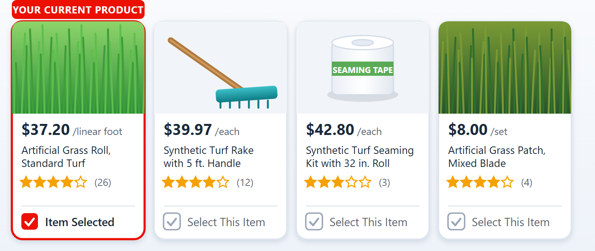

# [!DNL Velocity]を使用したデザインのカスタマイズ {#customize-design}

>[!BEGINSHADEBOX]

**このページ：** オープンソースの[!DNL Velocity] デザイン言語を使用して、[!DNL Adobe Target Recommendations]でレコメンデーションデザインをカスタマイズする方法を説明します。

>[!ENDSHADEBOX]

## [!DNL Velocity] の概要 {#velocity-overview}

[!DNL Velocity]に関する情報は、[https://velocity.apache.org](https://velocity.apache.org)にあります。

すべての[!DNL Velocity] ロジックや構文などをレコメンデーションデザインに使用できます。 つまり、*for* ループ、*if* ステートメント、およびその他のコードは、JavaScriptではなく[!DNL Velocity]で作成できます。

`productPage` mboxまたはCSV アップロードで[!DNL Recommendations]に送信されたエンティティ属性は、「複数値」属性を除いて、デザインに表示できます。 任意のタイプの属性を送信できますが、[!DNL Target]は、デザインが反復できる配列として「複数値」タイプの属性を渡しません（例：`entityN.categoriesList`）。

これらの値は次の構文で参照されます。

```
$entityN.variable
```

エンティティ属性名は、[!DNL Velocity]の短縮表記に従う必要があります。この表記は、*$*&#x200B;文字の先頭に[!DNL Velocity] テンプレート言語（VTL）識別子が続きます。 VTL 識別子は、アルファベット文字（a-z または A-Z）で始まる必要があります。

[!DNL Velocity]個のエンティティ属性名は、次の種類の文字に制限されています：

* アルファベット（a-z、A-Z）
* 数字（0-9）
* ハイフン（-）
* アンダースコア（_）

次の属性は[!DNL Velocity]配列として使用できます。 そのため、インデックスを通じて繰り返し繰り返したり、参照したりできます。

* `entities`
* `entityN.categoriesList`

次に例を示します。

```
#foreach ($category in $entity1.categoriesList) 
<br/>$category 
#end
```

または

```
#if ($entities[0].categoriesList.size() >= 3 ) 
$entities[0].categoriesList[2] 
#end
```

[!DNL Velocity]個の変数（属性）について詳しくは、[速度ドキュメント &#x200B;](https://velocity.apache.org/engine/releases/velocity-1.7/user-guide.html#variables)を参照してください。

プロファイルスクリプトをデザインで使用する場合、スクリプト名の前の$は`\` （バックスラッシュ）でエスケープする必要があります。 次に例を示します。

`\${user.script_name}`

>[!NOTE]
>
>ハードコーディングまたはループを通じて、デザインで参照できるエンティティの最大数は99です。 デザインスクリプトには、最大65,000文字を含めることができます。

次の図に似たものが表示されるデザイン：


次のコードを使用できます。

```
<table style="border:1px solid #CCCCCC;"> 
<tr> 
<td colspan="3" style="font-size: 130%; border-bottom:1px solid  
#CCCCCC;"> You May Also Like... </td> 
</tr> 
<tr> 
<td style="border-right:1px solid #CCCCCC;"> 
<div class="search_content_inner" style="border-bottom:0px;"> 
<div class="search_title"><a href="$entity1.pageUrl"  
style="color: rgb(112, 161, 0); font-weight: bold;"> 
$entity1.id</a></div> 
By $entity1.message <a href="?x14=brand;q14=$entity1.message"> 
(More)</a><br/> 
sku: $entity1.prodId<br/> Price: $$entity1.value 
<br/><br/> 
</div> 
</td> 
<td style="border-right:1px solid #CCCCCC; padding-left:10px;"> 
<div class="search_content_inner" style="border-bottom:0px;">  
<div class="search_title"><a href="$entity2.pageUrl"  
style="color: rgb(112, 161, 0); font-weight: bold;"> 
$entity2.id</a></div> 
By $entity2.message <a href="?x14=brand;q14=$entity2.message"> 
(More)</a><br/> 
sku: $entity2.prodId<br/> 
Price: $$entity2.value 
<br/><br/> 
</div> 
</td> 
<td style="padding-left:10px;"> 
<div class="search_content_inner" style="border-bottom:0px;"> 
<div class="search_title"><a href="$entity3.pageUrl"  
style="color: rgb(112, 161, 0); font-weight: bold;"> 
$entity3.id</a></div> 
By $entity3.message <a href="?x14=brand;q14=$entity3.message"> 
(More)</a><br/> 
sku: $entity3.prodId<br/> Price: $$entity3.value 
<br/><br/> 
</div> 
</td> 
</tr>  
</table>
```

>[!NOTE]
>
>属性の値の後にテキストを追加するには、属性名が完了したことを示すタグの前に、正式な表記法を使用して属性名を囲みます。 例えば、`${entity1.thumbnailUrl}.gif` のようになります。

`algorithm.name`と`algorithm.dayCount`は、デザインのエンティティ属性としても使用できるため、1つのデザインを使用して複数の条件をテストし、条件名をデザインに動的に表示できます。 これは、訪問者が「トップセラー」または「これを見た人が購入した」を見ていることを訪問者に示します。 `dayCount` （条件で使用されたデータの日数（例：「過去2日間の上位セラー」）も表示できます。

## [!DNL Velocity] デザインの数値の操作 {#numbers}

デフォルトでは、[!DNL Velocity]のデザインでは、すべてのエンティティ属性が文字列値として扱われます。 エンティティ属性は、数学演算を実行したり、別の数値と比較したりするために、数値として扱う必要がある場合があります。 エンティティ属性を数値として扱うには、次の手順に従います。

1. ダミー変数を宣言し、任意の整数値または double 値に初期化します。
1. 使用するエンティティ属性が空白でないことを確認します（デザインを検証および保存するには[!DNL Target Recommendations]のデザインパーサーで必要です）。
1. 手順1で作成したダミー変数の`parseInt`または`parseDouble` メソッドにエンティティ属性を渡して、文字列を整数値または倍数値に変換します。
1. 新しい数値に対して数学演算または比較を実行します。

### 例：割引価格の計算

ディスカウントを適用するために、表示される商品の価格を0.99 ドル引き下げるには、次のアプローチを使用できます。

```
#set( $double = 0.1 )

#if( $entity1.get('priceBeforeDiscount') != '' )
    #set( $discountedPrice = $double.parseDouble($entity1.get('priceBeforeDiscount')) - 0.99 )
    Item price: $$discountedPrice
#else
    Item price unavailable
#end
```

### 例：項目の評価に応じて表示する星の数の選択

商品の平均顧客評価に基づいて適切な数の星を表示するには、次のアプローチを使用できます。

```
#set( $double = 0.1 )

#if( $entity1.get('rating') != '' )
    #set( $rating = $double.parseDouble($entity1.get('rating')) )
    #if( $rating >= 4.5 )
        
    #elseif( $rating >= 3.5 )
        
    #elseif( $rating >= 2.5 )
        
    #elseif( $rating >= 1.5 )
        
    #else
        
    #end
#else
    
#end
```

### 例：項目の長さ（分）に基づく時間と分単位での時間の計算

長さが分で保存されている場合に、ムービーの長さを時間と分で表示するには、次の方法を使用します。

```
#if( $entity1.get('length_minutes') )
#set( $Integer = 1 )
#set( $nbr = $Integer.parseInt($entity1.get('length_minutes')) )
#set( $hrs = $nbr / 60)
#set( $mins = $nbr % 60)
#end
```

## 重要品目と推奨商品の表示 {#key-item}

デザインは、主要なアイテムを他のおすすめ商品と並べて表示することができます。 例えば、現在の項目をレコメンデーションの横に表示して参照できます。

これには、`$entity`属性の代わりに、レコメンデーションの基になっている`$key`属性を使用する列をデザイン内に作成します。 例えば、キー列のコードは次のようになります。

```
<div class="at-table-column"> 
   <a href="$key.pageURL"> 
       
      <br/><h3>$key.name</h3> 
      <br/><p class="at-light">$key.message</p> 
      <br/><p class="at-light">$key.value</p> 
   </a> 
</div>
```

結果は次のようなデザインになります。1 列が重要品目を表示しています。



[!DNL Recommendations] アクティビティが作成されると、「最後に購入したアイテム」など、訪問者のプロファイルからキーアイテムが取得された場合、[!DNL Target]は&#x200B;**[!UICONTROL Visual Experience Composer]** （VEC）にランダムな製品を表示します。 これは、アクティビティの設計中にプロファイルが使用できないためです。 訪問者がページを表示すると、予想されるキーアイテムが表示されます。

## 文字列値での置換の実行 {#replacements}

デザインは、文字列内の値を置き換えることができます。 例えば、米国で使用される小数点区切り記号は、ヨーロッパやその他の国で使用されるコンマ区切り記号に置き換えることができます。

次のコードは、条件付き販売価格の例にある 1 行を示しています。

```
<span class="price">$entity1.value.replace(".", ",") &euro;</span><br>
```

以下のコードは、販売価格の条件全体の例です。

```
<div class="price"> 
    #if($entity1.hasSalesprice==true) 
    <span class="old">Statt <s>$entity1.salesprice.replace(".", ",") &euro;</s></span><br> 
    <span style="font-size: 10px; float: left;">jetzt nur</span> $entity1.value.replace(".", ",") &euro;<br> #else 
    <span class="price">$entity1.value.replace(".", ",") &euro;</span><br> #end 
    <span style="font-weight:normal; font-size:10px;"> 
                                        $entity1.vatclassDisplay 
                                        <br/> 
                                        $entity1.delivery 
                                        <br> 
                                    </span>
</div>
```

## デザインサイズのカスタマイズと空白の値の確認 {#default}

[!DNL Velocity] スクリプトは、エンティティ表示の動的サイズを制御できます。 次の設計では、一致するエンティティが[!DNL Recommendations]から返されない場合に空のHTML要素を作成しないように、1対多の結果を使用できます。 このスクリプトは、バックアップの推奨事項が意味がなく、**[!UICONTROL 部分デザインレンダリング]**&#x200B;が有効になっているシナリオに最適です。

以下の HTML スニペットは、4x2 デフォルトデザインの既存の HTML 部分を置き換えます（ここでは、簡潔にするために CSS は含まれません）。

* 5 番目のエンティティが存在する場合、スクリプトは div 終了タグを挿入し、`<div class="at-table-row">` で新しい行を開始します。
* 4x2の場合、表示される結果の最大数は8ですが、`$count <=8`を変更することで、リストの数を小さくしたり大きくしたりするためにカスタマイズできます。
* ロジックは、複数の行のエンティティのバランスを取りません。 例えば、表示するエンティティが5個または6個ある場合、上の3個と下の2個（または上の3個と下の3個）は動的には表示されません。 一番上の行には、2行目を開始する前に4つの項目が表示されます。

```
<div class="at-table">
  <div class="at-table-row">
    #set($count=1) 
    #foreach($e in $entities)  
        #if($e.id != "" && $count < $entities.size() && $count <=8) 
            #if($count==5) 
                </div>
                <div class="at-table-row">
            #end
            <div class="at-table-column">
                <a href="$e.pageUrl">
                    <br/>
                    <h3>$e.name</h3>
                    <br/>
                    <p class="at-light">$e.message</p>
                    <br/>
                    <p class="at-light">$$e.value</p>
                </a>
            </div>
            #set($count = $count + 1) 
        #end 
    #end
  </div>
</div>
```
