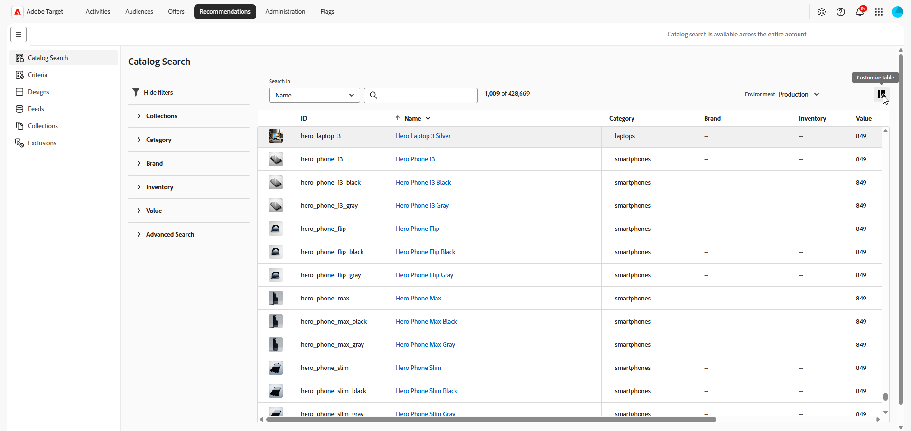
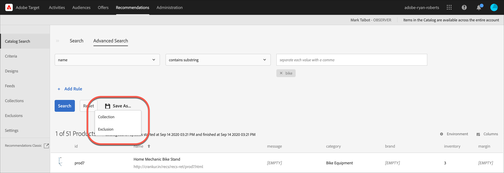

# [!UICONTROL カタログ検索] {#catalog-search}

>[!BEGINSHADEBOX]

**このページ：**&#x200B;では、[!DNL Adobe Recommendations]のカタログを検索して商品またはコンテンツを見つける方法と、アイテムをフィルタリング、表示、削除する方法について説明します。

>[!ENDSHADEBOX]

[!DNL Adobe Recommendations]の&#x200B;**[!UICONTROL カタログ検索]** ページは、カタログ内の製品またはコンテンツの検索に使用されます。 このページの最も基本的なタスクは、項目を検索することです。 このページでは、環境の変更、ファセットのフィルタリング、テーブルの列の変更なども可能です。

カタログは、商品セット（エンティティ）全体です。 商品を論理グループで整理する多数のコレクションを含めることができます。

カタログのインデックスは、最初のフィードがアップロードされたときに自動的に作成され、[指定されたスケジュール &#x200B;](/help/main/c-recommendations/c-products/feeds.md#steps)に従って更新されます。

カタログは、フィード ファイル、API、またはmboxの更新を通じて更新を受信すると、自動的に更新されます。 通常、1時間以内に更新が完了します。 更新が進行中の場合、最も新しく更新を開始した時間が表示されます。 更新が進行中でない場合、最も新しく更新を開始および終了した時間が表示されます。

## カタログを検索

検索結果を使用してカタログ内のアイテムを確認し、必要に応じてカタログからアイテムを削除します。

1. **[!UICONTROL Recommendations]** > **[!UICONTROL カタログ検索]**&#x200B;をクリックします。

1. （オプション）結果をフィルタリングするには、「**[!UICONTROL フィルターを表示]**」アイコン（）をクリックし、適用するフィルターを選択します。 使用可能なフィルターは、**[!UICONTROL 環境]**、**[!UICONTROL コレクション]**、**[!UICONTROL カテゴリー]**、**[!UICONTROL ブランド]**、**[!UICONTROL 在庫]**&#x200B;および&#x200B;**[!UICONTROL 値]**&#x200B;です。

   [環境](/help/main/administrating-target/environments.md)は、管理と分離されたレポート用にサイトと実稼動前の環境を整理します。 環境を変更するには、**[!UICONTROL 環境]** ドロップダウンリストから目的の環境を選択します。

   フィルターパネルが強調表示された

1. 「**[!UICONTROL 検索先]**」フィールドに検索語を入力します。

1. （オプション）オプションメニューから検索オプションを選択して、検索を絞り込みます。このオプションは、**[!UICONTROL 検索先]** フィールドの下向き矢印から開きます。

   次の検索オプションがあります。

   * ID
   * 名前
   * メッセージ

1. **[!UICONTROL テーブルをカスタマイズ]** アイコン （）をクリックして、**[!UICONTROL カタログ検索]** ページのアクティブな列を変更します。

   

1. 検索結果の項目をスクロールして、サムネールやその他の商品情報を表示します。

   >[!NOTE]
   >
   >数値を持つカスタム属性のカタログ検索では、結果はカスタム属性を数値ではなく文字列型として扱います。
   >
   >属性のタイプは現在変更できません。 変更を要求するには、[&#x200B; タイプが文字列から数値に変更する必要がある属性を参照して、顧客イシュー](/help/main/cmp-resources-and-contact-information.md#reference_ACA3391A00EF467B87930A450050077C)を開きます。

1. 検索結果内の項目をクリックして、ID、名前、メッセージ、カテゴリなどの詳細を表示します。

   

1. カタログからアイテムを削除するには、**[!UICONTROL カタログから削除]**&#x200B;をクリックします。

   その後、その項目に関するすべての情報がカタログインデックスから削除されます。 アイテムがカタログに再度含まれるのは、データフィードでアイテムが再度追加された場合のみです。 削除されたアイテムは、フィードとは別に削除する必要があります。

   

<!--
### Perform an advanced search {#advanced-search}

You can use [!UICONTROL Advanced Search] to further refine your search results or to save your search results as a [collection](/help/main/c-recommendations/c-products/collections.md) or [exclusion](/help/main/c-recommendations/c-products/exclusions.md).

1. Click the **[!UICONTROL Advanced Search]** link.

   

1. Use the drop-down lists to specify the parameter, operator, and values for your search.

1. (Optional) Click **[!UICONTROL Add Rule]** to add an additional search rule.

   Each additional search rule is joined with the AND operator.

1. Click **[!UICONTROL Search]**.

1. (Optional) Click **[!UICONTROL Save As]**, then click **[!UICONTROL Collection]** or **[!UICONTROL Exclusion]**.

   

   For more information, see [Create a collection or exclusion based on Advanced Search](#save-as) below.
-->

<!--
## Modify the Catalog Search page (filters and columns)

You can temporarily modify the available filters and columns on the [!UICONTROL Catalog Search] page for the current session.

### Modify filters

You can add additional filter facets to the [!UICONTROL Catalog Search] page.

1. In the **[!UICONTROL Filters]** panel, click **[!UICONTROL Modify]**.

   

1. Select the desired search facets (ID, name, message, etc.), then click **[!UICONTROL Save]**.

   

Keep in mind that the additional filter facets are available in the current session only.
-->

<!--
## Create a collection or exclusion based on Advanced Search {#save-as}

You can create [collections](/help/main/c-recommendations/c-products/collections.md) or [exclusions](/help/main/c-recommendations/c-products/exclusions.md) using [!UICONTROL Advanced Search] on the [!UICONTROL Catalog Search] page ([!UICONTROL Recommendations] > [!UICONTROL Catalog Search] > [!UICONTROL Advanced Search]).

1. Perform an [advanced search](#advanced-search).

1. Click **[!UICONTROL Save As]**, then click **[!UICONTROL Collection]** or **[!UICONTROL Exclusion]**.

   

   >[!IMPORTANT]
   >
   >The [!UICONTROL Advanced Search] functionality is case-insensitive; however, products returned at the time of delivery are based on case-sensitive search. This mismatch might lead to confusion. Ensure that you consider case-sensitivity when you create collections or exclusions based on results using the [!UICONTROL Advanced Search] functionality. For example, if you perform a search for "Holiday," that initial search lists results containing "Holiday" and "holiday." If you then create a catalog with the intent to return products containing "holiday," only products containing "holiday" are returned. Products containing "Holiday" are not returned. Exclusions are handled in a similar fashion.
-->
