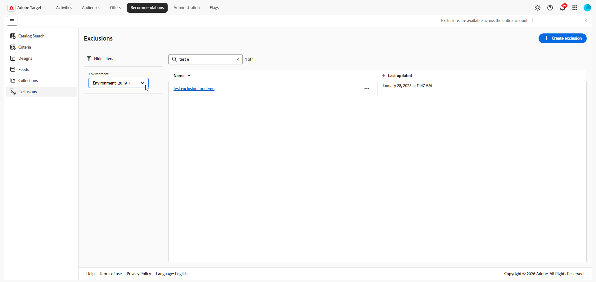
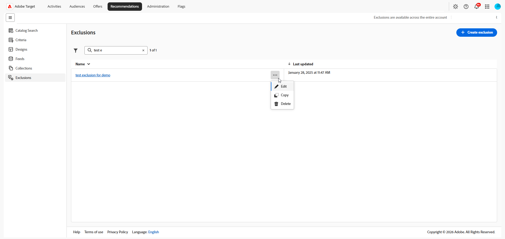

# 除外 {#exclusions}

>[!BEGINSHADEBOX]

**このページで：**&#x200B;製品またはコンテンツが訪問者に推奨されないようにするために、[!DNL Adobe Target Recommendations]で除外を作成および管理する方法を説明します。

>[!ENDSHADEBOX]

除外とは、訪問者に推奨すべきではない製品やコンテンツのサブセットのことです。 除外は、アカウント全体で使用できます。 [!DNL Recommendations] アクティビティの作成時に各エクスペリエンスに対して選択されるコレクションとは異なり、除外はアカウント全体のすべてのアクティビティに適用され、アクティビティの作成中に除外グループを割り当てることはできません。

除外は通常、次の場合に使用されます。

* 廃止された製品。
* カタログのアイテムが使用できなくなりました。 例えば、秋と冬のカタログのみがオンラインで表示される場合、夏のカタログのアイテムは購入できません。
* ほとんどのページやスクリーン（アダルト製品、NC-17映画など）で推奨するのが不適切な可能性があるアイテム。
* 不完全なメタデータフィールド（サムネール、価格、その他の重要なメタデータが含まれていない）を持つ製品。
* システム内に存在するものの、購入可能な商品ではないSKUや、QA チームが注文せずに購入をシミュレートするために使用する偽のSKUなど、推奨すべきではない製品。

>[!IMPORTANT]
>
>除外ルールは、すべての[環境](/help/main/administrating-target/environments.md)にグローバルに適用されます。
>
>静的および動的除外ルールに関する詳細情報、例、およびユースケースのシナリオについては、[動的および静的包含ルールの使用](/help/main/c-recommendations/c-algorithms/use-dynamic-and-static-inclusion-rules.md#inclusion-rules)を参照してください。

## 除外の作成

除外ルールは1回定義され、アカウント内のすべての[!DNL Recommendations] アクティビティに適用されます。

1. **[!UICONTROL Recommendations]** > **[!UICONTROL Exclusions]**&#x200B;をクリックして、既存の除外のリストを表示します。

   >[!NOTE]
   >
   >**[!UICONTROL Exclusions]** リストビューで各除外について報告された「項目数」は、設定されたデフォルトのRecommendations [&#x200B; ホストグループ &#x200B;](/help/main/administrating-target/hosts.md) （環境）内の、その除外のルールに一致する製品の数です。 デフォルトのホストグループを変更する方法について詳しくは、*Adobe Target開発者ガイド*&#x200B;の[計画と実装 [!DNL Recommendations]](https://experienceleague.adobe.com/ja/docs/target-dev/developer/recommendations){target=_blank}を参照してください。

1. **[!UICONTROL フィルターを表示]** アイコン （）をクリックし、**[!UICONTROL 環境]** ドロップダウンリストから目的の[環境](/help/main/administrating-target/environments.md)を選択して、その環境での除外の内容をプレビューします。 デフォルトでは、デフォルトのホストグループの結果が表示されます。

   フィルターパネルを開き、環境リストを表示する

1. 「**[!UICONTROL 除外を作成]**」をクリックします。

   

1. 除外&#x200B;**[!UICONTROL 名前]**&#x200B;を入力します。 オプションの説明も入力できます。

1. ルールビルダーを使用して除外を定義します。

   **[!UICONTROL ルール]** リストでパラメーターを選択し、演算子を選択してから、1つ以上の値を入力して製品を識別します。 複数の値はコンマで区切ります。

1. 「**[!UICONTROL 作成]**」をクリックします。

1. リスト内の目的の除外の横にあるその他のアクション アイコン（）をクリックし、適切なオプション（**[!UICONTROL 編集]**、**[!UICONTROL コピー]**、または&#x200B;**[!UICONTROL 削除]**）をクリックします。

   

<!--
## Create an exclusion using Advanced Search

You can also create exclusions using [!UICONTROL Advanced Search] on the [Catalog Search](/help/main/c-recommendations/c-products/catalog-search.md#save-as) page ( [!UICONTROL Recommendations] > [!UICONTROL Catalog Search] > [!UICONTROL Advanced Search]). 

After creating a search using "id > contains," for example, you can then click [!UICONTROL Save As] > [!UICONTROL Exclusion].

>[!IMPORTANT]
>
>The [!UICONTROL Advanced Search] functionality is case-insensitive; however, products returned at the time of delivery are based on case-sensitive search. This mismatch might lead to confusion. Ensure that you consider case-sensitivity when you create exclusions based on results using the Advanced Search functionality. For example, if you perform a search for "Holiday," that initial search lists results containing "Holiday" and "holiday." If you then create an exclusion with the intent to exclude products containing "holiday," only products containing "holiday" are excluded. Products containing "Holiday" are not excluded.
-->

## トレーニングビデオ：レコメンデーションでコレクションと除外を作成する（7:05） 

このビデオには、次の情報が含まれています。

* コレクションの作成
* 除外の作成

>[!VIDEO](https://video.tv.adobe.com/v/27689)
