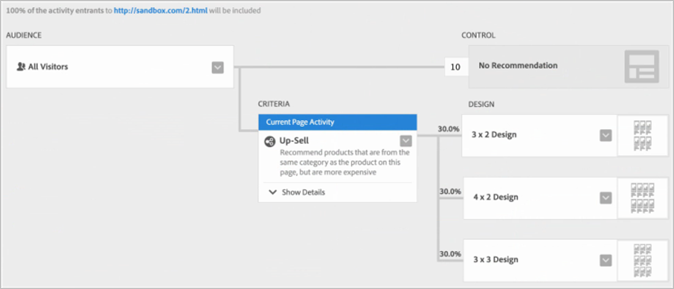

# Recommendations Classicと[!DNL Target] PremiumのRecommendations アクティビティの比較 {#classic-versus-activities}

>[!BEGINSHADEBOX]

**このページ：**&#x200B;では、[!DNL Recommendations Classic]が[!DNL Target Premium]の[!DNL Recommendations] アクティビティとどのように異なるかを説明します。

>[!ENDSHADEBOX]

>[!NOTE]
>
>[!DNL Recommendations] アクティビティは、 [!DNL Target Premium] ソリューションの一部です。 [!DNL Target Premium] ライセンスのない [!DNL Target Standard] では利用できません。

従来の [!DNL Recommendations] 製品では、ページでデータコレクション mbox を作成し、ページの特定の位置に表示 mbox を追加することによってレコメンデーションを表示しました。 [!DNL Target Premium]の[!DNL Recommendations] アクティビティは、訪問者情報を収集し、製品またはコンテンツが推奨される場所ごとにmboxを使用せずに、ページ上の任意の場所にレコメンデーションを作成します。 ページのヘッダーにJavaScriptのリファレンスを配置すると、ページ上の任意の場所でレコメンデーションが可能になります。 この参照は、`entity.id` キーや`entity.categoryId` キーなどのキーをグローバル [!DNL Target] mboxに渡します。

[!DNL Recommendations Classic] は、[!DNL Experience Cloud] UI で自身のカードとして表示されます。 [!DNL Recommendations] アクティビティは、[!DNL Target Premium] ワークフロー内で有効です。

[!DNL Recommendations Classic] の使用時は、[!DNL Recommendations] mbox を [!DNL Target Recommendations] で引き続き使用することができます。 従来のアプローチと[!DNL Target]のアプローチは、mboxを保持し、ヘッダーにJavaScript コードを使用して、ページ上の他の要素に対して[!DNL Recommendations]機能を有効にすることで、組み合わせることもできます。 ただし、[!DNL Target]の機能をすべて利用するには、[!DNL Recommendations Classic]人のユーザーが古いmboxを削除し、[!DNL Target Recommendations]のみに依存することを希望する場合があります。

[!DNL Target]の[!DNL Recommendations] アクティビティは、次の主な領域の[!DNL Recommendations Classic]に改善されます。

## オファーとしてのレコメンデーション {#recs-as-offer}

推奨事項は、[!UICONTROL A/B テスト &#x200B;] （[!UICONTROL 自動割り当て]および[!UICONTROL 自動ターゲット &#x200B;]を含む）および[!UICONTROL &#x200B; エクスペリエンスのターゲット設定] （XT）アクティビティに含めることができます。 これにより、同じアクティビティ内のレコメンデーションや非レコメンデーションのコンテンツなどをテストおよびターゲティングできます。 詳しくは、[オファーとしてのレコメンデーション](/help/main/c-recommendations/recommendations-as-an-offer.md)をご覧ください。

## 条件 {#criteria-comparison}

[!DNL Target Recommendations]には、事前パッケージ化されたルールと設定のセットを含む条件ライブラリが含まれています。 [!DNL Recommendations Classic]では、各レコメンデーションは、フォームに入力し、多くのルールのリストから選択して、手動で作成されました。 [!DNL Recommendations] アクティビティが作成されると、事前設定済みの基準セットが選択されます。 カスタムレコメンデーションは引き続き作成できますが、基準ライブラリには、最も一般的な設定の多くが含まれており、プロセスを簡素化し、人々が理解できる言語を使用するように事前に構築されています。 プリパッケージされた条件は、そのまま使用することも、特定のニーズに合わせてコピーして編集することもできます。

というラベルが付いた設定を含む基準カードのアップセルを示すスライド

条件は事前に設定されており、業種、ページタイプ、実装によって分類されています。 たとえば、小売の垂直方向に適用される基準は、特定のカテゴリ内の製品（`entity.categoryID` パラメーターで定義）を表示する製品ページで使用できます。

作成した条件の使用について詳しくは、[条件](/help/main/c-recommendations/c-algorithms/algorithms.md)を参照してください。

## ワークフロー {#workflow-comparison}

[!DNL Recommendations] ワークフローが簡略化されています。 視覚的なワークフローでは、複雑なフォームではなく、次の手順に従います。

1. 条件を選択します。
1. 事前設定済みの[&#x200B; デザイン &#x200B;](/help/main/c-recommendations/c-design-overview/create-design.md#create-design)を選択します。
1. レコメンデーションの結果をプレビューします。

## プレビュー表示 {#visual-preview}

レコメンデーションは設定後にプレビューでき、必要な変更を行うこともできます。ページにレコメンデーションを作成してからテストする必要はありません。 プレビューは、[!DNL Target] の内部でおこなうことができます。

## ターゲティング {#targeting-comparison}

[!DNL Recommendations Classic]には6つのターゲティングオプションがありました。 [!DNL Recommendations]件のアクティビティでは、[!DNL Target]件のターゲティングオプションの全範囲が使用されます。 オーディエンスは、[!DNL Target]またはその他[!DNL Adobe Experience Cloud]個のオーディエンス（[!DNL Audience Manager]や[!DNL Analytics]など）を使用して定義されます。 各デザインを表示するアクティビティ参加者の割合と、コントロールを表示する割合が選択されます。

## レポート {#reporting-comparison}

[!DNL Target]では、[!DNL Recommendations]さんが、[!DNL Target]と[!DNL Experience Cloud]の機能を活用した改善されたレポートを提供しています。 レポートには、[!DNL Recommendations]が提供する上昇率のみを表示する代わりに、[!DNL Recommendations] アクティビティに関する完全な情報が表示されます。

