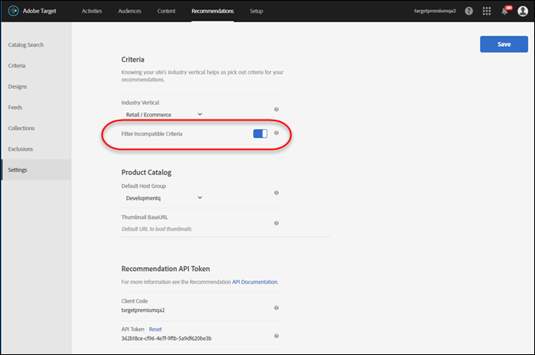
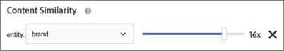

# レコメンデーション FAQ {#recommendations-faq}

>[!BEGINSHADEBOX]

**このページ：** [!DNL Adobe Target] [!DNL Recommendations]のアクティビティに関するよくある質問への回答を検索します。

>[!ENDSHADEBOX]

## データとAPI {#data-and-apis}

+++ APIを通じて作成された[!DNL Recommendations] オブジェクトは、[!DNL Target] UIに表示されますか？

はい。 APIを介して作成された[!UICONTROL Recommendations] オブジェクト （**[!UICONTROL 条件]**、**[!UICONTROL デザイン]**、**[!UICONTROL コレクション]**、および&#x200B;**[!UICONTROL 除外]**）は、UIで利用でき、APIまたは[!DNL Target] UIを介して編集できます。

+++

+++ [!DNL Target] UIで作成されたビジュアルオファーは、[!DNL Target] APIで管理できますか？

いいえ。 [!DNL Target] UIで作成されたビジュアルオファーを含む[!DNL Recommendations] アクティビティは、[!DNL Target] APIでは管理できません。 これらのアクティビティは&#x200B;**[!UICONTROL アクティビティ]** リストに表示されますが、（GETまたはPUTを使用して）読み取りや更新はできません。

+++

+++ 製品を挿入または更新するためのAPI呼び出しのサイズ制限は何ですか？ フィードの代わりに1回の通話で5万件の製品を更新できますか？

[!DNL Target]では、アプリケーションレベルで50 MBの投稿制限が課されますが、`application/x-www-form-urlencoded` コンテンツタイプヘッダーが渡された場合に限られます。

5万点の商品を用意し、1回の問い合わせが可能です。 呼び出しが失敗した場合は、バッチに分割できます。 Adobeでは、システム負荷によるタイムアウトの可能性を減らすために、5,000個または10,000個の商品のバッチを推奨しています。

+++

+++ フィードのアップロードに使用する CSV ファイルのサイズ上限を教えてください。

フィード CSV ファイルのアップロードの行数やファイルサイズにハードリミットはありません。 Adobeでは、アップロード時のエラーを回避するために、CSV ファイルを1 GBに制限することをお勧めします。 1 GBを超えるファイルは、複数のフィード ファイルに分割できます。

カスタム属性列の最大数は100で、カスタム属性は4096文字に制限されています。 必要な列の長さに関するその他の制限は、[[!DNL Target]  の制限ページ &#x200B;](/help/main/r-troubleshooting-target/target-limits.md)で確認できます。

+++

+++ 数値を持つカスタム属性を検索する場合、**[!UICONTROL カタログ検索]**&#x200B;で正しい結果が表示されないのはなぜですか？

数値を持つカスタム属性に対してカタログ検索を実行した場合、結果は属性を数値ではなく文字列として扱います。

お客様が属性のタイプを変更できる機能は現在使用できません。 変更を行うには、[&#x200B; タイプが文字列から数値に変更する必要がある属性を参照する顧客イシュー](/help/main/cmp-resources-and-contact-information.md#reference_ACA3391A00EF467B87930A450050077C)を開きます。

+++

## タイミングを更新 {#update-timing}

+++ カタログ内のアイテムの更新がサイトに反映されるまでにどのくらいの時間がかかりますか？

時間枠と結果は、項目の更新方法によって異なります。

| 更新 | レコメンデーション | カタログ検索 |
| --- | --- | --- |
| mboxまたはAPIを通じて更新された項目属性 | 15分以内 | カタログインデックスの後（3～8時間） |
| フィードを通じて更新された項目属性 | フィード取り込み後（2～8時間） | フィードの取り込み（2～8時間）とその後のカタログインデックス（3～8時間）の後、合計5～16時間以内 |
| [!DNL Target] UIまたはAPIを通じてカタログから削除された項目 | 15分以内 | カタログインデックスの後（3～8時間） |
| mboxまたはAPIを介してカタログに追加されたアイテム | 次のアルゴリズムの実行後。 アルゴリズム実行は、1 ～ 2日のアルゴリズムでは12時間ごとに、7日以上のアルゴリズムでは24時間ごとにスケジュールされます | カタログインデックスの後（3～8時間） |
| フィードを通じてカタログに追加されたアイテム | フィードの取り込み（2～8時間）とその後のアルゴリズムの実行後、合計2～32時間以内に、1～2日のアルゴリズムでは12時間ごとに、7日以上のアルゴリズムでは24時間ごとにスケジュールされます | フィード取り込み（2～8時間）とカタログインデックス（3～8時間）の後、合計5～16時間以内 |

アップデートが利用可能になるまで、次の内容が表示されます。

* 更新または削除された項目の場合は、既存の推奨事項と項目属性が表示されます。
* 追加された項目について、追加された項目がリクエストされたキーでない場合は、既存の推奨事項が表示されます。 追加された項目が要求されたキーである場合、バックアップの推奨事項が表示されます。

フィード ファイルを読み込んだ後、またはエンティティの更新をAPIまたはmboxを通じて受信した後、次の変更が60分以内に反映されます。

* 以前に除外された項目が含まれるようになった場合、その項目は次のアルゴリズム実行（12～24時間）に含まれます。

  こうした状況が発生するのは、[!DNL Target] がオンラインとオフラインの両方で除外を適用するからです。 項目を新たに除外すると、オンラインでの除外はすばやく適用されます。 新しい項目が含まれると、オンライン除外はすぐに消えますが、オフライン除外は次のアルゴリズムが実行されるまで消えません。

* 以前に項目が含まれていたが今は除外する必要がある場合、その項目は、ソースに応じて、テーブル内のタイムラインに従って除外されます（mboxまたはAPIを介して15分、フィードを介して12～24時間）。

次の変更は、次のアルゴリズムの実行（12 ～ 24時間以内）まで反映されません。

* アクティビティのコレクションルールで使用される項目属性。
* アクティビティに関連付けられた属性またはコレクションに基づくプロモーションで使用される項目属性。
* **[!UICONTROL 販売者]**&#x200B;または&#x200B;**[!UICONTROL 最も閲覧された]** アルゴリズムの「現在のカテゴリ」または「お気に入りのカテゴリ」に表示されるアイテム カテゴリ。
* 変更された属性がアルゴリズムのカスタムキーとして使用されるカスタム属性である場合の、推奨アイテムのランキング。
* 1つ以上の変更された属性に基づく推奨アイテムのランキング、レコメンデーションロジックが「類似した属性を持つアイテム」の場合、または「コンテンツの類似性」または「属性の重み付け」の要素を使用する場合。

>[!NOTE]
>
>フィードファイルは、そのステータスが「項目の読み込み」から「検索インデックスの更新を準備中」に変更される際に読み込まれるとみなされます。 更新は、**[!UICONTROL カタログ検索]** ユーザーインターフェイスに反映されるまでに60分以上かかる場合があります。 **[!UICONTROL カタログ検索]**&#x200B;は、フィードのステータスが「更新完了」に変更されたときに最新の状態になります。 **[!UICONTROL カタログ検索]**&#x200B;がまだ最新でない場合でも、サイトは上記の時間枠内で更新を反映します。 最新の&#x200B;**[!UICONTROL カタログ検索]** インデックス更新時間は、**[!UICONTROL カタログ検索]** ページに表示されます。

+++

+++ [!UICONTROL Recommendations]のアクティビティ、オファー、プロモーション、または条件設定の設定を変更して、サイトに反映するのにどのくらいの時間がかかりますか？

* プロモーション設定の変更がサイトに反映されるまでに最大5時間かかる場合があります。
* 他の条件設定に対する変更は、次のアルゴリズムが実行されるまで反映されない場合があります。

  * 動的インクルージョンルールの追加など、一部の条件設定は即座に反映されます。
  * 動的インクルージョンルールの削除やルックバックウィンドウの変更など、その他の条件設定は、次のアルゴリズムが実行されるまで組み込めません。
  * これらの変更はアルゴリズムの実行をトリガーしますが、完了には最大で24時間かかる場合があります。 また、アルゴリズムは12～24時間ごとにスケジュールで実行されます。

+++

+++ ユーザーの行動（製品Aのクリックや製品Bの購入など）が、同じユーザーが受け取るレコメンデーションに反映されるまでにどのくらいの時間がかかりますか？

* 現在表示または購入されている製品またはコンテンツは、ユーザーが同じページビューまたは[!DNL Target] コンテンツリクエストで受け取るレコメンデーションに影響します。
* 「最後に閲覧した製品」、「最も閲覧した製品」、全体的な閲覧履歴や購入履歴などの過去のユーザー行動は、そのリクエストで更新されます。 次のページビューやコンテンツリクエストでユーザーが受け取るレコメンデーションに影響します。 例えば、**[!UICONTROL 最近閲覧したアイテム]**&#x200B;と&#x200B;**[!UICONTROL おすすめアイテム]**&#x200B;のアルゴリズムは、製品の表示または購入ごとに更新され、その更新は後続のコンテンツリクエストに反映されます。

+++

+++ ユーザーの行動が、他のユーザーが受け取るレコメンデーションに反映されるまでにどのくらいの時間がかかりますか？

オフラインアルゴリズム処理には、集計中のユーザの行動が組み込まれる。 この処理は、アルゴリズムが実行されるたびに、12～24時間ごとに行われます。

+++

+++ 最近閲覧した項目に基づくレコメンデーションは、1 人の訪問者に対して複数のデバイスにわたって保持されますか？

訪問者がセッションを開始すると、セッション IDは単一のエッジマシンに関連付けられ、一時的なプロファイルキャッシュがこのマシンに保存されます。 同じセッションからの後続のリクエストは、最近閲覧した項目を含め、このプロファイルキャッシュを読み取ります。

セッションが終了すると（通常はアクティビティなしで30分後に期限切れになります）、最近表示された項目を含むセッションの状態は、同じ地理的エッジ内のより永続的なプロファイルストレージに保持されます。 新しいセッションが同じMarketing Cloud ID （MCID）、Experience Cloud ID （ECID）、またはCustomerIDまたは`mbox3rdPartyId`を通じて顧客プロファイルにリンクされている限り、異なるデバイスからの後続のセッションは、これらの最近表示された項目にアクセスできます。

訪問者が同時に2つのアクティブなセッションを持っている場合、デバイスがセッション IDの共有を強制されない限り、1つのデバイスで最近表示された項目は、他のデバイスで最近表示された項目を更新しません。 回避策が存在する可能性がありますが、[!DNL Target]では、複数のデバイス間でのセッション IDの共有を直接サポートしていません。 お客様はこのID共有を管理する必要があります。

この動作は、訪問者があるデバイスでアクティブになり、数分後に別のデバイスでアクティブになる場合にも発生します。 最初のデバイスのセッションは30分間は期限切れにならず、プロファイル状態が永続的な状態に書き込まれて処理されるまでに、最大5分の遅延が発生する可能性があります。 この動作をテストする場合は、セッションの有効期限が切れ、プロファイルが保存されるまで35分かかります。

訪問者が同時に2つのアクティブなセッションを持っていない場合、セッションが終了している限り、あるデバイスで最近表示された項目は、別のデバイスで最近表示された項目を更新します。 この動作をテストする場合は、セッションの有効期限が切れるまで35分かかります。

+++

## 基準、デザイン、プロモーション {#criteria-designs-promotions}

+++ [!DNL Recommendations] アクティビティの作成時に、カスタム条件を含むすべての条件を選択できないのはなぜですか？

使用可能な基準は、現在のカテゴリによって異なります。 レコメンデーションオファーが作成されると、アルゴリズムピッカーにカテゴリ IDに基づく条件が表示されます。 条件が適用される場所にカテゴリ IDが含まれていない場合、特定の条件はアルゴリズムピッカーで使用できません。 mbox内にカテゴリ IDが存在する場所が使用されている場合、条件ピッカーには、該当するすべての条件が含まれます。

[!DNL Target]には、アルゴリズム ピッカーのインテリジェント フィルタリングを制御する[Filter Incompatible Criteria](https://experienceleague.adobe.com/docs/target-dev/developer/recommendations.html?lang=ja){target=_blank}設定があります。 **[!UICONTROL 互換性のない条件をフィルター]**&#x200B;設定にアクセスするには、**[!UICONTROL 管理]** > **[!UICONTROL 推奨事項]**&#x200B;をクリックします。



* **[!UICONTROL 互換性のない条件をフィルター]**&#x200B;設定が有効になっていない場合、[!DNL Target]はアルゴリズム ピッカーのアルゴリズムをフィルタリングせず、すべてのアルゴリズムが表示されます。
* 設定が有効になっている場合、[!UICONTROL Visual Experience Composer] （VEC） アクティビティで、[!DNL Target]は選択した場所からentityIdとカテゴリ IDを読み取ります。 次に、それぞれの値がその場所に存在する場合、`currentItem|currentCategory`に基づくアルゴリズムが表示されます。 これにより、デフォルトでは、選択した場所と互換性のあるアルゴリズムのみがアルゴリズムピッカーに表示されます。 互換性のないアルゴリズムは、条件を選択する際に「**[!UICONTROL 互換性がある]**」チェックボックスをオフにすることで、引き続き表示できます。

  

次の特殊なケースでは、[!DNL Target]は&#x200B;**[!UICONTROL 互換性]** チェックボックスを表示しません。

* entityIdとカテゴリ IDの両方が場所に存在するため、何もフィルタリングされません。
* バージョン 55以前の[!DNL mbox.js]が使用されています。
* ページ （`!config.isAutoCreateGlobalMbox && !config.isRegionalMbox`）からmbox呼び出しは実行されません。
* [!DNL Target] のパラメーターが定義されていません。

>[!NOTE]
>
>**[!UICONTROL 互換性のない条件をフィルター]**&#x200B;設定は、[!UICONTROL Visual Experience Composer] （VEC）で作成されたアクティビティにのみ適用されます。 この設定は、**[!UICONTROL フォームベースのExperience Composer]**&#x200B;で作成されたアクティビティには適用されません。[!DNL Target]には場所コンテキストがないからです。

+++

+++ 一般的な属性の重み付けとコンテンツの類似性固有の属性の重み付けの違いは何ですか？

属性の重み付けには、「標準属性の重み付け」と「コンテンツの類似性属性の重み付け」の2つの形式があります。

* 「標準属性の重み付け」は、**[!UICONTROL コンテンツの類似性]**&#x200B;だけでなく、ほとんどの条件タイプに適用されます。 このタイプの重み付けでは、特定の属性値により多くの重みが付けられます。 次の例では、出力レコメンデーションで、Nike 製品の重みが大きくなります。

  ブランド属性がNikeで始まり、スライダーが25%に設定された

* 「コンテンツの類似性属性の重み付け」は、**[!UICONTROL コンテンツの類似性]**&#x200B;条件にのみ適用されます。 このタイプの重み付けはより動的で、現在の「レコメンデーションキー」（現在表示されている項目）に基づいています。 次の例（ブランド x 16）では、Nikeのスニーカーを閲覧した訪問者は、競合他社のスニーカーよりもNikeの他の商品（必ずしもスニーカーに限らない）を推奨される可能性が高くなります。 Adidasのスニーカーを閲覧した訪問者は、Adidas商品を勧められる可能性が高くなります。

  ブランド属性と重み付けスライダーが16xの コンテンツの類似性セクション

+++

+++ [!DNL Recommendations]の条件、プロモーション、またはテンプレート テスト ルールを作成する際に、mbox名を指定する必要がありますか？

[!DNL Recommendations]条件、プロモーション、またはテンプレートのテストルールがmbox パラメーターに基づいて作成されると、`mboxParameter`は`mboxName`の入力を求めなくなりました。 mbox 名はオプションになりました。 この変更により、複数のmboxからパラメーターを使用したり、エッジにまだ記録されていないパラメーターを参照したりできます。

目的のパラメーターを選択するには、次のいずれかの方法を使用します。

* 条件、プロモーション、またはテンプレートのテストルールを作成する際に、リストからパラメーター名を選択します。 パラメーター名の最初の文字を入力するか、フルネームを入力します。
* mbox名が既知であるがパラメーター名が不明な場合は、目的のパラメーターを渡す既知のmboxでフィルタリングする場合にチェック ボックスを使用します。

どちらのメソッドでも、mboxとパラメーターの間にリンクはありません。 条件、プロモーション、またはテンプレートのテストルールは、そのパラメーターを渡すすべてのmboxのパラメーターに基づいて動作します。

既存の条件、プロモーション、またはテンプレートのテストルールを編集すると、作成時に指定されたmbox名がフィルタリングに表示されます。

+++

+++ 特殊文字が配列を分割する場合はどうすればよいですか？

JavaScript のエスケープ値を使用してください。 引用符（&quot;）を使用すると、配列が壊れる恐れがあります。 エスケープ値を使用したコードスニペットの例を次に示します。

```
#set($String='') 
#set($escaper=$String.class.forName('org.apache.commons.lang.StringEscapeUtils')) 
<script type="text/javascript"> 
console.log("$escaper.escapeJavaScript($entity1.name)") 
console.log("$escaper.escapeJavaScript($entity2.name)") 
console.log('$escaper.escapeJavaScript($entity3.name)') 
names.push("$escaper.escapeJavaScript($entity4.name)") 
</script>
```

+++

+++ エンティティを動的に除外できますか？

はい。 レコメンデーションから除外するエンティティのエンティティ IDは、クエリ文字列で渡すことができます。 例えば、既にショッピングカートに入っている商品は除外できます。

除外機能を有効にするには、`excludedIds` mbox パラメーターを使用します。 このパラメーターは、コンマ区切りのエンティティ IDのリスト（例：`mboxCreate(..., "excludedIds=1,2,3,4,5")`）を指します。 値は、レコメンデーションがリクエストされたときに送信されます。

除外は、現在の[!DNL Target]呼び出しにのみ実行されます。 `excludedIds`の値が再度渡されない限り、以降の[!DNL Target]呼び出しでアイテムは除外されません。 各ページのレコメンデーションからカート内のアイテムを除外するには、引き続き各ページで`excludedIds`の値を渡します。

`entityIds`を除外するには、`&excludes=${mbox.excludedIds}` トークンをオファーコンテンツ URLに追加します。 コンテンツ URLが抽出されると、必要なパラメーターは現在のmbox リクエストパラメーターに置き換えられます。

デフォルトでは、この機能は新しく作成されたレコメンデーションで有効になります。 動的に除外されたエンティティをサポートするには、既存の推奨事項を保存する必要があります。

>[!NOTE]
>
>除外されるエンティティが多すぎる場合、レコメンデーションテンプレートを埋めるのに十分なエンティティがないかのように、レコメンデーションが動作します。

+++

+++ 新しいオーディエンスを定義した後、従来の[!DNL Recommendations] アクティビティを保存できないのはなぜですか？

オーディエンスに一意の名前が付けられていることを確認してください。 オーディエンスが既存のオーディエンスと同じ名前を持つ場合、従来の[!DNL Recommendations] アクティビティ（2016年10月より前に作成された[!DNL Recommendations] アクティビティ）を保存することはできません。

+++

+++ [!DNL Adobe Recommendations Classic]で作成されたアルゴリズムを[!DNL Recommendations Premium]で使用できますか？

[!DNL Recommendations Classic] で作成されたアルゴリズムは、[!DNL Recommendations Premium] ではサポートされていません。 レガシーアルゴリズムは[!DNL Target Premium]で使用できますが、[!DNL Target Premium] UIでアクティビティが非アクティブ化または削除されると、同期の問題が発生する可能性があります。 2つのソリューションの違いについて詳しくは、[[!DNL Recommendations Classic] と [!DNL Recommendations] の [!DNL Target Premium]](/help/main/c-recommendations/c-recommendations-faq/recommendations-classic-versus-recommendations-activities-target-premium.md)のアクティビティを参照してください。

+++

+++ 新しい記事やビデオのみを推奨するにはどうすればよいですか？

メディア&amp;パブリッシング業界の顧客は、多くの場合、最新の記事や動画のみを掲載して推奨を得ることを望んでいます。 例えば、[!DNL Target]のお客様は、次のアプローチを使用して、60日未満の記事をレコメンドしました。

1. 記事の公開日をYYYMMDD形式でカスタムエンティティ属性として渡します。 次に例を示します。

   | エンティティ属性 | 例 |
   | --- | --- |
   | issueDate | 2021218 |
   | lastViewDate | 2021701 |
   | parentCategory | commentary |
   | publishDate | 20210113 |
   | publishDateDisplay | 2021 年 1 月 13 日（PT） |

1. 今日の日付から60日を差し引いた日付をYYYMMDD形式で返すプロファイルスクリプトを作成します。

   

1. 条件に動的インクルージョンルールを使用して、`publish date > today's date minus 60 days`を指定します。

   プロファイル属性の一致ルールを持つに保存されている値を比較します

この例では、`priorDate60`値をmbox パラメーターとして渡すことで、パラメーターのマッチングを行うこともできます。

+++

## トラブルシューティング {#troubleshooting}

+++ [!DNL Target] でレコメンデーションを表示できないことがあるのはなぜですか？

使用可能なレコメンデーションの数が少ないため、[!DNL Target]がレコメンデーションを表示できない場合があります。

各基準に対して生成される値の数は、デザインで指定されたエンティティの数の3倍になります。 実行時フィルタリング（在庫やmbox属性のマッチングなど）は、3x値が生成された後に適用されるので、配信時に残る値は3x未満になります。 これを軽減するためには、他のエンティティを非表示にして、デザインのエンティティ数を増やします。

次の JavaScript は、デザインの始めで利用可能で、リクエストされるエンティティの数を増やすことができます。 この例では、要求されたエンティティ数は30 （3x10）です。

```
#foreach($entity in $entities) 
 #if( $foreach.count > 10 ) 
  #break 
 #end 
 #set ($foo = $entity.id) 
#end 
```

+++

+++ [!DNL Recommendations] コンテンツ トレースで返されることがあるNO_CONTENT応答は何を意味しますか？

リクエストされたアルゴリズムとキーの組み合わせでレコメンデーションを使用できない場合、NO_CONTENT が返されます。 この状況は、通常、アルゴリズムでバックアップが無効になっており、次の条件の1つ以上も満たされている場合に発生します。

* 結果の準備がまだ整っていない。

  この状況は通常、新しく作成されたアクティビティが最初に保存された場合、またはアクティビティで使用されるコレクション、条件、プロモーションに設定を変更した後に発生します。

* 結果は準備完了ですが、リクエストされたアルゴリズムとキーの組み合わせに対して最も近いエッジサーバーにまだキャッシュされていません。

  リクエストはキャッシュ操作を開始するので、この問題は数回のページのリロード後または数分後に解決します。

* 結果の準備は整っているが、指定されたキー値には使用できない。

  この状況は通常、最新のアルゴリズム実行後にカタログに追加されたアイテムに対してレコメンデーションが要求された場合に発生します。 次のアルゴリズムの実行後に解決されます。

* テンプレートの部分レンダリングが無効になっているため、テンプレートに入力するのに十分な結果が得られない。

  この状況は通常、可能な結果から多くの項目を積極的にフィルタリングする動的インクルージョンルールで発生します。 この状況を回避するには、バックアップを有効にして包含ルールをバックアップに適用しないか、アグレッシブにフィルタリングされていない条件で条件を順次使用します。

+++

+++ [!DNL Recommendations]のコレクションがゼロ （0）になった場合はどうすればよいですか？

以前はゼロになっていなかったコレクションがゼロになる場合は、次の点を考慮してください。

* コレクションを再保存し、番号が更新されるかどうかを確認します。 再保存すると、そのコレクションを使用するすべてのアルゴリズムが再実行されます。
* 適切な環境が表示されていることを確認します。 **[!UICONTROL 管理]** > **[!UICONTROL 推奨事項]**&#x200B;をクリックし、**[!UICONTROL 製品カタログ]** セクションの&#x200B;**[!UICONTROL 既定のホストグループ]**&#x200B;設定を確認します。

  製品カタログセクションで「デフォルトのホストグループ」ドロップダウンがハイライト表示された管理タブの

* インデックスが最新であることを確認します。 **[!UICONTROL Recommendations]** > **[!UICONTROL カタログ検索]**&#x200B;をクリックし、インデックスの経過時間を確認します（例：「3時間前にインデックス作成」など）。 インデックスは必要に応じて更新できます。
* フィードまたはデータレイヤーで何かが変更され、その結果、エンティティがコレクションルールと一致しなくなったかどうかを確認します。 大文字と小文字が一致することを確認します（ルールでは大文字と小文字が区別されます）。
* フィードが正常に実行されたかどうか、または誰かがFTP ディレクトリやパスワードなどを変更したかどうかを確認します。
* [!DNL Target]は（顧客ページまたはアプリ上の）配信をできるだけ早く更新し、マーケターにUIで表現を提供する必要があります。 [!DNL Target] では、UI の更新が同期されるのを待つために、配信の更新を遅延させません。 [mboxTrace](/help/main/c-activities/c-troubleshooting-activities/content-trouble.md)を使用して、リクエストが受信された時点のシステム内の内容を確認します。

+++

+++ [!DNL Recommendations] アクティビティで&#x200B;**[!UICONTROL データをダウンロード]** アクションが失敗するのはなぜですか？

[!DNL Recommendations] アクティビティの&#x200B;**[!UICONTROL アクティビティの概要]** ページで&#x200B;**[!UICONTROL データのダウンロード]**&#x200B;をクリックすると、[!DNL Target] ユーザーインターフェイスにエラー`Error while fetching recommendation data file.`が表示される場合があります

このエラーは、通常、アクティビティの結果セットが非常に大きい場合に発生します。 生成されたCSVは、1回のダウンロードでユーザーインターフェイスから返すことができる応答サイズを超えています。 レコメンデーションデータ自体は維持されます。 このサイズのファイルを配信できるのは、ブラウザー内のダウンロードパスのみです。

+++

## 既知の問題 {#known-issues}

[!UICONTROL Recommendations] アクティビティに関する既知の問題は次のとおりです。

* [!DNL Target]が`getOffer()`を含むJSON オファーを返すと、JSONの型が返されます。 ただし、JSON [!DNL Recommendations] デザインでは、HTMLの型が返されます。
* 期限切れのエンティティは、フィードまたはAPIを通じて更新を受け取ってから60日後に正しく期限切れになります。 ただし、有効期限が切れたエンティティは、有効期限が切れた後に&#x200B;**[!UICONTROL カタログ検索]** インデックスから削除されません。 フィードまたはAPIを通じて削除されたエンティティは、現在、**[!UICONTROL カタログ検索]** インデックスからも削除されていません。 （IRI-857）
* A/Bおよびエクスペリエンスのターゲット設定アクティビティの[!DNL Recommendations]件のオファーで、[!DNL Recommendations] トレイの視覚的なプレビューが表示されない。 （TGT-33426）
* 条件リスト（カード）ビューに表示されるカスタム条件フィードのステータスは、10分ごとに更新され、まれに10分以上古くなることがあります。 カスタム条件の編集ビューに表示されるステータスはリアルタイムで取得され、常に最新の状態になります。 （TGT-35896、TGT-36173）
