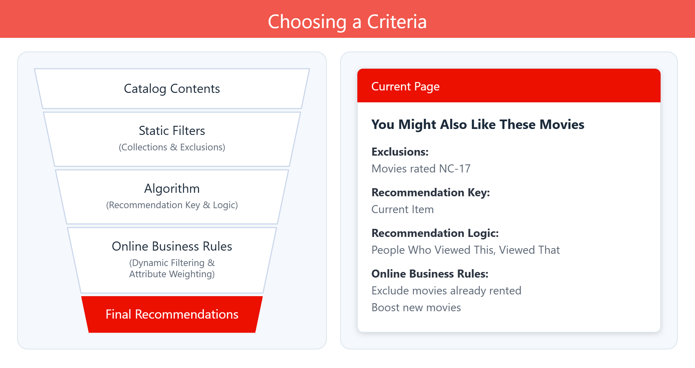
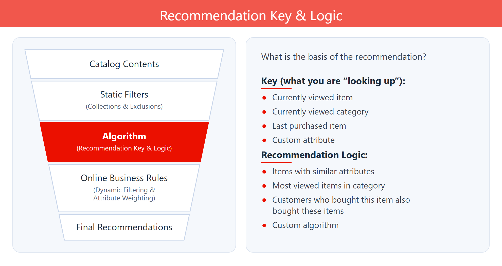
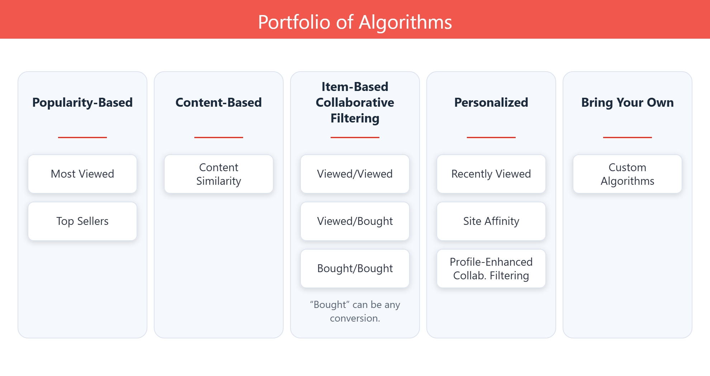
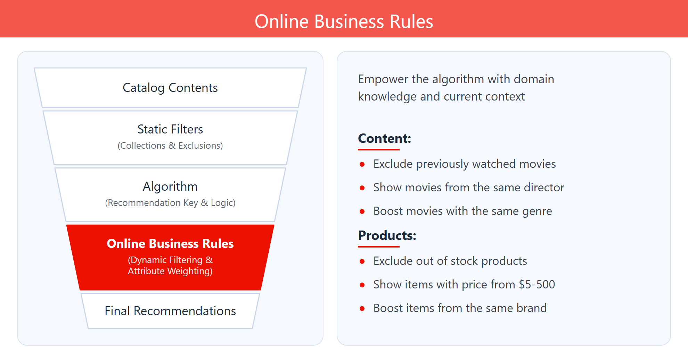

# レコメンデーションの概要 {#introduction-to-recommendations}

>[!BEGINSHADEBOX]

**このページ：**&#x200B;では、[!DNL Adobe Target]の[!DNL Recommendations]のアクティビティが訪問者に関連する製品またはコンテンツをどのように表示するか、および[!DNL Recommendations]の実装とアクティビティを計画および構築する方法について説明します。

>[!ENDSHADEBOX]

このページは、*推奨事項の概要* ウェビナーに基づいています。 [!DNL Recommendations] アクティビティは、以前の訪問に基づいてリアルタイムの提案を最適化することで、顧客が興味を持つ可能性のある製品またはコンテンツを自動的に表示します。 このページでは、[!DNL Target] UIで[!DNL Recommendations] アクティビティを構築する方法についても説明します。

## はじめに

顧客は、レコメンデーションを期待し、それを出発点として利用可能な他のオプションを検討するようになっています。 ほとんどすべての人が、店舗でもデジタル資産でも、レコメンデーションで初めて見た商品を購入しています。

視聴者がメディアやコンテンツを利用する方法は、パーソナライズされたレコメンデーションが重視されるようになっています。Netflix、Spotify、YouTubeなどのデジタルファースト企業は、レコメンデーションを通じて顧客体験を向上させています。 かつてないほど多くの選択肢が利用可能になっている中、インタラクションの時点で顧客にとって最も関連性の高いコンテンツを特定することが重要です。

マーケターは、[!DNL Adobe Target] を使用して、幅広い業種、お客様のタイプおよびチャネルにわたってパーソナライズされたエクスペリエンスを推進します。 次の表は、顧客が[!DNL Target]を使用してパーソナライズされたレコメンデーションを配信する方法の例をいくつか示しています。

| ユースケース | 例 |
|---|---|
| 投稿 | Web パブリッシャーは[!DNL Target Recommendations]を使用して、サイト訪問者に記事を推奨し、エンゲージメントを向上させます。 |
| ビデオチュートリアル | [!DNL Adobe Creative Cloud]は[!DNL Target]を使用して、Photoshop アプリケーションでPhotoshop ユーザーにビデオチュートリアルをレコメンドしています。 |
| ゲーム | ゲーム会社は、[!DNL Target]を使用して、ゲーム機のユーザーにゲームやコンテンツをレコメンドしています。 |
| B2B セールス | 企業間企業は、[!DNL Target]を使用して、B2B見込み顧客にビデオ、ホワイトペーパー、ブログ記事を推奨し、ダウンロードを提供し、既存顧客にヘルプを提供します。 |
| 旅行 | ドイツの旅行予約者が[!DNL Target]を使用して、旅行者にホテルなどを勧めています。 詳しくは、[Adobe Summit セッション &#x200B;](https://2017.summit.adobe.com/na/sessions/summit-online/online-2017/#17608){target=_blank}を参照してください。 |
| 小売 | 大手B2B retailerは、[!DNL Target]を使用して、ブラウザーとモバイルアプリで訪問者を再訪問する際に上位のカテゴリーと商品をレコメンドしています。 |

## 優れたレコメンデーションの要素

優れたレコメンデーションは関連性が高く、パーソナライズされている： 関連性とパーソナライゼーションを促進する3つの要素：

* **マーケターは**&#x200B;を制御して、推奨項目の関連性を高めます。 マーケターは、レコメンデーションモデルで検討すべき製品やコンテンツの属性を把握しています。 例えば、動画サイトでは、オーディエンスは同じディレクターの映画に興味を持つかもしれませんが、同じスタジオの映画には興味を持たないかもしれません。 [!DNL Target]は、このドメイン知識を使用してアルゴリズムを強化するためのコントロールを提供します。
* **洗練されたモデル**&#x200B;を使用して、数百万のカタログ項目とインタラクションイベントを理解できます。 [!DNL Target]は、10年に及ぶ経験を基にマシンラーニング機能を構築しており、年間数十億件のレコメンデーションを処理しています。
* **ユーザーコンテキスト**&#x200B;を使用して、レコメンデーションがタイムリーで関連性のあるものであることを確認します。 例えば、オーディエンスが視聴した動画や、カートに追加したシャツなどをレコメンデーションに含めないでください。 [!DNL Target] ユーザープロファイルは、パーソナライゼーションを確保するための推奨事項に使用できます。

## [!DNL Target] レコメンデーションの実装

まず、次の点を定義する戦略を作成します。

* **お勧めのアイテム**：製品、ビデオ、コンテンツ
* **レコメンデーションの場所**: チャネル（web、モバイル、実店舗、キオスクなど）、カスタマージャーニーの一部、レコメンデーションを含むサイトのページ。
* **成功測定**：レコメンデーションのないエクスペリエンスをレコメンデーションのあるエクスペリエンスと比較したり、2種類のレコメンデーションを比較したりして、レコメンデーションが成功したかどうかを判断する方法。 顧客生涯価値への影響といった一部の指標は直接測定することが難しいため、1訪問あたりの売上、平均注文額、クリック数など、より具体的な指標の方が使いやすいことがよくあります。 場合によっては、目標は指標を最小限に抑えることです。たとえば、サポート呼び出しの数などです。

戦略を定義した後、[!DNL Target Recommendations]の実装には、次の3つの大まかな手順が必要です。

### コンテンツまたは製品について[!DNL Target]に教える

[!DNL Recommendations]で始めると、推奨するすべての項目に関する情報が渡されます。

最も簡単で頻繁に使用される方法は、製品情報管理システムまたはコンテンツ管理システムからCSV ファイルを毎日または毎週送信することです。 その他のオプションとして、[!DNL Adobe Target] JavaScript ライブラリを使用してページからデータレイヤーに関する情報を渡したり、APIを使用してソースシステムから直接情報を渡したり、既に[!DNL Analytics]にカタログデータを渡している場合は[!DNL Adobe Analytics]統合を使用したりします。 複数のオプションを同時に使用できます。例えば、ほとんどのデータをCSV ファイルを介して毎日渡したり、APIを介してより頻繁にインベントリ更新を渡したりできます。 通常、このステップの設定にはIT部門が関与します。

どちらの方法を選択しても、各項目に関するメタデータを3つのカテゴリに含めることができます。

* レコメンデーションを受け取ったユーザーに表示する&#x200B;**データ。** 例えば、映画の名前やサムネール画像 URL です。
* マーケティングとマーチャンダイジングのコントロールを適用するのに役立つ&#x200B;**データ。** 例えば、映画の評価で、NC-17 映画をレコメンデーションしないようにできます。
* **項目と他の項目の類似性を判断するのに役立つデータ。** 例えば、映画のジャンルや映画に出演している役者です。

### ユーザー行動のキャプチャ

タグを追加するか、既存の[!DNL Analytics]実装を使用して、[!DNL Target]がユーザーが表示および購入するアイテムを認識できるようにします。 購入が自身のコンテキストに関係ない場合は、別のタイプのコンバージョンイベント（例：PDFのダウンロード、アンケートへの回答、ニュースレターの購読、動画の視聴など）を追跡します。

既に[!DNL Target]を使用してサイトでA/B テスト アクティビティを実行している場合は、この手順を既に完了している可能性があります。 既に[!DNL Adobe Analytics]を使用してサイト訪問とコンバージョン行動のレポートを作成している場合は、[!DNL Analytics]を行動データソースとして使用できます。 それ以外の場合、最も簡単なオプションは、[[!DNL Adobe Experience Platform]](https://experienceleague.adobe.com/docs/target-dev/developer/client-side/at-js-implementation/deploy-at-js/implement-target-using-adobe-launch.html?lang=ja){target=_blank}のタグなどのタグマネージャーを使用してこれを設定することです。 オフラインまたはアプリ内のインタラクションは、リアルタイム APIを介して[!DNL Target]に送信することもできます。

### 適切なコンテキストでのレコメンデーションの取得

集計でのユーザーの動作に加えて、[!DNL Target]には、ページに関する情報とユーザープロファイルからの情報を含む、レコメンデーションが表示される特定のコンテキストが必要です。 [!DNL Target]は、この情報を使用してアイテムをフィルタリングし、レコメンデーションのパーソナライゼーションを改善します。

## 最初のレコメンデーションアクティビティの構築

[!DNL Recommendations] アクティビティは、オーディエンス、条件、デザインを組み合わせたものです。 [!DNL Target]には、14の組み込みオーディエンス、42の組み込み基準、10の組み込みデザインテンプレートが含まれています。 これらの各項目をカスタマイズするか、独自の項目を追加できます。

[!DNL Target]は、条件カードの概念を使用しています。これは、パーソナライゼーションのレシピのようなものです。 適切な基準を選択または作成することは、意図したパーソナライゼーション結果を達成するために重要です。 基準カードはfunnelのように機能し、カタログ全体から最終的なレコメンデーションのセットに移動します。

以下の節では、このfunnelの一部と、それらが[!DNL Target]でどのように機能するかについて説明します。

### 静的フィルター（コレクションおよび除外）

静的フィルターは、頻繁に変更される予定がないカタログ属性に関連する広範に適用可能なルールなので、複数のレコメンデーションで使用できます。

### アルゴリズム（レコメンデーションキーおよびロジック）

次のステップは、レコメンデーションの基礎となるレコメンデーションキーとロジックを選択します。 レコメンデーションキーは、レコメンデーションを選択するために「検索」するものです。

[!DNL Target]には、アルゴリズムのポートフォリオが含まれています。

### オンラインビジネスルール

最後のステップは、オンラインビジネスルールを適用することです。これにより、訪問者がデジタルプロパティで何をしているのかに基づいて、ドメインに関する知識と現在のコンテキストでアルゴリズムを強化できます。

