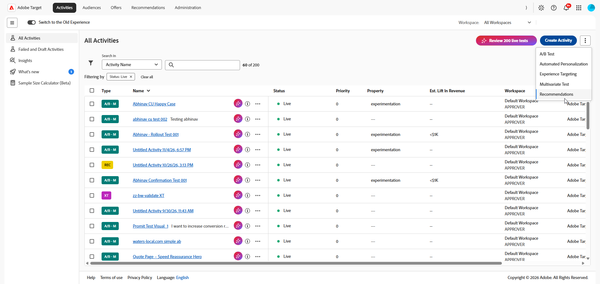

# [!DNL Recommendations] アクティビティの作成 {#create-recs-activity}

>[!BEGINSHADEBOX]

**このページで：**&#x200B;場所の選択からアクティビティの設定まで、[!DNL Target] **[!UICONTROL Visual Experience Composer]** （VEC）で[!DNL Recommendations] アクティビティを作成する方法を説明します。

>[!ENDSHADEBOX]

[!DNL Recommendations] アクティビティは、ページ上に推奨アイテムを表示します。 [!DNL Target] **[!UICONTROL Visual Experience Composer]** （VEC）でアクティビティを作成すると、レコメンデーションを[!DNL Target]対応ページに直接配置し、訪問者が表示すべき場所に配置できます。

## アクティビティを作成し、場所を選択します {#create-activity}

アクティビティ URLと場所は、レコメンデーションが表示されるページとそのページの領域を定義します。

1. **[!UICONTROL アクティビティ]** メニューから、**[!UICONTROL アクティビティの作成]** > **[!UICONTROL 推奨事項]**&#x200B;をクリックします。

   

1. 必要に応じて、**[!UICONTROL Visual]**&#x200B;を選択します。

   代わりに&#x200B;**[!UICONTROL Form-Based Experience Composer]**&#x200B;を使用するには、**[!UICONTROL Form]**&#x200B;を選択します。 詳しくは、[フォームベースの Experience Composer](/help/main/c-experiences/form-experience-composer.md) を参照してください。 **[!UICONTROL シングルページアプリケーション]** VECを含むコンポーザーの比較については、[&#x200B; エクスペリエンスとオファー](/help/main/c-experiences/experiences.md)を参照してください。 VECの問題については、[Visual Experience Composerのトラブルシューティング &#x200B;](/help/main/c-experiences/c-visual-experience-composer/r-troubleshoot-composer/troubleshoot-composer.md)を参照してください。

1. （条件付き） [&#x200B; ワークスペース &#x200B;](/help/main/administrating-target/c-user-management/property-channel/property-channel.md)を選択します。

1. アクティビティ URLを指定し、**[!UICONTROL 作成]**&#x200B;をクリックします。

   アクティビティ URLは、レコメンデーションが表示されるページです。 [!DNL Target]はURL プロトコル （[!DNL https]と[!DNL http]）を区別しないため、`http://www.adobe.com`と`https://www.adobe.com`は両方とも一致します。

   VECが開き、ページが表示されます。

1. レコメンデーションが表示される要素をクリックし、**[!UICONTROL コンテンツを置換]** > **[!UICONTROL レコメンデーション]**&#x200B;を選択します。

   <!--
   * **[!UICONTROL Replace w/ Recommendations]**: Deletes the current content of the element and replaces it with the recommendations.
   * **[!UICONTROL Insert Recommendations Before]**: Places the recommendations before the element, above or to the left of it, depending on the page construction.
   * **[!UICONTROL Insert Recommendations After]**: Places the recommendations after the element, below or to the right of it, depending on the page construction.

   

   Use **[!UICONTROL Expand Selection]** to expand the selection to the parent container, so that it includes the desired page elements.
   -->

   レコメンデーションの対象となる訪問者には、指定した領域の推奨項目が表示されます。 条件を満たさない訪問者には、デフォルトのコンテンツが表示されます。

   >[!NOTE]
   >
   >**[!UICONTROL Recommendations]**&#x200B;のアクティビティでは、一度に1つの変更またはレコメンデーションのみがサポートされます。 複数のレコメンデーションを表示するには、複数の[!DNL Recommendations] アクティビティを作成するか、A/B テストまたはXT テストを使用します。

   

<!--
1. Select a page type: Cart Page, Category Page, Home Page, Landing Page, Product Page, Search Results Page, Thank You Page, or Other.

   

   The page type determines which criteria are suggested in the next section.
-->

1. **[!UICONTROL プロパティを表示]** メニューにアクセスし、**[!UICONTROL 推奨事項を選択]**&#x200B;をクリックします。

   レコメンデーションを選択ボタンを含むVisual Experience Composerの

## 条件の選択 {#select-criteria}

基準は、推奨される項目と、各訪問者に対してどのように選択されるかを決定します。

1. 1つ以上の[条件](/help/main/c-recommendations/c-algorithms/algorithms.md)のチェックボックスを選択します。

   

   複数の条件を選択すると、トラフィックは均等に分割され、各条件の割合を変更することはできません。 例えば、2つの条件が選択されていて、アクティビティが参加者の20%にデフォルトのコンテンツを表示する場合、参加者の40%に各条件の推奨事項が表示されます。

   >[!NOTE]
   >
   >すべての基準があらゆるページで正しく実行されるわけではありません。 現在のアイテムまたは現在のカテゴリの推奨事項に互換性を持たせるには、ページまたはmboxが`entity.id`または`entity.categoryId`で渡される必要があります。 互換性のある基準のみを表示することをお勧めします。 アクティビティで互換性のない条件を使用できるようにするには、**[!UICONTROL 互換性]** チェックボックスをオフにします。 このチェックボックスは、**[!UICONTROL 管理]** > **[!UICONTROL 推奨事項]** > **[!UICONTROL 互換性のない条件をフィルター]**&#x200B;の設定によっては表示されない場合があります。 詳しくは、[設定](https://experienceleague.adobe.com/docs/target-dev/developer/recommendations.html?lang=ja){target=_blank}を参照してください。

1. オプションで、条件を検索または作成します。

   * リストが長い場合に既存の条件を検索するには、目的の条件が表示されるまで検索フィールドに入力します。 一部の条件は[!DNL Recommendations]で指定されており、チームはカスタム条件を作成することもできます。
   * 新しい条件を作成するには、**[!UICONTROL 条件を作成]**&#x200B;をクリックし、新しい条件の情報を入力します。 [条件の作成](/help/main/c-recommendations/c-algorithms/create-new-algorithm.md)を参照してください。
   * 基準をシーケンスにグループ化するには、基準シーケンスを作成します。 [条件シーケンスの作成](/help/main/c-recommendations/c-algorithms/create-criteria-sequence.md)を参照してください。

1. 「**[!UICONTROL 次へ]**」をクリックします。

## デザインとプロモーションの選択 {#select-design}

デザインは、選択した場所のレコメンデーションの外観を決定するテンプレートです。コレクションは、表示する資格のあるアイテムを決定します。 オプションで、レコメンデーションにプロモーションを追加できます。

1. [デザイン](/help/main/c-recommendations/c-design-overview/design-overview.md)を選択します。

   

   * 既存のデザインを使用するには、1つ以上のデザインのチェックボックスをオンにし、**[!UICONTROL 次へ]**&#x200B;をクリックします。 複数の基準を選択した場合、1つのデザインのみを選択できます。
   * カスタムデザインを作成するには、**[!UICONTROL デザインを作成]**&#x200B;をクリックし、新しいデザインの名前とコードを入力します。 **[!UICONTROL 次へ]**&#x200B;をクリックし、画像を選択またはアップロードしてから、**[!UICONTROL 完了]** > **[!UICONTROL 完了]**&#x200B;をクリックします。

   [!DNL Target]には、いくつかの事前設定済みデザインが含まれています。 カスタムデザインについて詳しくは、[&#x200B; デザインの作成](/help/main/c-recommendations/c-design-overview/create-design.md#create-design)および[Velocity](/help/main/c-recommendations/c-design-overview/customizing-a-template.md#customize-design)を使用したデザインのカスタマイズを参照してください。

1. 「**[!UICONTROL 次へ]**」をクリックします。

1. **[!UICONTROL オプション]** ページで、コレクションを選択します。

   コレクションは、レコメンデーションに表示する資格のあるアイテムを決定します。 コレクションの作成方法など、詳細については、[&#x200B; アクティビティでのコレクションの使用](/help/main/c-recommendations/c-products/collections.md#use-collection)を参照してください。

1. （オプション）レコメンデーションに前面および背面のプロモーションを追加します。 [&#x200B; プロモーションの追加](/help/main/c-recommendations/t-create-recs-activity/adding-promotions.md#add-promotions)を参照してください。

1. 「**[!UICONTROL Save]**」をクリックします。

   VEC画面には、レコメンデーションデザインがページに表示されます。

## アクティビティのレビューと完了 {#complete-activity}

保存前にレコメンデーションとアクティビティフローを確認することで、適切なオーディエンス、基準、デザインが整っていることを確認できます。

1. （オプション）「**[!UICONTROL プレビュー]**」をクリックして、アクティビティが訪問者にどのように表示されるかを確認します。 このモードでは、訪問者がレコメンデーションを操作するので、レコメンデーションを操作できます。 「**[!UICONTROL 作成]**」をクリックして、VECに戻ります。

1. VECで推奨事項を確認し、**[!UICONTROL 次へ]**&#x200B;をクリックします。

1. フロー図でアクティビティを確認し、必要な変更を加えます。 終了したら「**[!UICONTROL 次へ]**」をクリックします。

   につながります

   フロー図では、アクティビティのオーディエンス、エクスペリエンス、成功指標をカバーしています。 図から、次の変更を行うことができます。

   * **オーディエンス**：すべての訪問者にデフォルトで推奨事項が表示されますが、代わりに既存のオーディエンスを選択できます。 新しいオーディエンスを作成する代わりに、[&#x200B; アクティビティのみのオーディエンス &#x200B;](/help/main/c-target/creating-activity-only-audience.md#concept_A6BADCF530ED4AE1852E677FEBE68483)を作成するか、[複数のオーディエンスを組み合わせて](/help/main/c-target/combining-multiple-audiences.md#section_2F1CE9434CC04174B4BA2BFC89B85D77) アドホックオーディエンスを構築することができます。
   * **条件**：条件を表示するか、コレクションを変更します（**[!UICONTROL 条件]** ラベルの横）。
   * **コントロール グループ**：コントロール エクスペリエンスを表示する参加者の割合を変更します。 [!DNL Recommendations] アクティビティで、コントロールグループはレコメンデーションなしでページを表示します。
   * **デザイン**: デザイン コードを表示するか、デザインを変更または削除します。

1. アクティビティの設定を指定します。例えば、名前（必須）と目的（オプション）を指定します。 アクティビティ名のルールを含む設定については、[Recommendations アクティビティ設定](/help/main/c-recommendations/t-create-recs-activity/recs-activity-settings.md#recs-activity-settings)を参照してください。

1. 「**[!UICONTROL 保存して閉じる]**」をクリックします。

## アクティビティの管理 {#manage-activity}

アクティビティを保存すると、**[!UICONTROL 概要]** ページにアクティビティの概要が表示されます。 このページでは、次のアクションを使用できます。

* アクティビティをアクティブ化、編集、またはQAします。
* Experience Cloud フィードにアクティビティを共有します。
* エクスペリエンスのURLを表示してデータをダウンロードします。
* コントロールのエクスペリエンスを表示するアクティビティ参加者の割合を変更します。
* 基準の詳細を表示または非表示にし、デザインのコードを表示します。

アクティビティからさらに2つのページを使用できます。

* **[!UICONTROL レポート]**: [!DNL Recommendations] アクティビティのパフォーマンスに関するレポートを表示します。
* **[!UICONTROL 衝突]**：発生する可能性のある[活動の衝突](/help/main/c-experiences/c-visual-experience-composer/activity-collisions.md)を表示します。 複数のアクティビティが同じページにコンテンツを配信すると、競合が発生し、予期しないコンテンツが表示される場合があります。

## トレーニングビデオ：Recommendations アクティビティの作成（7:15） 

>[!VIDEO](https://video.tv.adobe.com/v/27688)
